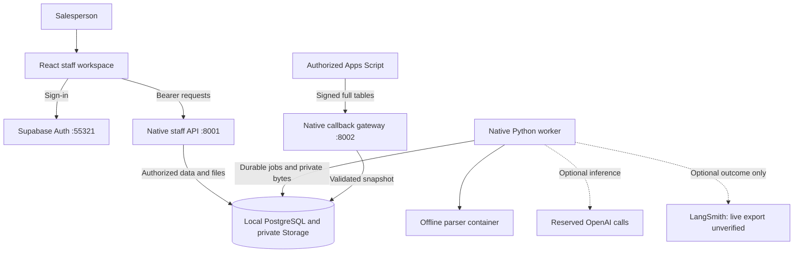

# LumaQuote architecture

This describes the implemented local workspace, including the photo changes
currently in the working tree. Milestone readiness remains governed by the
[implementation tracker](IMPLEMENTATION_PLAN.md) and actual evidence.

This is the process/module overview. Detailed call contracts live in the
[backend](reference/BACKEND.md), [data model](reference/DATA_MODEL.md),
[agent runtime](reference/AGENT_RUNTIME.md), [media](reference/MEDIA.md),
[catalog](reference/CATALOG.md), [frontend](reference/FRONTEND.md) and
[Google synchronization](reference/GOOGLE_SYNC.md) references. Configuration and
verification have [their own guide](reference/CONFIGURATION.md) and
[test map](reference/TOOLING_AND_TESTS.md).

## Processes and trust boundaries

<!-- diagram:system-boundaries:start -->

[Open full-size SVG](diagrams/rendered/system-boundaries.svg) · [Editable Mermaid](diagrams/system-boundaries.mmd)

Mermaid source

<!-- diagram:system-boundaries:end -->

The browser supplies a Supabase bearer token. The API validates it with Auth and
resolves current membership; client-supplied company IDs or metadata do not grant
access. `luma_api` attaches the verified identity to its transaction for RLS.
`luma_worker` is a separate trusted runtime identity. Administrative credentials
are reserved for local provisioning and authorized integration setup.

Business tables are not exposed through Supabase REST. Originals and normalized
media live in `luma-private`; the browser receives authorized bytes through the
API, never Storage credentials or public object capabilities. Docker runs
Supabase and isolated media decoding. UI, API, worker and tests run natively.

The Google gateway is a separate application, not a route on the staff API. Its
current GAS contracts and live-verification limits belong to [gas/README.md](../gas/README.md)
and [Google evidence](evidence/google-gas-progress.json). WhatsApp delivery is
still unfinished; `local_delivered` means a local test-channel effect only.

## Code ownership

- [Backend core](../app/backend/luma/core) owns settings, transactional identities,
  Auth, admission, scoped idempotency, errors, audit and private file access. It
  does not import features.
- [Conversations](../app/backend/luma/features/conversations) separates transport,
  intake/message persistence, and staff/customer participation. Takeover and
  request edits invalidate or block affected queued work under the conversation lock.
- [Quotations](../app/backend/luma/features/quotations) owns pure Decimal rules,
  immutable revisions, freshness checks, exact review decisions, dispatch
  eligibility and canonical PDF rendering. `main.py` only composes the API.
- [Catalog](../app/backend/luma/features/catalog) owns bounded exact-first lexical
  lookup, version-bound semantic candidates and typed citations. Paid embedding
  quality remains unverified; descriptive vectors never supply prices or stock.
- [Media](../app/backend/luma/features/media) owns bounded transport, private
  original admission, processing records, publication and sandbox operations.
- [Agent graph](../app/agents/luma_agent/graph.py), `state.py`, `nodes/`, and
  `runtime/` own orchestration, leases, PostgreSQL checkpoints and outbox delivery.
  [Media adapters](../app/agents/luma_agent/adapters/media_reading.py) contain the
  fixed provider contracts, separate from deterministic business authorization.
- [Frontend app](../app/frontend/src/app) composes screens/providers. Feature UI
  and mutations live under `src/features`; `src/shared` owns independent UI,
  session/API infrastructure and generated contracts. TanStack Query owns remote
  state; dirty quotation edits remain local until server confirmation.

## Durable business state

Conversations carry ownership, optimistic version and last customer activity.
Messages preserve actor, kind, provider identity and private media reference.
`media` binds its message to the same company and conversation with foreign keys;
its existing `transcript` column holds a ready voice transcript or photo reading.
Original and normalized paths stay private. Model readings are not confirmations.

Quotes contain immutable canonical content, hash, recipient, snapshot and expiry.
Runtime roles may update quote status, not its reviewed content. Approval records
bind the approver to that exact quote/hash/recipient. PDF bytes are created once
from the canonical revision and stored privately, including the reviewed customer
identity rather than mutable conversation labels.

Jobs and outbox intents are distinct. Jobs coordinate preparation/media work;
outbox records coordinate an authorized customer-facing effect. Claiming a job
does not authorize sending. Dispatch rechecks ownership, active membership,
approval, recipient, expiry, source and commercial eligibility.

## Agent participation and recovery limits

The graph follows extraction, clarification or preparation, then staff review.
Its PostgreSQL thread key is derived from company and conversation identities.
Customer and staff pauses use durable interrupts. Only trusted worker jobs resume
them; a browser resume value cannot approve a quote. Duplicate queued work is not
a new customer answer, and pending media does not trigger placeholder-based replies.

Paused restart/resume is tested with fresh worker processes. Active-operation
crash recovery is bounded: current leases expire after 120 seconds and a later
claim reconciles up to 100 expired jobs. Jobs are fenced/failed, outstanding usage
becomes unknown, and pending media exposes an interrupted status. No provider work
is automatically replayed. Transactional lease checks hold a shared row lock so
recovery skips an in-progress authorized transaction. There is no heartbeat or
general retry UI yet. Uncertain outcomes require staff reconciliation.

See [workflows](WORKFLOWS.md), [API contracts](api/README.md),
[local operation/recovery](../LOCAL_DEVELOPMENT.md), and
[verification requirements](TESTING_PLAN.md).

## Semantic retrieval work in progress

An applied working-tree migration defines tenant-scoped vectors bound to current
source ID/version/page and descriptive content. Prices/stock are excluded from
embedding text. The allowance layer now distinguishes primary and retrieval
operations under the same run maximum. Actual database tests verify tenant scope,
constraints, stale evidence and shared run allowances. A real synthetic embedding
index/query roundtrip passed; live graph fallback and semantic quality remain unverified.

The working-tree catalog repository now shares conservative constraints between
lexical and semantic queries. Semantic rows must match current tenant, product,
source version, page, model and descriptive content. A cosine-distance ceiling
limits suggestions but is not a confidence score. Vector validation/index
publication code is present; migration and actual SQL checks passed after local
infrastructure recovery. Deterministic test vectors do not establish retrieval quality.

The working-tree graph now includes `nodes/retrieval.py` between extraction and
routing. It returns lexical candidates first and can attempt a reserved semantic
fallback only for a descriptive miss with existing current vectors and paid AI
enabled. It overwrites bounded candidate state on each turn; it does not accumulate
old suggestions. Clarification rechecks candidate records before creating an
outbox intent. Fresh-process graph restart tests passed with paid AI disabled;
the paid semantic provider branch still needs separate verification.
