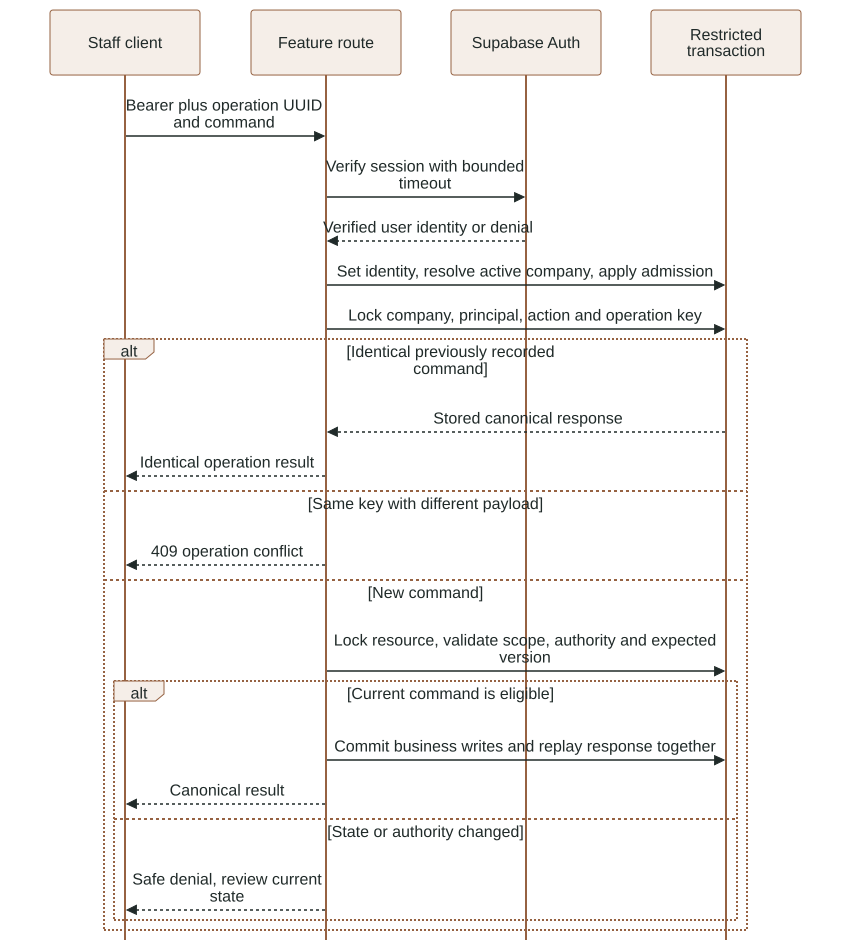
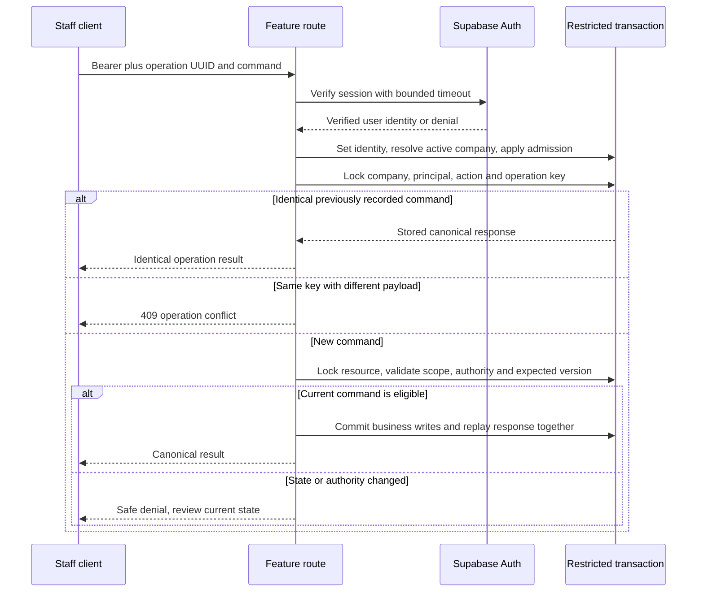

# Staff API reference

The generated [OpenAPI schema](openapi.json) is the machine-readable contract.
This guide explains business preconditions and failure handling. The native API
is composed in [main.py](../../app/backend/luma/main.py); it listens on loopback
port 8001 through `npm run dev:api`.

### Staff identity, idempotency and optimistic mutation protocol

New mutation versus identical replay; no bearer values shown. See the surrounding contract for details and limitations.

<!-- diagram:staff-operation:start -->


[Open full-size SVG](../diagrams/rendered/staff-operation.svg) · [Editable Mermaid](../diagrams/staff-operation.mmd)

<details>
<summary>Mermaid source</summary>



</details>
<!-- diagram:staff-operation:end -->

## Identity and mutation protocol

Staff routes require `Authorization: Bearer <session-token>`. The server verifies
the token and current membership; payloads cannot select a company or role.
Mutating conversation commands also require an opaque UUID `Idempotency-Key`.
The same principal/action/key and canonical payload replay the recorded response.
Changing the payload under the same key returns 409. Retries still require access.

- `POST /api/conversations` accepts customer name/company and bounded request text.
- `GET /api/conversations/{cid}` returns canonical state, messages, latest quote
  and delivery records. `GET /api/workspace` supplies scoped collections.
- `POST .../{cid}/messages` records an internal note; `customer-reply` simulates
  a local-test customer response. Neither is a live WhatsApp send.
- `POST .../{cid}/ownership` requires `expected_version` and `owner` (`agent` or
  `staff`). `POST .../{cid}/reply` requires staff ownership, bounded text and the
  expected version; it queues a human reply rather than approving a quotation.
- `POST .../{cid}/draft` requires the conversation version and product IDs/integer
  quantities. Discount, shipping and terms are bounded optional inputs. The
  server calculates authoritative commercial content.
- `POST .../{cid}/decision` accepts `expected_revision` and `approve`/`reject`.
  Approval binds to the current immutable offer and intended recipient.
- `GET /api/quotes/{qid}/pdf` and `GET /api/sources/{sid}/pdf` authorize private
  bytes. Historical originals remain distinct from current recommendation eligibility.
- `POST /api/catalog/search` accepts a query up to 500 characters and optional
  explicit watt/CCT/IP filters. This read uses bearer Auth and rate admission;
  it does not require an idempotency key or make a paid provider call.

`GET /api/events` exists, but current frontend queries poll; an endpoint alone
does not establish a wired SSE client. Health reports process status only.

## Command payloads and a review sequence

The following JSON is illustrative synthetic input. Obtain real conversation,
product and revision identities from authorized responses; do not send placeholders
literally. Every mutating step uses a fresh operation UUID for a new intent, and
reuses that same UUID plus unchanged input when retrying the same intent.

Create a local request with `POST /api/conversations`:

```json
{
  "customer_name": "Synthetic customer",
  "customer_company": "Example fit-out",
  "text": "Please quote 3 DL-001."
}
```

The server assigns company, recipient, channel and authority. Customer name is
bounded to 120 characters, company to 160 and request text to 8,000. Undeclared
fields are rejected by the owned strict input models; that policy does not mean
every integer field has identical coercion semantics. Refer to OpenAPI and the
actual schema for each property's strictness and limits.

Read the conversation's current version and a product ID from the scoped
workspace, then submit `POST /api/conversations/{cid}/draft`:

```json
{
  "expected_version": 2,
  "lines": [{"product_id": "<product-id-from-workspace>", "quantity": 3}],
  "discount_percent": "0",
  "shipping": "0",
  "terms": "Delivery date subject to staff confirmation."
}
```

The version above is an example, not a fixed value. There are 1..40 selected lines;
quantity is a strict integer 1..10,000 and products must be distinct. Shipping is
at most USD 10,000 with two decimal places; discount is at most 10% with two
decimal places and requires admin authority when nonzero. Terms are at most
1,200 characters. Prices/totals, source references and customer labels are captured
by the backend. See [the transaction details](../reference/BACKEND.md).

After reviewing the returned canonical offer, submit a decision using its quote
revision, not the conversation version:

```json
{"expected_revision": 1, "decision": "approve"}
```

Approval returns queued intent, not delivery. Poll authorized detail for the actual
outbox state. The current worker can produce `local_delivered` only on the local
channel; it blocks live dispatch. A customer edit, takeover or stale commercial
record can block an intent between approval and dispatch.

An internal note/customer-test reply accepts bounded text. A human `/reply` also
requires a strict positive `expected_version`, at most 2,000 characters and staff
ownership. It cannot approve a quotation or operate as an alternative send bypass.
An `/ownership` command accepts a positive expected version plus agent/staff.

Catalog lookup accepts strict optional watts 1..2,000, CCT 1,000..12,000 and a
supported IP token. Conflicting/negated natural-language constraints return no
safe candidates rather than an invented substitute. Its endpoint is lexical;
paid fallback is internal to the admitted agent path.

## Binary attachment protocol

`POST /api/conversations/{cid}/audio` and `.../image` accept raw binary bodies,
not multipart forms. Required headers are bearer authorization, an idempotency
UUID and `Expected-Version`. Use `Content-Type: application/octet-stream`.
Limits apply to actual streamed bytes (10 MB audio, 5 MB image), with a 30-second
upload deadline. Decode and provider work happen later through durable jobs.

The JSON response contains `message_id` and `status: queued`. This is acceptance,
not a transcript or completed reading. Replay binds to the exact content digest,
target and expected version. Media changes invalidate affected offers immediately.

`GET /api/media/{message_id}/audio` streams only normalized WAV; `/image` streams
only normalized JPEG. Both require current membership and matching media kind.
Message read models expose availability booleans/status, never Storage paths.
Malformed files are rejected by the worker; unavailable previews return 404.

## Errors and limits

- 401/403: invalid session or insufficient authority; refresh/sign in as appropriate.
- 404: resource is absent or unavailable in the authorized scope.
- 409: stale version/revision, conflicting operation identity or invalid business
  transition. Re-read and review; never silently overwrite the latest state.
- 413/422: byte cap or validated content/schema failure; use supported smaller input.
- 408: attachment stream timed out; retry the same selected bytes/identity.
- 429: shared admission/estimated allowance exhausted; rate errors include retry guidance.
- 503: required enforcement/capacity is unavailable; manual recovery must not bypass it.

Current staff defaults are 120 reads/minute, 30 mutations/minute, 10
approval/send-class actions/minute, and six customer turns/minute/conversation.
Attachment classes have their own six/minute staff counters. Counter resets and
quota recovery are not client-controlled.

## Regenerating contracts

After route/schema changes, generate OpenAPI from `luma.main.app.openapi()` using
the repository Python wrapper, write UTF-8 JSON to this directory, then run:

```powershell
npx openapi-typescript docs/api/openapi.json -o app/frontend/src/shared/api/generated.ts
npm run typecheck
```

Do not hand-edit generated declarations. The separate Google callback gateway has
different HMAC contracts documented in [the GAS guide](../../gas/README.md).
