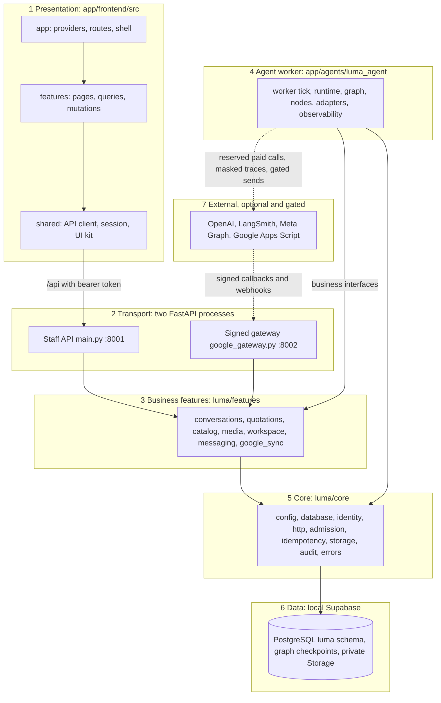
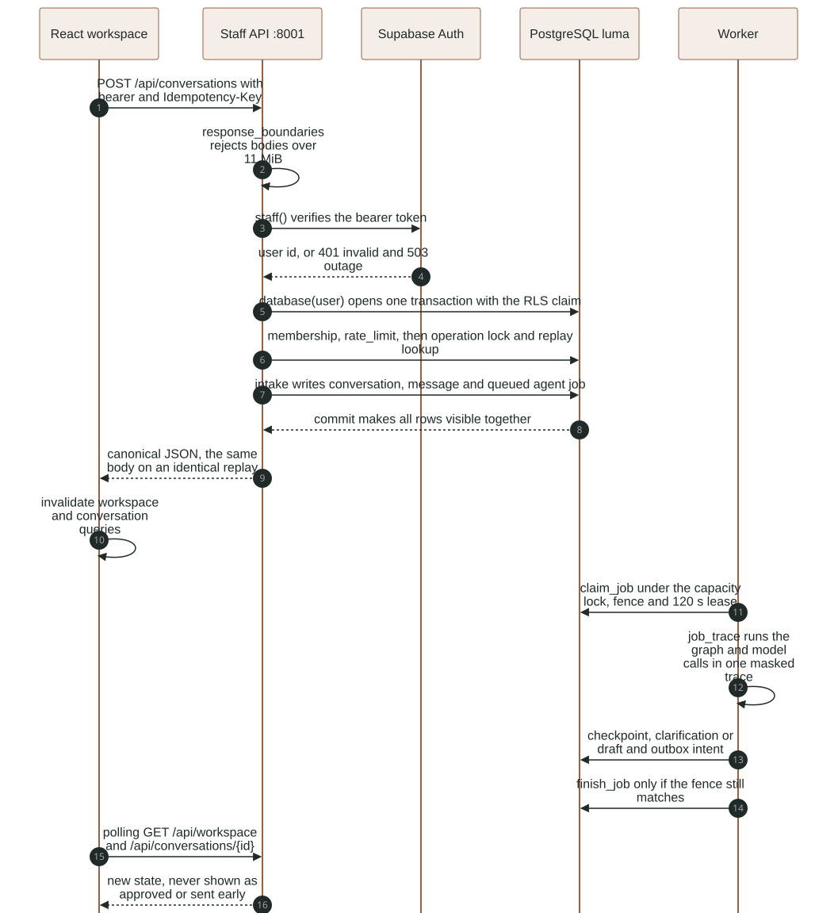
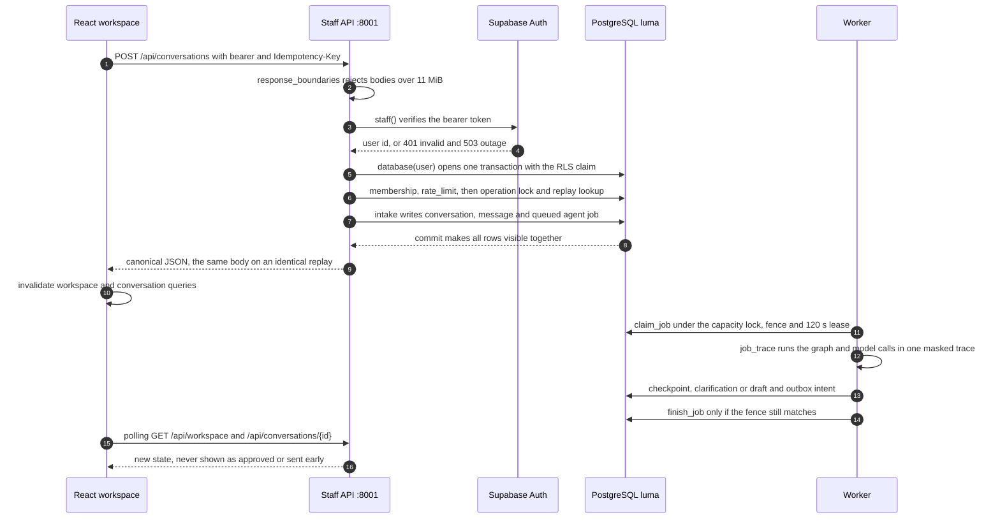

# LumaQuote by layer

This folder explains the application one layer at a time. Each guide says what the
layer owns, which code it lives in, what it may and may not call, which recent
changes touched it, how it is tested and what is still open. Each guide has at
least one source-backed diagram.

These guides are a map, not a second copy of the contracts. Detailed behavior
stays in one place, the focused [reference guides](../README.md#detailed-implementation-references),
and the layer guides link to the exact section. When the two disagree, the
reference and the code win; fix the layer guide in the same change.

Snapshot: 2026-11-03, working tree on top of commit `853147d`. It includes
uncommitted work from the same day (outage handling, admission-limit tests,
token/cost tracing, page and scene reviews, the evaluation relabel).

## The layers

| # | Layer | Code | Guide | Main references |
|---|---|---|---|---|
| 1 | Presentation | `app/frontend/src` | [frontend](frontend.md) | [FRONTEND](../reference/FRONTEND.md) |
| 2 | Transport | `luma/main.py`, `luma/google_gateway.py`, `core/http.py` | [transport](transport.md) | [BACKEND](../reference/BACKEND.md), [API](../api/README.md) |
| 3 | Business features | `luma/features/*` | [business features](business-features.md) | [BACKEND](../reference/BACKEND.md), [CATALOG](../reference/CATALOG.md), [MEDIA](../reference/MEDIA.md) |
| 4 | Agent worker | `app/agents/luma_agent` | [agent worker](agent-worker.md) | [AGENT_RUNTIME](../reference/AGENT_RUNTIME.md) |
| 5 | Core infrastructure | `luma/core/*` | [core](core.md) | [BACKEND](../reference/BACKEND.md), [CONFIGURATION](../reference/CONFIGURATION.md) |
| 6 | Data | `supabase/migrations`, local Supabase | [data](data.md) | [DATA_MODEL](../reference/DATA_MODEL.md) |
| 7 | External integrations | adapters, `gas/`, messaging | [integrations](integrations.md) | [WHATSAPP](../reference/WHATSAPP.md), [GOOGLE_SYNC](../reference/GOOGLE_SYNC.md), [PROVIDER_CONTRACTS](../PROVIDER_CONTRACTS.md) |
| - | Verification (cross-cutting) | `tests/`, `scripts/` | [verification](verification.md) | [TOOLING_AND_TESTS](../reference/TOOLING_AND_TESTS.md), [AGENT_RULES](../reference/AGENT_RULES.md) |

## Layer map

The arrows show the allowed call direction (rule R5 in [AGENTS.md](../../AGENTS.md)).
`core` never imports a feature; routes validate transport and delegate; `main.py`
only composes; worker nodes call feature business interfaces instead of writing
their own business rules. `scripts/check_architecture.py` and
`scripts/check_frontend.cjs` enforce the import direction.

<!-- diagram:layer-map:start -->

[Open full-size SVG](../diagrams/rendered/layer-map.svg) · [Editable Mermaid](../diagrams/layer-map.mmd)

Mermaid source

<!-- diagram:layer-map:end -->

Read it from the top. Only the React app talks to the staff API, and only through
the Vite proxy with a Supabase bearer token. Nothing external reaches the staff
API: providers call back through the separate signed gateway. The worker is a
separate process with its own database role; it is the only layer that spends
money (OpenAI) or exports traces (LangSmith).

## One request through every layer

This sequence follows a new local-test customer request, the most complete path
in the app. It shows where each layer starts and stops: the API transaction ends
at the commit, and the agent's work happens later in the worker. The browser
learns about the result only by polling; it never assumes success.

<!-- diagram:request-trace:start -->

[Open full-size SVG](../diagrams/rendered/request-trace.svg) · [Editable Mermaid](../diagrams/request-trace.mmd)

Mermaid source

<!-- diagram:request-trace:end -->

Three things in this trace are easy to get wrong:

1. **The job is queued inside the request transaction.** If the commit fails, no
   job exists, so the API never acknowledges work that was not stored
   (`core/admission.enqueue`).
2. **Claiming a job is not permission to send.** The worker writes an outbox
   intent; a separate dispatch step rechecks ownership, approval, recipient,
   expiry and source before any customer-facing effect
   ([BACKEND: approval, freshness and dispatch](../reference/BACKEND.md#approval-freshness-and-dispatch)).
3. **Queued, ready and `local_delivered` are not delivered.** `local_delivered`
   is a local test-channel effect, not a WhatsApp receipt.

## Other views

The [diagram index](../diagrams/README.md) lists every view. The ones most
useful next to these guides are the [process boundaries](../diagrams/rendered/system-boundaries.svg),
the [durable agent graph](../diagrams/rendered/agent-graph.svg), the
[approval sequence](../diagrams/rendered/quotation-approval.svg) and the three
ER views in [DATA_MODEL](../reference/DATA_MODEL.md).

## Keeping these guides current

- A change that adds, moves or removes a module updates the owning layer guide's
  "Where it lives" table, then runs `npm run graph:update` (decision D33).
- A change to a diagram here edits its `.mmd` source in `docs/diagrams/`, then
  `npm run test:diagrams`, `npm run diagrams:render` and `npm run diagrams:check`.
  The catalog binds each view to the code it describes, so a code edit marks the
  view stale until it is reviewed and re-rendered.
- Facts that belong to a reference guide go there first; the layer guide links.
