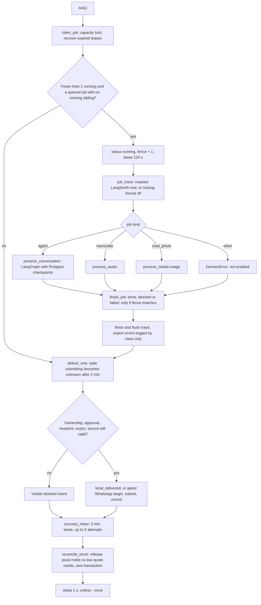

# Layer 4: Agent worker

The worker is a separate native Python process (`npm run dev:worker`). It claims
durable jobs from PostgreSQL, runs the LangGraph quotation agent, processes voice
and photo media, resolves outbox intents and processes inbound WhatsApp events.
It is the only process that calls paid providers or exports traces. It has its
own database role (`luma_worker`) and never receives a browser request.

Detailed contracts: [AGENT_RUNTIME reference](../reference/AGENT_RUNTIME.md),
[MEDIA](../reference/MEDIA.md) for media jobs, [CATALOG](../reference/CATALOG.md)
for retrieval.

## Where it lives

| Path | Owns |
|---|---|
| [`worker.py`](../../app/agents/luma_agent/worker.py) | `tick()` and the polling loop (`--once` for tests) |
| [`runtime/jobs.py`](../../app/agents/luma_agent/runtime/jobs.py), [`recovery.py`](../../app/agents/luma_agent/runtime/recovery.py) | Claiming with capacity and fences; expired-lease recovery |
| [`runtime/conversations.py`](../../app/agents/luma_agent/runtime/conversations.py) | Running the graph for one conversation with Postgres checkpoints |
| `runtime/audio.py`, `runtime/media.py` | Transcription and photo reading jobs |
| [`runtime/delivery.py`](../../app/agents/luma_agent/runtime/delivery.py) | `deliver_one`: reauthorize and apply one outbox intent |
| `runtime/catalog_index.py` | Operator-run embedding index (`scripts/index_catalog.py`) |
| [`graph.py`](../../app/agents/luma_agent/graph.py), `state.py`, `nodes/` | Graph: `extract`, `retrieve`, then `ask` and `clarify` or `prepare` and `review` |
| `requirements.py`, `written_requests.py`, `schemas.py` | Deterministic confirmation rules and structured output models |
| `budget.py`, `lease.py` | Estimated allowance reservation; lease and version checks before writes |
| `adapters/` | Fixed OpenAI contracts: media reading, embeddings |
| [`observability.py`](../../app/agents/luma_agent/observability.py) | Masked LangSmith job traces, model-call runs, tokens and estimated cost |

## One tick

<!-- diagram:worker-tick:start -->

[Open full-size SVG](../diagrams/rendered/worker-tick.svg) · [Editable Mermaid](../diagrams/worker-tick.mmd)

Mermaid source

<!-- diagram:worker-tick:end -->

- **Capacity.** At most two jobs run at once across all companies, and at most
  one per conversation. Claiming takes a global advisory lock, recovers up to 100
  expired leases first, then sets `running`, increments the `fence` and leases
  the job for 120 s.
- **Fencing.** `finish_job` updates the job only if its `fence` still matches and
  it is still `running`. A worker whose lease expired cannot overwrite the
  outcome recorded by recovery.
- **Outcomes.** `done` on success; `blocked` for a `DomainError` (a safe business
  refusal); `failed` for anything else. Only the error class name is stored and
  logged, never its text.
- **Delivery.** `deliver_one` first turns `submitting` intents older than two
  minutes into `unknown` (the send may or may not have happened), then locks the
  conversation before the outbox row and reauthorizes. `local_test` intents become
  `local_delivered`; `whatsapp` intents go through the gated three-phase send in
  [messaging](../reference/WHATSAPP.md); anything else is visibly blocked.
- **Inbound.** `process_inbox` leases one `luma.inbox` row for two minutes and
  retries transient failures up to five attempts.

The graph itself, its interrupts and its durable thread are drawn in the existing
[agent graph](../diagrams/rendered/agent-graph.svg),
[job recovery](../diagrams/rendered/job-recovery.svg) and
[estimated allowance](../diagrams/rendered/estimated-allowance.svg) views.

## Spending and tracing

- **Paid calls need three things:** `ENABLE_PAID_AI=true`, an API key, and a
  successful budget reservation (USD 0.25 per run maximum, retrieval at most 0.01
  inside it; USD 5 per UTC day; USD 25 total). These are estimates, not billing.
- **Tracing.** When `LANGSMITH_TRACING` and a key are set, each job runs inside
  one masked root trace `luma.job.<kind>`; graph steps and model calls nest under
  it. Outside a worker job, tracing is forced off. Masking covers inputs,
  outputs, metadata and, since 2026-11-03, the `error` field. See
  [trace privacy](../reference/AGENT_RUNTIME.md#trace-privacy-and-debugging).

## Changes on 2026-11-03

- `observability.py`: `masked_client` now passes `anonymizer=mask`. Before this, a
  nested exception's text and traceback reached LangSmith unmasked (langsmith
  0.14.14 sends a run's `error` only through `anonymizer`). Found by the new
  nested probes; [evidence](../evidence/trace-redaction-nested-2026-11-03.json).
- `observability.py`: new `set_usage` puts tokens and an estimated cost into
  `usage_metadata`, which fills LangSmith's Tokens and Cost columns.
  `nodes/extraction.py`, `adapters/media_reading.py` and `adapters/embeddings.py`
  call it with the same rates used for settlement.
- Evaluation runs now go through `job_trace` too (decision D42), so paid
  development runs are visible in LangSmith.

## Tests and evidence

- `tests/unit/test_trace_masking.py` (24 tests, 6 new): nested tool, model-call
  and exception probes; tokens and cost on model-call runs.
- `test_graph_restart.py`, `test_written_confirmation.py`, `test_job_recovery.py`,
  `test_budget_reservations.py`, `test_agent_retrieval.py`, `test_hostile_content.py`.
- Paid development run `dev-run-3` (40 of 60 scenarios, traced):
  [evidence](../evidence/evaluation-development-agent-run3-2026-11-03.json), label `synthetic`.

## Open gaps

- No heartbeat: a job longer than 120 s can be fenced while still running.
- Tracing rates are duplicated in the call sites and the settlement code; change both together.
- The live trace canary predates the `anonymizer` fix.
- `dev-run-3` misses (e003 and five older ones) are not yet diagnosed.

## Extending safely

- A node that changes business state calls a feature function and checks the
  lease (`lease.assert_job`) in the same transaction.
- A new provider call goes through an adapter, reserves budget first, wraps its
  work in `model_call` and calls `set_usage` before `set_outputs`.
- Never treat a model reading as a confirmation or an approval.
