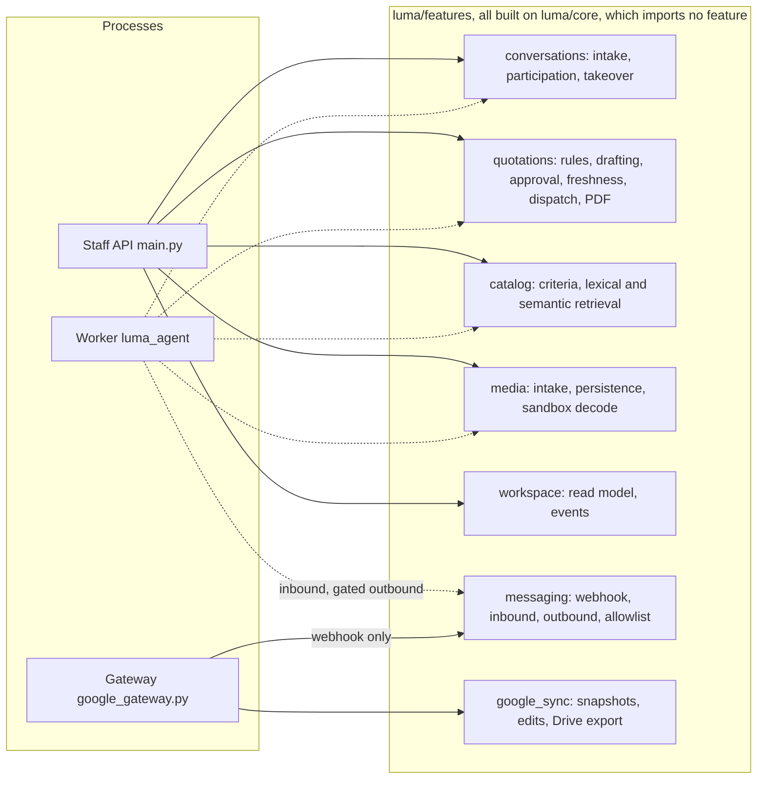

# Layer 3: Business features

Each folder under `app/backend/luma/features/` owns one business area: its
schemas, routes, rules and persistence. Business rules and authorization live
here as deterministic code, never in a prompt (rule R5). Three processes call
into this layer: the staff API, the signed gateway and the worker. All of them use
the same functions, so a rule is enforced the same way no matter who triggers it.

## Who calls what

Solid arrows are HTTP routers composed into the staff API or the gateway; dotted
arrows are direct Python calls from the worker.

<!-- diagram:backend-modules:start -->

[Open full-size SVG](../diagrams/rendered/backend-modules.svg) · [Editable Mermaid](../diagrams/backend-modules.mmd)

Mermaid source

<!-- diagram:backend-modules:end -->

The worker imports feature functions directly (for example
`conversations.service.add_message`, `quotations.drafting.draft`,
`catalog.retrieval.search_catalog`, `messaging.authorization.authorize_outbound`).
It does not re-implement them. It runs them with the `luma_worker` database
role instead of a staff identity, so every worker path rechecks the facts that
make an action valid (ownership, version, approval) inside its own transaction.

## Features

| Feature | Main modules | Responsibility | Reference |
|---|---|---|---|
| [conversations](../../app/backend/luma/features/conversations) | `routes`, `service`, `participation`, `repository`, `schemas` | Local-test intake, customer replies, staff notes and human replies, takeover. Locks the conversation, bumps its version, supersedes affected offers and queues agent work in the same transaction. | [Conversation commands](../reference/BACKEND.md#conversation-commands) |
| [quotations](../../app/backend/luma/features/quotations) | `rules`, `drafting`, `approval`, `freshness`, `dispatch`, `documents`, `repository` | Decimal pricing and stock rules, immutable revisions with a content hash, exact-revision approval, freshness checks, dispatch eligibility, canonical PDF created once and stored privately. | [Drafting](../reference/BACKEND.md#drafting-an-immutable-offer), [approval](../reference/BACKEND.md#approval-freshness-and-dispatch) |
| [catalog](../../app/backend/luma/features/catalog) | `criteria`, `retrieval`, `semantic`, `routes` | Exact-first lexical lookup, version-bound semantic candidates with a distance ceiling, typed citations, source PDFs. Descriptive text never supplies prices or stock. | [CATALOG](../reference/CATALOG.md) |
| [media](../../app/backend/luma/features/media) | `intake`, `persistence`, `processor`, `sandbox`, `routes` | Bounded voice/photo upload, private original storage, offline container decode, publication of normalized bytes, authorized previews. A reading is never a confirmation. | [MEDIA](../reference/MEDIA.md) |
| [workspace](../../app/backend/luma/features/workspace) | `queries`, `routes`, `schemas` | The read model for the UI (`GET /api/workspace`) and bounded refresh notices (`GET /api/events`). Reports integrations as configured or unverified, never as live. | [Private PDFs and read models](../reference/BACKEND.md#private-pdfs-and-read-models) |
| [messaging](../../app/backend/luma/features/messaging) | `webhook`, `inbound`, `outbound`, `authorization`, `allowlist`, `whatsapp_client` | Signed WhatsApp ingress, sender allowlist, inbox leasing, outbound authorization and three-phase gated sending. | [WHATSAPP](../reference/WHATSAPP.md) |
| [google_sync](../../app/backend/luma/features/google_sync) | `callbacks`, `snapshots`, `validation`, `exports`, `routes` | Signed edit receipts, full-snapshot validation and atomic import, pull-based Drive export of approved PDFs. | [GOOGLE_SYNC](../reference/GOOGLE_SYNC.md) |

## Rules every feature follows

- **Lock order.** Anything that changes a conversation, its offers or its outbox
  takes the conversation lock first. The dispatcher follows the same order, so
  edits, approvals, takeovers and sends cannot deadlock each other.
- **Optimistic versions.** Staff edits carry the conversation version they were
  based on. A stale version is a 409, even with a fresh operation key.
- **Immutable offers.** A quotation revision is never edited. A change creates a
  new revision; runtime roles may change a quote's status but not its content.
- **Approval binds exact content.** An approval names one quote id, its content
  hash and its recipient. Dispatch rechecks ownership, active membership,
  approval, recipient, expiry, source and commercial eligibility before any
  effect.
- **Model output is advice.** Extracted requirements, transcripts, photo readings
  and semantic matches can suggest; only staff decisions and deterministic rules
  can approve, price or send.

## Changes on 2026-11-03

No feature module changed today. Feature behavior gained new tests: per-minute
limits on conversation, decision, reply and upload paths
(`test_admission_limits.py`) and clean rollback of a voice upload when Storage is
unreachable (`test_outages.py`).

## Tests and evidence

The [integration coverage map](../reference/TOOLING_AND_TESTS.md#integration-coverage-by-responsibility)
lists the test file for each feature: manual workflow, concurrency, preparation
conflicts, storage invariants, PDF, staff replies, catalog retrieval and semantic
search, voice and photo intake, WhatsApp, Drive export and Google callbacks.

## Open gaps

- A request that passes the rate check and then fails in a feature (409, 404)
  rolls its counter increment back, so failing requests are never limited. Left
  as a strict xfail test pending a user decision (R2). See [core](core.md#admission).
- The quotation PDF route does not call the shared read limiter.
- Live WhatsApp sending and live Google sync are implemented but unverified; see
  [integrations](integrations.md).

## Extending safely

- New business logic goes in the feature, not in the route and not in a worker node.
- A rule that decides money, stock, approval or sending must be plain code with a
  unit test, never prompt text.
- If a new action must invalidate queued work, do it under the conversation lock
  in the same transaction as the change.
