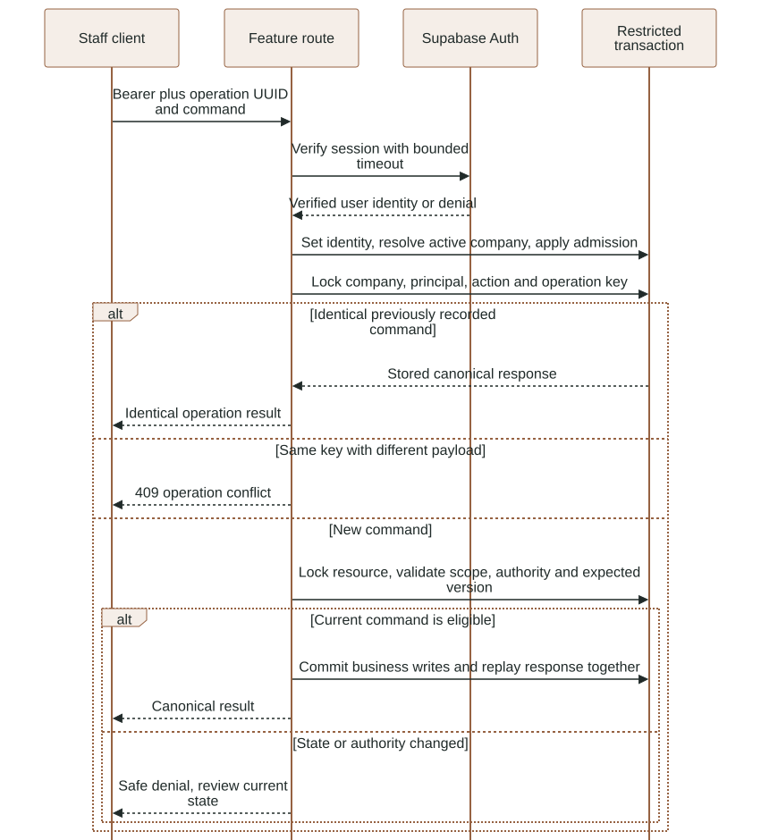
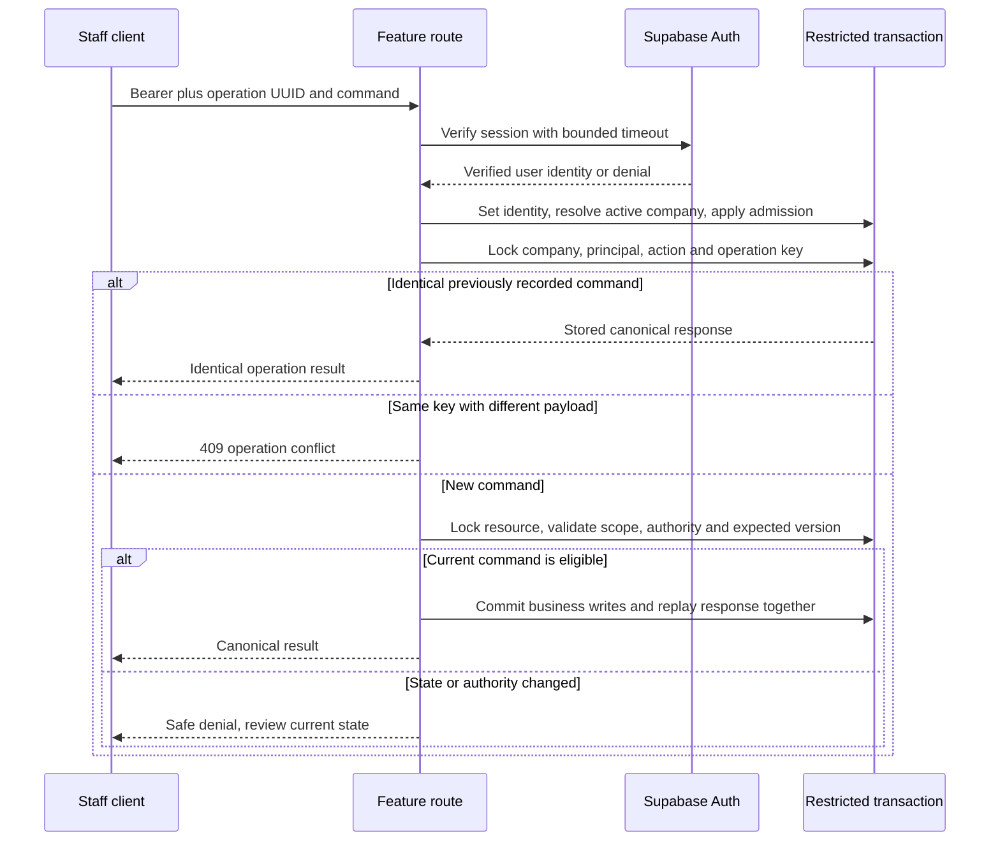

# Layer 5: Core infrastructure

`app/backend/luma/core/` holds the shared machinery every other backend layer
uses: configuration, database transactions, identity, admission, idempotency,
private file access, audit and errors. It never imports a feature
(`scripts/check_architecture.py` fails if it does), so it carries no business
knowledge.

Detailed contracts: [identity and transactions](../reference/BACKEND.md#identity-company-selection-and-transactions),
[admission and repeat submissions](../reference/BACKEND.md#admission-and-repeat-submissions),
[configuration](../reference/CONFIGURATION.md).

## Where it lives

| Module | Public seam | Contract in one line |
|---|---|---|
| [`config.py`](../../app/backend/luma/core/config.py) | `settings()` | Typed `Settings` from ignored env files, cached with `lru_cache`; secrets are `SecretStr`. Paid AI and live WhatsApp default to off. |
| [`database.py`](../../app/backend/luma/core/database.py) | `database(user_id=None, worker=False)` | One dict-row transaction on the `luma_api` or `luma_worker` DSN, 5 s connect timeout, `search_path` set, RLS claim set from an already verified user id. Commits on normal exit, rolls back on exception, never retries. |
| [`identity.py`](../../app/backend/luma/core/identity.py) | `membership(conn, user_id)` | The user's active company and role, or 403. |
| [`http.py`](../../app/backend/luma/core/http.py) | `staff`, `Staff`, `OperationKey`, `response_boundaries`, `domain_error`, `dependency_unavailable` | Transport edge; see [transport](transport.md). |
| [`admission.py`](../../app/backend/luma/core/admission.py) | `rate_limit`, `enqueue` | Fixed one-minute counters per server-chosen key; global 100-job queue cap. |
| [`idempotency.py`](../../app/backend/luma/core/idempotency.py) | `operation(...)` | Apply-or-replay a mutation under a company, user, action and key lock. |
| [`contracts.py`](../../app/backend/luma/core/contracts.py) | `StrictModel`, `digest` | Pydantic base that forbids unknown fields; stable SHA-256 of canonical JSON. |
| [`storage.py`](../../app/backend/luma/core/storage.py) | `put_file`, `get_file`, `delete_files` | Private bucket `luma-private` with the backend-only service key; create-only writes; company-prefix guard on deletes. |
| [`audit.py`](../../app/backend/luma/core/audit.py) | `audit(...)` | Append one scoped audit row in the caller's transaction; no secrets in detail. |
| [`errors.py`](../../app/backend/luma/core/errors.py) | `DomainError(message, status=409)` | A safe, staff-readable rejection with an HTTP status. |

## Authenticated mutation protocol

This existing view shows how `staff`, `database`, `membership`, `rate_limit` and
`operation` combine for a new mutation and for an identical replay.

<!-- diagram:staff-operation:start -->

[Open full-size SVG](../diagrams/rendered/staff-operation.svg) · [Editable Mermaid](../diagrams/staff-operation.mmd)

Mermaid source

<!-- diagram:staff-operation:end -->

## Admission

`rate_limit(conn, key, limit)` upserts a counter row in `luma.rate_windows` for
the current minute bucket. When the count passes the limit it commits the denial
and raises 429, so a rejected request cannot erase its own count. It is a fixed
window, not a sliding one.

| Key (per user unless noted) | Limit per minute |
|---|---|
| reads | 120 |
| catalog search | 30 |
| mutations | 30 |
| staff replies | 10 |
| decisions (approve/reject) | 10 |
| voice uploads, photo uploads | 6 each |
| customer messages or media, per conversation | 6 |

`enqueue` takes a global advisory lock, refuses with 503 when 100 jobs are queued
or running, and inserts the job inside the caller's transaction.

All limits were exercised through the real API on 2026-11-03
(`tests/integration/test_admission_limits.py`: 8 passed, 1 strict xfail). The
xfail records a real gap: the counter shares the request transaction, so a
request that passes the check and then fails (409, 404) rolls its increment back.
Fourteen stale decisions in a minute all returned 409 and none 429. Fixing it
means committing the counter on a separate short connection, which changes
security behavior and waits for the user's decision (R2). The queue cap is
global, so one company can fill it for all.

## Idempotency

`operation` locks `company:user:action:key`, hashes the canonical payload and then:

- returns the stored response when the same key arrives with the same payload;
- raises 409 when the same key arrives with a different payload;
- otherwise runs the callback and stores its JSON response in the same transaction.

Replays still pass authentication, membership and admission first, so a key never
outlives a revoked membership. External I/O inside a callback cannot be rolled
back by this protocol.

## Changes on 2026-11-03

- `http.py`: new `dependency_unavailable` handler (safe 503, `Retry-After: 30`);
  registered in `main.py` for `psycopg.OperationalError` and `httpx.TransportError`.

## Open gaps

- Rate counters on failing requests (above).
- No scheduled clean-up of old `rate_windows` rows.
- A Storage write that succeeds before a failed commit leaves an orphan object;
  retention works from database rows, so nothing removes it.

## Extending safely

- Keep `core` free of feature imports and business terms.
- Pass only an Auth-verified user id to `database(user)`; it sets the RLS claim
  but does not grant membership.
- Call `rate_limit` before any business write in the transaction, because it may
  commit.
- Store only JSON-safe canonical data in an idempotent response, never secrets.
