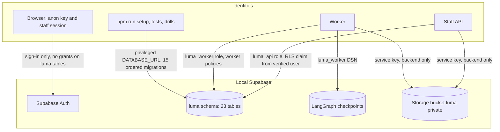

# Layer 6: Data (PostgreSQL and private Storage)

All durable state lives in a local Supabase stack started with `npm run db:start`
(Docker): PostgreSQL with pgvector, Supabase Auth and Storage. Business tables are
in the `luma` schema. The browser has no grant on them; only the staff API and
the worker reach them, each with its own restricted role.

Detailed contracts: [DATA_MODEL reference](../reference/DATA_MODEL.md) (every
table, key, grant, policy and migration), [CONFIGURATION](../reference/CONFIGURATION.md#supabase-and-database-identities)
for connection settings.

## Who may reach what

<!-- diagram:data-access:start -->

[Open full-size SVG](../diagrams/rendered/data-access.svg) · [Editable Mermaid](../diagrams/data-access.mmd)

Mermaid source

<!-- diagram:data-access:end -->

| Identity | Used by | Reach |
|---|---|---|
| Browser (anon key + staff session) | React app | Supabase Auth sign-in only. `anon` and `authenticated` hold no grants on any `luma` table. |
| `luma_api` (`LUMA_API_DATABASE_URL`) | Staff API | Operation-specific grants; row policies check active membership of the user id set by `database(user)`. |
| `luma_worker` (`LUMA_WORKER_DATABASE_URL`) | Worker, graph checkpoints | Broader worker policies across companies. Never given to a browser or an untrusted tool. |
| Service key (`SUPABASE_SERVICE_ROLE_KEY`) | Backend `core/storage.py` | Objects in the private `luma-private` bucket. |
| Privileged `DATABASE_URL` | `npm run setup`, tests, retention and backup drills | Migrations, provisioning, clean-up. Not a runtime identity. |

Grants and row policies work together: a policy does not add a missing grant, and
a grant does not bypass a policy for these roles.

## What is stored

The 23 tables group as follows (relationships are drawn in the
[catalog ER](../diagrams/rendered/evidence-data.svg),
[offer and approval ER](../diagrams/rendered/workflow-data.svg) and
[conversation ER](../diagrams/rendered/conversation-data.svg) views):

| Group | Tables |
|---|---|
| Tenancy and identity | `companies`, `memberships` |
| Catalog and evidence | `sources`, `products`, `snapshots`, `catalog_embeddings` |
| Conversations and media | `conversations`, `messages`, `media` |
| Offers and decisions | `quotes`, `approvals`, `outbox` |
| Work and spending | `jobs`, `usage`, `operations`, `rate_windows`, `audit` |
| Channels | `inbox` (WhatsApp events), `drive_exports` |
| Google sync | `google_sync_state`, `google_snapshot_receipts`, `google_edit_receipts`, `google_refresh_signals` |

LangGraph checkpoints are stored separately by `PostgresSaver` on the worker DSN.
Their thread key is derived from company and conversation ids; it is not a foreign
key. Media originals and normalized bytes, plus quotation PDFs, are objects in
`luma-private`; rows keep the private path, never a public URL.

## Migrations

Fifteen ordered files in [`supabase/migrations/`](../../supabase/migrations),
from `20261029000000_enable_vector.sql` to `20261102020000_media_purge.sql`. Each
file's purpose is listed in [migration sequence](../reference/DATA_MODEL.md#migration-sequence-and-local-application).
`npm run setup` guards the database target, applies them, provisions the restricted
roles and loads the synthetic catalog.

## Changes on 2026-11-03

New `tests/integration/test_migrations.py` (2 tests):

- All 15 files apply cleanly to an empty database, and the resulting schema equals
  the live local schema. A negative check (last file left out) makes the
  comparison fail, so the test can detect drift. It also asserts that `anon` and
  `authenticated` have no grants on any `luma` table.
- A pending job created under the earlier migrations survives the later five files.

## Retention and recovery

- `scripts/retention.py`: runtime media after 7 days, idle business data after 90
  days; dry run unless `--execute`; refuses any target but the local database.
- `scripts/backup_restore_drill.py`: dump, scratch restore, comparison and object
  round trip for one company.
- See [checkpoints, retention and preservation](../reference/DATA_MODEL.md#checkpoints-retention-and-preservation).

## Open gaps

- A Storage write that succeeds before a failed commit leaves an orphan object;
  retention works from rows, so nothing removes it.
- Pending approvals and quotes across a schema upgrade are not tested.
- No scheduled job runs retention or clears old `rate_windows` rows.

## Extending safely

- A schema change is a new migration file; never edit an applied one.
- Give each new table row-level security, an explicit `company_id` and only the
  grants each role needs. Then run `test_migrations.py`.
- Keep prices and stock out of embedding text; vectors describe, they never price.
