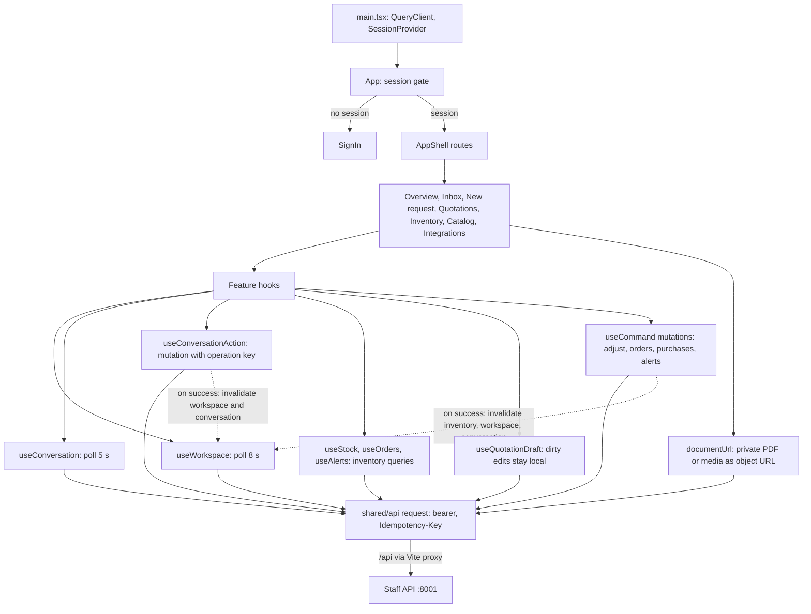

# Layer 1: Presentation (React staff workspace)

The staff workspace is a React 19 + Vite single-page app. It shows conversations,
quotation drafts, the catalog and connection status, and it sends staff commands.
It holds no business authority: every decision is rechecked by the staff API, and
the browser never receives Storage credentials or direct table access.

Detailed contracts: [FRONTEND reference](../reference/FRONTEND.md).

## Where it lives

| Path | Owns |
|---|---|
| [`src/main.tsx`](../../app/frontend/src/main.tsx) | `QueryClient` (5 s stale time, no refetch on focus) and `SessionProvider` |
| [`src/app/`](../../app/frontend/src/app) | `App` (session gate and routes), `AppShell` (navigation, capture mode), shell styles |
| [`src/features/conversations/`](../../app/frontend/src/features/conversations) | Inbox, thread, composer, new request, voice/photo upload, private media preview, conversation queries and mutations |
| [`src/features/quotations/`](../../app/frontend/src/features/quotations) | Quotation panel, product selections, totals, review actions, `useQuotationDraft` (local dirty edits) |
| [`src/features/overview/`](../../app/frontend/src/features/overview) | Overview page and the optional lazy 3D `LightingScene` with its error boundary |
| [`src/features/inventory/`](../../app/frontend/src/features/inventory) | Inventory page (stock, customer orders, purchase orders, alerts), export toolbar, order banner, overview stock card, nav count, their queries and mutations (D49) |
| `src/features/{catalog,integrations,workspace,auth}/` | Catalog search page, connection status page, workspace read model hook, sign-in |
| [`src/shared/`](../../app/frontend/src/shared) | Business-independent API client, generated OpenAPI types, Supabase session, UI kit (shadcn-based) |

`shared` must not import a feature; `scripts/check_frontend.cjs` enforces that and
the adjacent JSDoc contracts (rule R4).

## Routes

| Path | Page |
|---|---|
| `/` | Overview |
| `/inbox/:id?` | Inbox, with the selected conversation and its quotation panel |
| `/requests/new` | New local-test request |
| `/quotations` | Quotation list |
| `/inventory` | Stock, customer orders, purchase orders, alerts (lazy loaded) |
| `/catalog` | Catalog search |
| `/integrations` | Connections status |
| anything else | Overview (no not-found page yet, gap G8) |

## How data moves

<!-- diagram:frontend-layer:start -->

[Open full-size SVG](../diagrams/rendered/frontend-layer.svg) · [Editable Mermaid](../diagrams/frontend-layer.mmd)

Mermaid source

<!-- diagram:frontend-layer:end -->

- **Reads poll.** `useWorkspace` refetches every 8 s and `useConversation` every
  5 s. Query keys include the signed-in user id, so a different user never sees a
  cached copy. The backend also offers `GET /api/events` (server-sent refresh
  notices), but the UI does not use it yet (gap G1); `EventSource` cannot send the
  bearer header the endpoint requires.
- **Writes are idempotent.** Each command carries a stable `Idempotency-Key`
  created for that user action, so a retry replays the stored response instead of
  repeating the effect. After the server confirms, the hook invalidates the
  workspace and conversation queries. Approval or delivery is never shown
  optimistically.
- **Draft edits stay local.** `useQuotationDraft` keeps unsaved selections while
  polling refreshes the server copy, and keeps them when the server answers 409
  (the conversation changed). See [unsaved quotation edits](../reference/FRONTEND.md#unsaved-quotation-edits-survive-polling-and-conflicts).
- **Private documents.** `documentUrl` fetches a PDF, audio or image with the
  bearer token and turns it into a temporary object URL; the caller revokes it
  when the viewer closes.
- **Errors.** `ApiError` carries the server's safe `detail` and status. A 503 from
  an Auth, database or Storage outage shows the server's retry message; the client
  does not retry on its own.

## Changes on 2026-11-03

- Accessibility fixes found by the new reviews: `role="img"` on the 3D canvas
  wrapper (`LightingScene.tsx`), a singular "conversation" label (`InboxPage.tsx`),
  and a 24 px minimum target size for small buttons and links (`shell.css`,
  `overview.css`, `conversations.css`).
- New browser reviews: `tests/browser/scene-review.cjs` (3D scene with real
  software WebGL, keyboard, fallback, capture) and `tests/browser/page-review.cjs`
  (axe, overflow, landmarks, control names and target sizes on 14 views: six
  pages plus a populated conversation, at 1440 px and 430 px).
- The manual browser workflow gained an opt-in showcase recording mode
  (`LUMA_RECORD_DIR`). It records video, signs in on a throwaway page so the email
  and password never appear, turns on capture mode and fails if a credential,
  email or phone pattern becomes visible.

## Tests and evidence

- `npm run test:ui` (Vitest components), `npm run check:frontend`, `npm run typecheck`, `npm run build`.
- `npm run test:browser`: the manual workflow plus the scene and page reviews.
- Evidence: [scene review](../evidence/scene-review-2026-11-03.json) and
  [page accessibility review](../evidence/page-accessibility-review-2026-11-03.json),
  both `local-substitute` (headless Chromium with software WebGL).

## Open gaps

- The [frontend plan](../proposals/2026-11-03-frontend-plan.md) lists G1-G8 (SSE
  not used, stale Google OAuth wording, job state not shown, bare audio player,
  one-click approval, portrait layout, capture mode masks names only, no
  not-found page). It is not started.
- The lazy 3D chunk is 934 kB (248 kB gzip) and triggers Vite's 700 kB warning.
- The 3D orbit control is pointer-only by decision (the scene is decorative).
- Not covered by the axe run: approved, delivered and failed-media page states;
  screen readers and real devices.

## Extending safely

- Put feature UI and its queries under `src/features/<feature>`; keep `src/shared`
  free of business terms.
- Every mutation sends an operation key and reconciles from the server response.
- Never show an approval, send or delivery before the server confirms it.
- Never put a secret behind a `VITE_` variable; only the Supabase URL and anon key are public.
