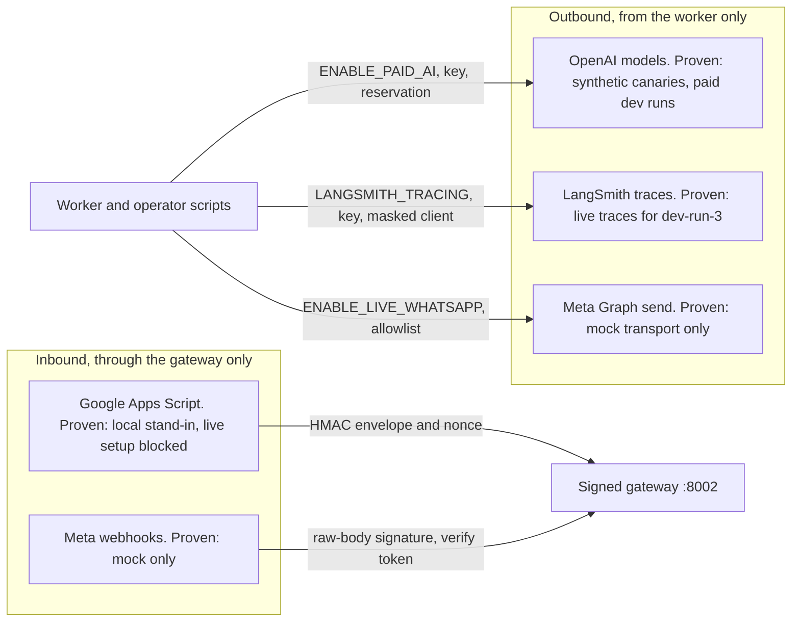

# Layer 7: External integrations

Four outside services connect to LumaQuote. Each one is optional, switched off by
default and gated by explicit configuration. None of them can approve a quotation
or change a price. This guide shows the gates and how far each integration has
actually been proven.

## Gates and proof

<!-- diagram:integrations-map:start -->

[Open full-size SVG](../diagrams/rendered/integrations-map.svg) · [Editable Mermaid](../diagrams/integrations-map.mmd)

Mermaid source

<!-- diagram:integrations-map:end -->

| Service | Direction | Code | Gate | Proven so far | Reference |
|---|---|---|---|---|---|
| OpenAI (Responses `gpt-6-luna`, `gpt-transcribe`, vision, `text-embedding-3-small`) | Outbound from the worker and operator scripts | `nodes/extraction.py`, `adapters/media_reading.py`, `adapters/embeddings.py` | `ENABLE_PAID_AI`, `OPENAI_API_KEY`, budget reservation | Synthetic live canaries; paid development runs (`dev-run-3`, `synthetic`) | [PROVIDER_CONTRACTS](../PROVIDER_CONTRACTS.md), [paid AI policy](../reference/CONFIGURATION.md#paid-ai-policy) |
| LangSmith | Outbound trace export from the worker | `observability.py` | `LANGSMITH_TRACING`, `LANGSMITH_API_KEY` | Live root traces seen for `dev-run-3` and the one-scenario `trace-check` | [trace privacy](../reference/AGENT_RUNTIME.md#trace-privacy-and-debugging) |
| Meta WhatsApp Cloud API | Webhook in through the gateway; send out from the worker | `features/messaging/*` | Five `WHATSAPP_*` values, `WHATSAPP_TEST_RECIPIENTS` allowlist, `ENABLE_LIVE_WHATSAPP` | Mock Graph transport only (21 tests) | [WHATSAPP](../reference/WHATSAPP.md) |
| Google Sheets and Drive via Apps Script | Apps Script calls the gateway (snapshots, edits, export claim and receipt) | `features/google_sync/*`, `gas/*.gs` | `GOOGLE_SHEET_ID`, `GOOGLE_COMPANY_ID`, `GOOGLE_CALLBACK_SECRET`, matching Script Properties | Local Python stand-in that signs like `gas/Exports.gs`; GAS source pushed; live setup blocked | [GOOGLE_SYNC](../reference/GOOGLE_SYNC.md), [gas/README](../../gas/README.md) |

The backend holds no Google OAuth credentials (decision D10): Apps Script runs in
the user's account and pulls or pushes through signed calls. Meta and Google can
reach the system only through the gateway on port 8002, never the staff API.

## Shared rules

- **Off by default.** A configured key does not turn anything on. Paid AI, tracing
  and live WhatsApp each need their own switch.
- **Signed ingress.** Google envelopes carry an HMAC and nonce; replays are
  rejected. WhatsApp webhooks are checked against the raw body signature and the
  verify token; senders outside the allowlist are ignored.
- **Uncertain outcomes stay uncertain.** A send that may or may not have reached
  Meta becomes `unknown` and needs staff reconciliation; it is never retried
  automatically.
- **Estimates are not invoices.** Budget figures and LangSmith costs are the
  project's estimates.
- **No secrets leave the backend.** Provider keys never reach the browser, logs or
  traces (masked).

## Changes on 2026-11-03

- LangSmith model-call runs now carry tokens and an estimated cost, and the
  `error` field is masked ([agent worker](agent-worker.md#changes-on-2026-11-03)).
- Every paid evaluation run must be traced (decision D42).
- Live Google and Meta setup started in the browser (decision D37) and stopped:
  the internet provider redirects the tunnel's certificate checks, so ngrok cannot
  start. GAS source was pushed with `clasp push --force`. Nothing was changed in
  the Google or Meta accounts. Open steps are in [MORNING_ACTIONS](../MORNING_ACTIONS.md).

## Open gaps

- WhatsApp has never contacted Meta; Google sync has never run live.
- The gateway has no outage handler (see [transport](transport.md#open-gaps)).
- `npm run google:push` cannot push a changed manifest without `--force`.
- Public ingress rate profiles for Google and Meta are not defined.

## Extending safely

- A new provider gets its own adapter, an off-by-default switch, a budget or rate
  gate and a masked trace.
- A new inbound integration goes on the gateway with its own signature check and
  never on the staff API.
- Never claim a live integration from a configured key or a mock test.
