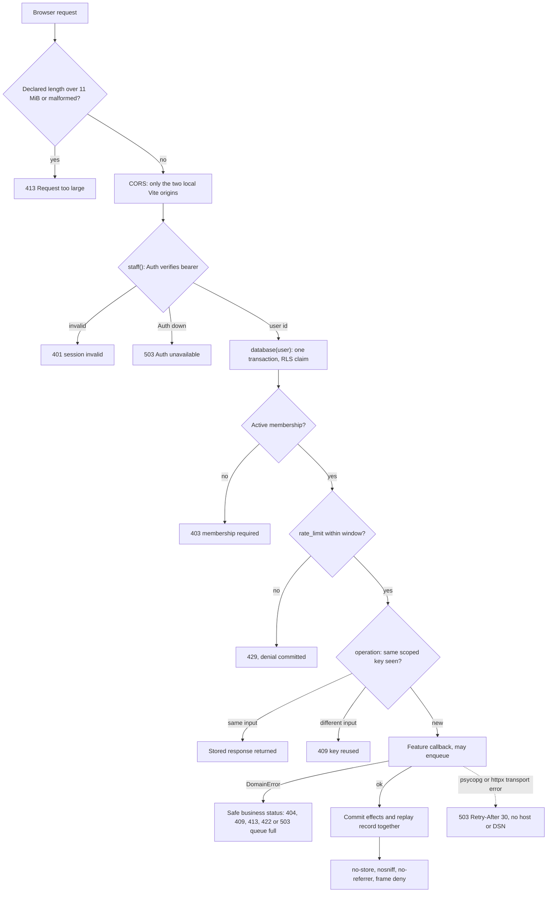

# Layer 2: Transport (staff API and signed gateway)

Two FastAPI applications form the HTTP edge. They validate transport details
(size, headers, identity, JSON shape) and hand the request to a business feature.
They contain no business rules. They are separate processes on purpose: the
staff API stays on this machine, and only the signed gateway may ever be exposed
through a tunnel.

Detailed contracts: [BACKEND reference](../reference/BACKEND.md) (identity,
admission, surface inventory, failures) and the [API guide](../api/README.md)
with the [generated OpenAPI](../api/openapi.json).

## Where it lives

| Path | Owns |
|---|---|
| [`luma/main.py`](../../app/backend/luma/main.py) | Staff API composition: CORS, exception handlers, response middleware, five routers, `GET /api/health` |
| [`luma/google_gateway.py`](../../app/backend/luma/google_gateway.py) | Gateway composition: Google callbacks and the WhatsApp webhook only; no docs, no OpenAPI |
| [`luma/core/http.py`](../../app/backend/luma/core/http.py) | `response_boundaries` middleware, `domain_error` and `dependency_unavailable` handlers, `staff` bearer dependency, `OperationKey` header |
| `luma/features/*/routes.py`, `messaging/webhook.py` | One router per feature; each route authenticates, admits and delegates |

## The two processes

| | Staff API `luma.main:app` | Signed gateway `luma.google_gateway:app` |
|---|---|---|
| Port | 8001, loopback | 8002, tunneled only for live Google/Meta setup |
| Callers | The React app through the Vite proxy | Google Apps Script, Meta webhooks |
| Identity | Supabase bearer token, verified with Auth on every request | HMAC envelope and nonce (Google); verify token and raw-body signature (Meta) |
| Operations | 17 under `/api/` plus health | 4 Google callbacks, `GET`/`POST /webhooks/whatsapp` |
| CORS | Only `http://127.0.0.1:5173` and `http://localhost:5173`; `GET`, `POST`; headers `Authorization`, `Content-Type`, `Idempotency-Key`, `Expected-Version` | None |
| Outage handler | `dependency_unavailable` (503) | Not registered (see open gaps) |

`tests/unit/test_surface_inventory.py` fails when either operation list changes
without the [surface inventory](../reference/BACKEND.md#surface-inventory-reviewed-2026-11-03)
being reviewed.

## Request pipeline

Every staff mutation follows the same order. The order matters: identity and
membership come before admission, admission before the idempotency lock, and the
feature runs on the same connection so its effects and the replay record commit
together.

<!-- diagram:api-pipeline:start -->

[Open full-size SVG](../diagrams/rendered/api-pipeline.svg) · [Editable Mermaid](../diagrams/api-pipeline.mmd)

Mermaid source

<!-- diagram:api-pipeline:end -->

- **Size and headers.** `response_boundaries` rejects a non-numeric
  `Content-Length`, or one above 11 MiB, with 413 before any route runs, and adds
  `Cache-Control: no-store`, `nosniff`, `no-referrer` and `X-Frame-Options: DENY`
  to every response that passes that check. Both processes use it.
- **Identity.** `staff()` calls Supabase Auth `GET /auth/v1/user` with a 5 s
  timeout. A non-200 answer is 401; a transport error or malformed answer is 503.
  Only the verified user id is used; client-sent company ids or metadata grant nothing.
- **Business errors.** A feature raises `DomainError(message, status)`; the
  handler returns `{"detail": message}` with that status (default 409). Messages
  are written to be safe for staff to read.
- **Outages.** Since 2026-11-03, `psycopg.OperationalError` and
  `httpx.TransportError` raised inside a staff route return 503 with
  `Retry-After: 30` and a fixed message. The exception text is never returned or
  logged, because connection errors can contain the DSN. The transaction has
  already rolled back, so retrying with the same `Idempotency-Key` is safe. Before
  this change a database outage returned a bare 500.

## Status codes a caller should expect

| Status | Meaning | What the caller does |
|---|---|---|
| 401 | Bearer token invalid or expired | Sign in again |
| 403 | No active membership | Stop; an administrator must restore access |
| 404 | Resource not in the caller's company | Stop; never guess another id |
| 409 | Stale version, changed input under a used key, or a business rule refused | Re-read and review; do not retry blindly |
| 413 | Body or declared length too large | Send a smaller file |
| 422 | Invalid fields | Fix the input |
| 429 | Rate limit for this key and minute | Wait for the next minute |
| 503 | Auth, database or Storage unreachable, or the job queue is full | Retry later with the same operation key |

## Tests and evidence

- `tests/integration/test_api_boundaries.py`: forged/missing bearer, Auth outage,
  exact CORS origins, response headers on both processes, 413, 429.
  Evidence: [api-boundaries-2026-11-02.json](../evidence/api-boundaries-2026-11-02.json).
- `tests/integration/test_outages.py` (new): database unreachable gives 503 with
  `Retry-After: 30` and no host or DSN in the body, then recovers; a Storage
  transport error during a voice upload leaves no message, media or job row and
  the retry succeeds.
- `tests/integration/test_admission_limits.py` (new): every per-minute limit
  through the real API. See [core](core.md#admission).
- `tests/unit/test_surface_inventory.py` (new): 18 staff API operations (17 plus
  health) and 6 gateway operations; only health is unauthenticated.

## Open gaps

- The gateway does not register `dependency_unavailable`, so a database outage
  during a Google callback or WhatsApp webhook gets FastAPI's generic 500 instead
  of a 503 with `Retry-After`. Google and Meta retry on their own, but the answer
  is less clear. Not tested.
- FastAPI's `/docs`, `/redoc` and `/openapi.json` are served unauthenticated on
  the staff API. This is acceptable only while the process is local.
- Expired, wrong-issuer and wrong-audience tokens, and CORS as run by a real
  browser, are not tested.

## Extending safely

- A new route: authenticate with `Staff`, open `database(user)`, resolve
  `membership`, call `rate_limit` with a server-chosen key, then wrap any mutation
  in `operation(...)` and delegate to the feature. Then update the surface
  inventory test and table.
- Never expose the staff API through the tunnel; add public callbacks only to the
  gateway, each with its own signature check.
- Never put exception text into a response.
