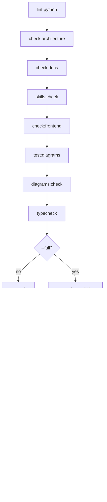

# Cross-cutting layer: verification and tooling

Checks run across every layer. They are grouped by cost and scope: fast static
checks, offline tests, tests against the local Supabase stack, browser runs, and
opt-in paid runs. A result only counts for the scope it actually ran in, and each
result names exactly one label: `local`, `local-substitute`, `sandbox`, `live` or
`synthetic` (rule R9).

Detailed map: [TOOLING_AND_TESTS reference](../reference/TOOLING_AND_TESTS.md).
Rule enforcement (hooks, `check:docs`, skills): [AGENT_RULES](../reference/AGENT_RULES.md).
Required test targets: [TESTING_PLAN](../TESTING_PLAN.md).

## The verify gate

<!-- diagram:verify-gate:start -->

[Open full-size SVG](../diagrams/rendered/verify-gate.svg) · [Editable Mermaid](../diagrams/verify-gate.mmd)

Mermaid source

<!-- diagram:verify-gate:end -->

`scripts/verify.cjs` runs the steps in this order and stops at the first failure.
Each step has a 180 s timeout except `test:python` (1500 s) and `test:browser`
(420 s). Logs go to `.local/checks/<step>.log` and a summary to
`.local/checks/summary.json`; both are ignored by git. "All checks pass" means one
complete `npm run verify:full` on the final tree (rule R12).

| Command | Adds |
|---|---|
| `npm run check:rules` | Fast docs and skills checks only |
| `npm run verify` | Static checks, offline unit and UI tests, build, secret scan |
| `npm run verify:full` | The whole Python suite against local Supabase and the browser suite |

The latest complete green `verify:full` ran on 2026-11-03: 13 of 13 steps,
364 Python tests passed, 66 opt-in paid tests skipped, 3 deselected, 1 expected
failure; 3 browser tests passed. [Evidence](../evidence/checkpoint-2026-11-03.json).
It predates some later edits from the same day.

## Test families by layer

| Layer | Offline | Local infrastructure | Browser |
|---|---|---|---|
| [Presentation](frontend.md) | Vitest components (`test:ui`) | - | `manual-workflow.cjs`, `scene-review.cjs`, `page-review.cjs` |
| [Transport](transport.md) | `test_surface_inventory.py` | `test_api_boundaries.py`, `test_outages.py`, `test_admission_limits.py` | - |
| [Business features](business-features.md) | `test_quotation_rules.py`, `test_catalog_questions.py`, `test_channel_contracts.py` | Workflow, concurrency, PDF, catalog, media, WhatsApp, Drive, Google tests | Manual workflow |
| [Agent worker](agent-worker.md) | `test_trace_masking.py`, `test_requirement_policy.py`, `test_written_requests.py`, `test_embedding_contracts.py` | Graph restart, written confirmation, job recovery, budgets, retrieval, hostile content | - |
| [Data](data.md) | - | `test_migrations.py`, `test_retention.py`, `test_backup_restore.py`, storage invariants | - |
| [Integrations](integrations.md) | - | Mock Graph (WhatsApp), Python GAS stand-in | - |
| Rules and tooling | `test_agent_rules.py`, `test_scan_secrets.py`, `test_summarize_post_hoc.py`, `test_evaluation_dataset.py`, diagram tests | - | - |

Opt-in paid tests (`test_live_model.py`, `test_live_voice.py`, `test_live_photo.py`,
`test_live_embeddings.py`, `test_trace_canary.py`, `test_live_evaluation.py`) are
skipped unless their own `LUMA_RUN_*` flag is set, and need the user's approval
for each run.

## Changes on 2026-11-03

- New integration tests: `test_admission_limits.py`, `test_outages.py`,
  `test_migrations.py`, `test_scene_review.py`, `test_page_review.py`, with the
  shared server starter `tests/integration/browser_servers.py`.
- New unit test: `test_surface_inventory.py`. More probes in `test_trace_masking.py`
  and `test_evaluation_dataset.py`.
- `npm run test:browser` now runs the scene and page reviews after the workflow.
- `scripts/verify.cjs`: `test:python` allowance 1500 s, `test:browser` 420 s.
- Evaluation: 7 more scenarios rewritten into text specs so Recall@5 has 14
  labeled cases (decision D38); `scripts/evaluation_dataset.py` validates that each
  target matches the spec. Live evaluation jobs run inside the masked worker trace
  (D42); the paid `dev-run-3` covered 40 of 60 development scenarios (D41).
- The browser workflow has an opt-in showcase recording mode (`LUMA_RECORD_DIR`).

## Open gaps

- No frozen holdout exists yet, so no evaluation result is a release score.
- CI on GitHub runs static, unit, UI, diagram and build checks only; local
  Supabase, sandbox and browser suites run on this machine.
- Screen readers, real devices and live provider accuracy are not tested.
