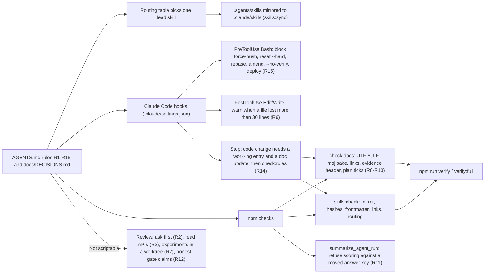

# Working rules, skill routing and their enforcement

Reader: anyone (person or AI model) changing this repository, and anyone maintaining the
rule tooling itself. The rules are in [AGENTS.md](../../AGENTS.md); the user's decisions are
in [DECISIONS.md](../DECISIONS.md); the reasoning and the past mistakes they target are in
[the approved proposal](../proposals/2026-11-03-working-rules.md). This guide explains how
each rule is enforced, what the tools read and write, how they fail, and how to extend them.

## Overview

How the working rules are enforced. See the surrounding contract for details and limitations.

<!-- diagram:rule-enforcement:start -->

[Open full-size SVG](../diagrams/rendered/rule-enforcement.svg) · [Editable Mermaid](../diagrams/rule-enforcement.mmd)

Mermaid source

<!-- diagram:rule-enforcement:end -->

Three layers, from strongest to weakest:

1. **Claude Code hooks** stop or flag an action while the agent is working.
2. **npm checks** fail `npm run verify` / `verify:full` and therefore CI and phase commits.
3. **Review** covers rules no script can judge (asking first, reading API docs, honest claims).

A passing check is not proof that the rules were followed in spirit. For example, the Stop
hook sees that a reference guide changed, not that the change is deep enough; depth remains
a review item under the [deep documentation standard](../../.agents/skills/project-documentation/references/deep-documentation.md).

## Rule-to-enforcement map

| Rule | Enforced by | Where |
|---|---|---|
| R1 read rules, decisions, lead skill | review; skills auto-listed by Claude Code | `AGENTS.md`, `.claude/skills/` |
| R2 ask first for security/money/deletion/paid/external/accounts/scope | review | `docs/DECISIONS.md` |
| R3 never guess an API | review | lockfiles |
| R4 inline contracts | script | `check:architecture` (Python), `check:frontend` (TS) |
| R5 layering | script | same two checks |
| R6 large deletions | hook (warning) | `scripts/hooks/guard.py edit` |
| R7 experiments isolated | review | - |
| R8 UTF-8, LF, no mojibake, links resolve | script | `scripts/check_docs.py` |
| R9 evidence labels and header | script | `scripts/check_docs.py` |
| R10 plan ticks need evidence; phase 4 needs `live` | script | `scripts/check_docs.py` |
| R11 scoring rules pinned before a run | script | `tests/integration/test_live_evaluation.py`, `scripts/summarize_agent_run.py` |
| R12 honest gate claims | review | `scripts/verify.cjs` summary |
| R13 no secrets or phone numbers | script | `check:secrets`; `tests/unit/test_trace_masking.py` |
| R14 docs and work log with every change | hook (blocking) | `scripts/hooks/guard.py stop` |
| R15 no history rewrite, hook bypass or deploy | hook (blocking) | `scripts/hooks/guard.py bash` |

## Claude Code hooks

Configured in the committed project file [`.claude/settings.json`](../../.claude/settings.json).
Each hook runs `node scripts/python.cjs scripts/hooks/guard.py <mode>` with the hook's JSON
payload on stdin. Exit code 2 plus a message on stderr is Claude Code's signal to block (Bash,
Stop) or to show the message to the model (after Edit/Write). The guards only read git state
and run read-only checks; they never change files.

### `bash` (PreToolUse on Bash, R15)

Blocks a command before it runs when it matches: force-push (`--force`, `--force-with-lease`,
`-f`, `+refspec`), `git reset --hard`, `git rebase`, `git commit --amend`, `filter-branch` /
`filter-repo`, `--no-verify`, or a deployment command (Vercel, Wrangler, `supabase db push` /
`link` / `functions deploy`, `clasp deploy`, `gcloud ... deploy`, `npm run deploy`).

- Matching is textual, so a harmless command that contains the text (for example
  `echo "git rebase"`) is also blocked. This is deliberate: false blocks are cheap, a missed
  force-push is not.
- `clasp push` (source upload) is allowed; `clasp deploy` (creating a deployment) is not.
- To allow a blocked operation the user must approve it and run it themselves, or change the
  rule in `AGENTS.md` and the pattern list in `guard.py` together (R2).

### `edit` (PostToolUse on Edit and Write, R6)

Runs `git diff --numstat HEAD -- <file>`; when deletions exceed 30 lines it tells the model to
inspect `git diff` and justify the loss in the work log. It does not undo anything. New
(untracked) files never warn. The threshold is `DELETION_LIMIT` in `guard.py`.

### `stop` (Stop, R14 and R8-R10)

When the agent tries to finish:

1. Reads `git status --porcelain --untracked-files=all` (all changes against HEAD, including
   earlier uncommitted work).
2. If any non-Markdown file under `app/`, `scripts/`, `tests/`, `supabase/`, `gas/` or
   `package.json` changed, it requires **both** a changed `docs/WORK_LOG.md` **and** at least one
   other changed documentation file (`docs/**` except the work log, `README.md`,
   `LOCAL_DEVELOPMENT.md`, `gas/README.md` or a Markdown file under `app/`).
3. Always runs `scripts/check_docs.py` and `scripts/skills.py check`.
4. Blocks with every problem listed. A second stop attempt in the same chain
   (`stop_hook_active: true`) is allowed so the agent can report a real blocker instead of
   looping; the problems remain visible in the previous message.

Limits: once changes are committed the working tree is clean and the hook has nothing to
compare, so it enforces documentation per working session, not per commit. Code review and
`npm run verify` remain the gate for commits.

## npm checks

| Command | What it does |
|---|---|
| `npm run check:docs` | R8-R10 over root Markdown, `docs/**/*.md`, `docs/evidence/*.json` and `gas/README.md`. |
| `npm run skills:check` | Mirror equality, upstream hashes, project hashes, frontmatter, project links, routing coverage. |
| `npm run check:rules` | Both of the above; the Stop hook runs the same pair. |
| `npm run skills:sync` | Rewrites `.claude/skills/` from `.agents/skills/` (deletes the old mirror first). |
| `npm run skills:manifest` | Refreshes project-authored hashes and registers new project skills. |
| `npm run graph:update` | Rebuilds the code knowledge graph in `graphify-out/` (no LLM, about 20 s). |

`check:docs` and `skills:check` run in `npm run verify` right after the architecture check.

### `scripts/check_docs.py` details

- **Encoding (R8):** every governed file must decode as UTF-8, contain no CRLF and no mojibake
  (UTF-8 bytes read as Windows-1252, such as an en dash appearing as three characters). Text
  inside inline code (backticks) is skipped so rules can quote the bad sequence.
- **Links (R8):** relative Markdown links outside fenced code must resolve to an existing path.
  Anchors are not checked.
- **Evidence (R9):** a JSON file in `docs/evidence/` that is not in `LEGACY_EVIDENCE` must be an
  object with `date`, `commit`, `label`, `command` and `result`, and `label` must be one of
  `local`, `local-substitute`, `sandbox`, `live`, `synthetic`. The 22 files written before
  2026-11-03 are listed by name as legacy; never add a new file to that list.
- **Plan ticks (R10):** every `- [x]` line in `docs/IMPLEMENTATION_PLAN.md` must link an existing
  `evidence/...` file. Under the `## 4.` heading the linked evidence must carry `label: "live"`,
  so a local substitute can never tick a live-integration item.

### `scripts/skills.py` details

- **Canonical source:** `.agents/skills/` (Codex reads it). **Mirror:** `.claude/skills/` (Claude
  Code discovers `<name>/SKILL.md` there). The mirror is committed so a fresh clone works without
  a setup step; never edit it by hand.
- **Active skill:** a top-level folder in `.agents/skills/` with a `SKILL.md`. Merged skills live
  under a lead's `references/<name>/` with `SKILL.md` renamed `GUIDE.md`, so they are read through
  the lead and not listed separately.
- **Hashes:** `upstream-manifest.json` keeps the original import hashes; upstream files must stay
  byte-identical at their `active_path` (with `renamed_files` applied). Upstream skills that were
  adapted locally (e.g. `mermaid-diagrams`) are checked against `project-manifest.json` instead.
  Project-authored files may change, but the manifest must be refreshed (`skills:manifest`), which
  makes every edit a visible diff.
- **Routing:** every active skill name must appear in backticks in `AGENTS.md`.

### Evaluation scoring pin (R11)

When a paid evaluation run starts, the harness writes `.local/evaluation-runs/<run>/run.json`
with the SHA-256 of `scenarios.json` and `oracle.json` (first start wins; resuming a run does not
re-pin). `scripts/summarize_agent_run.py` compares those hashes with the current fixtures:

- equal: scored normally, `post_hoc: false`;
- different or missing `run.json`: refused with exit 1 and nothing written, unless `--post-hoc`
  is passed, in which case the report has `post_hoc: true` and both hash sets.

Runs `dev-run-1` and `dev-run-2` (2026-11-02) predate the pin; re-summarizing them now needs
`--post-hoc`. Their existing evidence files are unchanged.

## Skill routing

The routing table in [AGENTS.md](../../AGENTS.md#skill-routing) names one lead skill per task and at
most two supporting skills. The 19 active skills, what they absorbed and their provenance are in
[SKILL_SELECTION.md](../../.agents/skills/SKILL_SELECTION.md). To add a skill: create
`.agents/skills/<name>/SKILL.md` with `name` and `description` frontmatter, add it to the routing
table, run `npm run skills:manifest` and `npm run skills:sync`, scan it with SkillSpector as the
user's global rule requires, and record the decision in `docs/DECISIONS.md`.

## Knowledge graph (decision D33)

`graphify-out/` holds a graph of the code and Markdown structure built by the `graphify` CLI:
`graph.json` (queryable), `graph.html` (interactive view) and `GRAPH_REPORT.md` (communities,
hubs, freshness commit). `.graphifyignore` excludes skills, the skills mirror, archives,
generated output and binary fixtures. The per-machine cache and build state are git-ignored.

- Rebuild after adding, moving or deleting modules: `npm run graph:update`. It is deterministic
  (syntax-tree extraction, no LLM, no API key, about 20 s for ~290 files).
- Ask questions: `graphify query "<question>"`, `graphify path "A" "B"`, `graphify explain "X"`.
- Prerequisite: the `graphify` CLI on PATH (installed for this user; package `graphifyy`).
- Gaps: Apps Script `.gs`, CSS and Mermaid files are not parsed; SQL migrations add nothing
  until the optional `tree_sitter_sql` extra is installed; Markdown is captured structurally
  (headings, links), not semantically. A semantic pass over docs needs the `/graphify` skill
  with LLM subagents and was not run.

## Failure and recovery

| Symptom | Cause | Fix |
|---|---|---|
| Stop blocked: "no new entry" / "no documentation was updated" | Code changed without docs | Update the owning `docs/reference/` guide and add a work-log entry |
| `mirror: <skill> ... differs` | Edited `.agents/skills` without syncing | `npm run skills:manifest` then `npm run skills:sync` |
| `manifest: ... upstream file modified` | An imported file was edited | Revert it; adapt behaviour in the lead `SKILL.md` instead |
| `R10 ... needs evidence labeled 'live'` | A phase 4 item was ticked on local evidence | Untick it until a live run produces `live` evidence |
| `Refusing to score (rule R11)` | Oracle or scenarios changed after the run started | Rerun, or summarize with `--post-hoc` and report it separately |
| `R15: blocked ...` on a harmless command | Textual match | Rephrase the command; never weaken the pattern silently |

## Tests and evidence

- `tests/unit/test_agent_rules.py` (17 tests): R8 mojibake/CRLF/links with the inline-code
  exemption; R9 header and label; R10 including the phase 4 `live` requirement; R15 blocked and
  allowed commands; R14 Stop decisions including `stop_hook_active`; R6 against a temporary git
  repository; skills frontmatter and routing.
- `tests/unit/test_summarize_post_hoc.py` (4 tests): matching pin, changed pin, missing pin,
  `--post-hoc` labeling.
- Live hook check (2026-11-03, local): a probe command containing `git rebase` was blocked by the
  installed PreToolUse hook in a Claude Code session.
