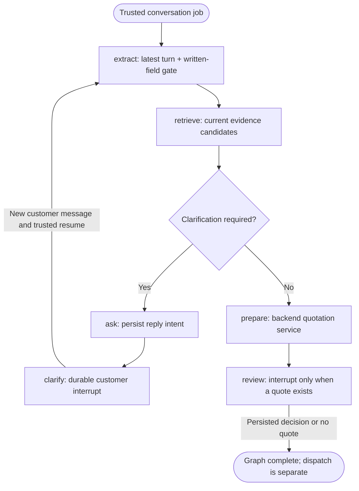
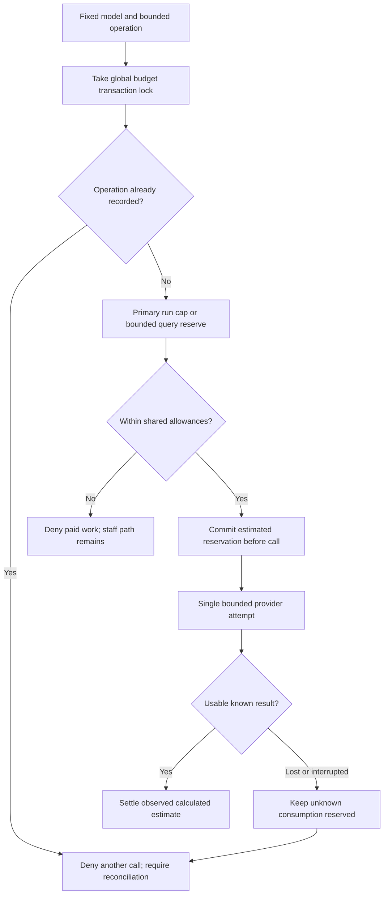
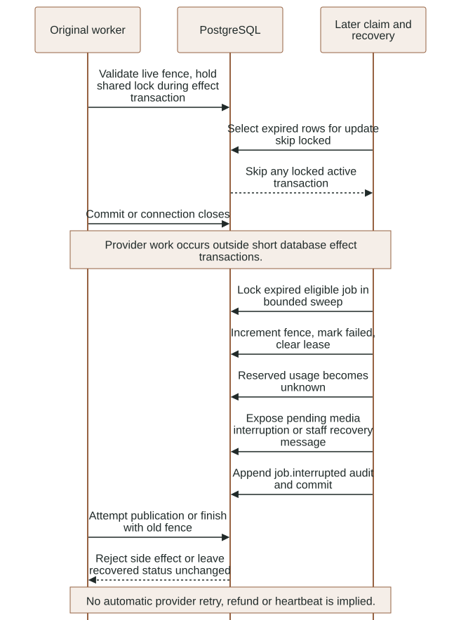
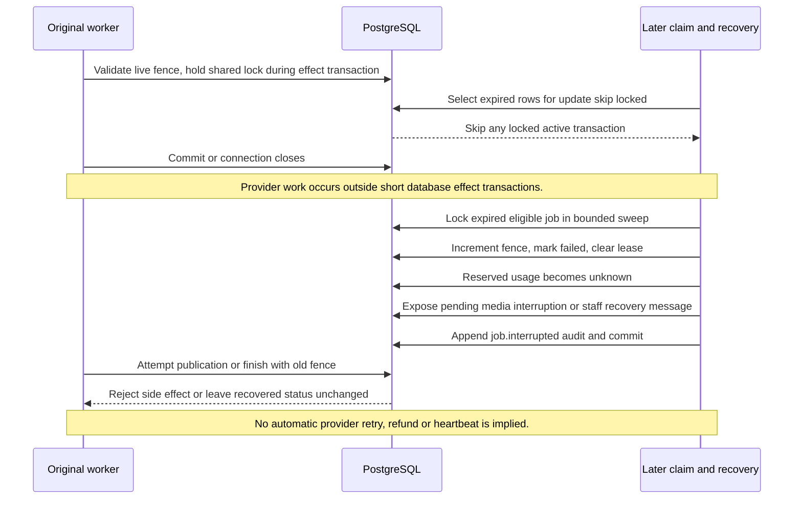

# Agent state, participation, spending and recovery

This guide explains `app/agents/luma_agent`. The graph extracts and orchestrates;
backend features calculate offers and authorize actions. A model response,
checkpoint or resume command is never an approval credential.

## Graph contract

<!-- diagram:agent-graph:start -->

[Open full-size SVG](../diagrams/rendered/agent-graph.svg) · [Editable Mermaid](../diagrams/agent-graph.mmd)

Mermaid source

<!-- diagram:agent-graph:end -->

`graph.build_graph(checkpointer)` compiles these nodes with the supplied durable
checkpointer. There is no send node. `ask` creates an outbox intent, while
`prepare` creates an unapproved draft. Dispatch is a separate worker operation.
The runtime uses synchronous checkpoint durability and recursion limit 20.

`state.AgentState` is a partial typed dictionary, not a public HTTP schema:

- `company_id`, `conversation_id`, `job_id`, `fence`: persisted job scope and lease.
- `customer_message_id`: newest customer message processed by extraction; duplicate
  jobs must not masquerade as another customer answer.
- `observed_version`: conversation version used to derive the requirements.
- `extraction`: validated but untrusted structured requirements.
- `clarification`: deterministic question or no question.
- `quote_id`: backend-created revision identity, never model-granted approval.
- `catalog_candidates`, `retrieval_status`: bounded per-turn retrieval results.

These fields use replacement semantics; candidate state is refreshed each turn,
not accumulated across requests. Checkpoints contain some extraction/question
content and therefore still require retention/access controls. They are not
secret-free merely because private files and credentials are stored elsewhere.

## Extraction and consequential-field confirmation

`nodes/extraction.extract` validates the job lease and agent ownership and reads
up to 12 newest customer messages. Only the newest complete body is extraction
context. Staff notes and earlier orders cannot supply missing fields to a newer
cancellation or incomplete correction. A body over 16,000 characters asks for a
restatement before primary extraction reservation: taking a suffix could erase a negation.
The recent message kinds determine whether the media-specific question applies.

With paid AI disabled, `baseline_extract` recognizes the explicit quantity/SKU
form such as `3 DL-001`. This is an offline baseline with limited grammar, not a
substitute claim of live model reasoning. With paid AI enabled, extraction uses
the configured `gpt-6-luna`, bounded structured output, 45-second timeout, zero SDK
retries, storage disabled and automatic raw tracing disabled. It reserves before
the provider call, settles from token-derived estimates on success and marks
uncertain consumption unknown on failure.

`requirements.clarification_for` replaces model-authored commercial prose with
fixed questions. Missing/uncertain fields, invalid model syntax or duplicate SKUs
ask for clarification. For **every** modality, the newest message must be text
and its complete written order must exactly match all extracted `(SKU, quantity)`
pairs. Order of distinct lines is immaterial; missing/extra or repeated lines are
not. A well-formed provider result alone cannot establish customer intent.

`written_requests.parse_written_request` is the independent deterministic seam:
it accepts 1-20 unique pairs with ASCII counts 1..10000 and the existing
two-letter/three-digit SKU shape. An optional `Please quote`, `Confirm`, `Order`,
`I need` or `We need` prefix and optional `unit(s)`, `pcs` or `piece(s)` labels are
allowed. Separate lines with comma, semicolon, `and` or newline; case and harmless
whitespace are normalized. For example, `Please quote 3 DL-001 and 2 PN-002.`
is an explicit complete request. It does not accept packs as individual units.

The **whole** message must match. `Do not quote 3 DL-001`, `3 DL-001 or 4 PN-002`,
quoted examples, JSON/instructions and conditional orders therefore cannot be
reduced to their positive-looking substrings. `yes`, media alone and model-inferred
fields cannot pass. This deliberately narrow confirmation language asks natural
language customers for a complete restatement when interpretation is necessary;
it is not a general English intent detector. Corrections must repeat the complete
current order; earlier text is never silently merged. Staff can take over and
draft manually. This gate establishes explicit request fields only; product
support, pack size, price, stock, approval and dispatch remain backend checks.

The development policy corpus has 40 controlled specifications, with an
evaluator-only oracle outside runtime ingestion. Its text/media-label actions
test this boundary, not provider recognition or the release holdout. Generated
boundary cases also verify that malformed quantities/oversized lists clarify
instead of causing structured-output validation errors. See
[tooling and tests](TOOLING_AND_TESTS.md#unit-and-component-coverage) for execution
and the separate persisted graph regression scope.

`nodes/retrieval.retrieve` acts only when clarification is needed and no explicit
lines exist. "Explicit" means at least one extracted line with a non-empty SKU
(`requirements.has_explicit_lines`): for a purely descriptive request the structured model
returns one placeholder line with null `sku` and `quantity` (seen on every sampled descriptive
input), and counting that as an order line used to suppress candidate suggestions. The same
helper gates the `ask` node's fallback search. This is a discovery gate only; confirmation
still requires the written-order gate and nothing here selects a line. It checks the live lease, observed version and owner; searches exact/
lexical evidence first; then optionally attempts semantic fallback. Before its
paid reservation it locks/rechecks the conversation again. See
[catalog retrieval](CATALOG.md) for cache and paid-call details.

## Asking, drafting and review

`nodes/workflow.ask` locks the conversation, checks ownership and observed version,
revalidates each proposed hit against current exact catalog evidence and formats
only validated candidates. If a source retires after retrieval, the old hit cannot
appear in the question. If no candidate survives, the safe generic question
remains. The unique action key `clarify:{job_id}` prevents the same job from
creating duplicate clarification intents. No quote line is selected by similarity.

`clarify` calls `interrupt` after the intent has been persisted in the preceding
node. Its trusted resume payload carries a new job ID and fence, not approval or
customer-controlled tool instructions. It routes back to extraction.

`prepare` checks the lease, locks the conversation, checks owner/version and
resolves explicit SKUs in current catalog records. Unsupported, discontinued or
insufficient-stock selections add an internal staff-review message instead of a
substitute. Supported selections call backend `quotations.drafting.draft` using
salesperson authority, then record that staff approval is required. The agent has
no admin discount authority.

`review` interrupts only when a quote exists. Resume checks that the persisted
quote is already approved/rejected/superseded/expired. A resume value cannot
perform that decision. API decision transactions and final dispatch checks remain
the authoritative [backend contracts](BACKEND.md).

## Durable thread routing and restart

`runtime/conversations.process_conversation` derives the thread as
`company_id:conversation_id`. A session advisory lock serializes graph invocations
across checkpoint commits. The lock is held by a dedicated connection and released
on connection close/crash. Checkpointer connections use the restricted worker DSN.

Before invoking the graph, the runtime reads current conversation, latest quote
and latest customer message:

- Pending queued/processing media returns without asking about its placeholder.
- Older preparation returns when a non-superseded/non-expired staff-prepared or
  decided quote already covers the latest customer activity.
- A `review_only` job may complete an existing review interrupt only. It cannot
  start extraction or answer a customer clarification.
- A paused clarification resumes only if a different customer message exists.
- A paused review resumes only after the persisted decision is terminal for that
  participation point. A new customer turn can then start new extraction.

This separates conversational persistence from HTTP retries and job identity.
Restart tests invoke independent native processes against real PostgreSQL
checkpoints; they do not use an in-memory saver as proof of durable participation.

## Worker capacity and lease ownership

`worker.tick` claims one job, dispatches by kind, records a safe outcome/error
class, optionally exports an allowlisted outcome trace, then attempts one outbox
dispatch. The polling loop sleeps one second between ticks; `--once` performs a
bounded diagnostic tick. Unsupported integration job kinds fail visibly.

`runtime/jobs.claim_job` holds a global capacity advisory lock, reconciles expired
jobs, permits at most two running jobs and excludes a second running job for the
same conversation. Claiming increments fence/attempt count and sets a 120-second
lease. Queue capacity is separately enforced at insertion.

`lease.assert_job` requires running status, matching fence and an unexpired lease.
Its shared row lock lasts for the transaction so expiry recovery cannot invalidate
that transaction halfway through its database effect. Long provider work is
outside that lock; the next publication transaction must validate again.
`assert_request_version` separately rejects results derived from old customer or
staff state. `finish_job` updates only a still-running matching fence; a stale
worker cannot turn an already recovered job back into done.

There is no heartbeat or automatic safe replay of arbitrary failed work. The
120-second lease must be assessed against real bounded operation durations; a
lease alone cannot prove an external provider was never called twice under every
possible infrastructure failure.

### Shared estimated allowance and unknown provider outcomes

Internal estimates, not a provider-enforced invoice cap. See the surrounding contract for details and limitations.

<!-- diagram:estimated-allowance:start -->

[Open full-size SVG](../diagrams/rendered/estimated-allowance.svg) · [Editable Mermaid](../diagrams/estimated-allowance.mmd)

Mermaid source

<!-- diagram:estimated-allowance:end -->

## Estimated allowance lifecycle

`budget.reserve` serializes admission with the global budget advisory lock.
Default policy is USD 25 total, USD 5 per UTC day and USD 0.25 per run. Primary
operations reserve the full run amount. A retrieval operation can reserve at most
USD 0.01 only if prior settled/uncertain consumption leaves room under that same
run maximum. An unresolved full primary reservation leaves no room for a child.

Each `(job_id, operation)` is unique. An existing operation denies another call,
even if it is settled; callers must not change IDs to bypass reconciliation.
All-company totals are deliberately shared under the current local policy, not a
per-tenant billing product. Reserved/unknown amounts consume both total and daily
allowance, including after UTC midnight. Settled estimates count on their start
day. Released entries do not consume the sum, but no general reconciliation UI
currently authorizes automatic release.

Amounts are internal estimates derived from configured rate assumptions and
observed tokens/duration. Database precision and provider charges can differ.
These controls are not a provider-enforced hard invoice cap. Consult
[provider contracts](../PROVIDER_CONTRACTS.md) before changing models or rates.

### Expired-job fencing and conservative uncertainty recovery

Bounded expiry reconciliation; no heartbeat or automatic provider replay. See the surrounding contract for details and limitations.

<!-- diagram:job-recovery:start -->

[Open full-size SVG](../diagrams/rendered/job-recovery.svg) · [Editable Mermaid](../diagrams/job-recovery.mmd)

Mermaid source

<!-- diagram:job-recovery:end -->

## Interrupted work and unknown outcomes

`runtime/recovery.recover_expired` selects up to 100 expired running jobs with
`FOR UPDATE SKIP LOCKED`. It optionally accepts a trusted test company scope;
that parameter is not a public authority mechanism. In one transaction it:

1. Fails each expired job, increments its fence and clears its lease.
2. Changes outstanding reserved usage to unknown without freeing the amount.
3. For queued/processing media, publishes an interrupted/unknown result while
   preserving normalized access where available.
4. For other work, adds internal recovery context and marks an applicable current
   request needs-staff without rewriting an already reviewed offer.
5. Appends `job.interrupted` audit evidence.

Reconciliation is idempotent because failed jobs no longer match its selection.
It does not retry the provider, approve, send or automatically release consumption.
Two-connection tests verify locked rows are skipped until the owner releases them.
If a live lease is already lost, a worker's immediate error-publication attempt
can itself be denied; the later expiry sweep is the recovery path.

Outbox interruption is separate: old `submitting` intents become unknown in the
delivery runtime, not queued for blind resend. The current implemented effect is
the atomic local channel only. External receipts/reconciliation remain unfinished.

## Trace privacy and debugging

Automatic graph/model tracing is disabled around invocations. The explicit
`observability.trace_outcome` root export allows only a validated opaque job UUID
and done/blocked/failed status. It excludes prompts, customer labels, phones,
transcripts, documents, URLs, nested tool data and credentials. Export failure is
optional and logged by safe exception class without stopping quotation work.

The observed LangSmith monthly trace-limit rejection remains an account blocker;
configured keys or local fake-client privacy tests do not establish a successful
live export. Diagnose with job/audit/status records and existing redacted evidence,
not by enabling unrestricted raw traces. See
[tooling and test evidence](TOOLING_AND_TESTS.md) for exact scenarios and gaps.
