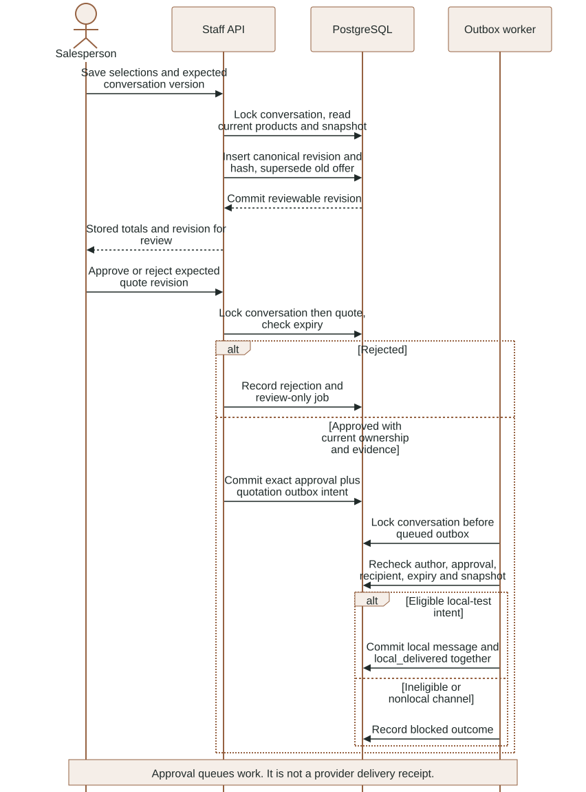
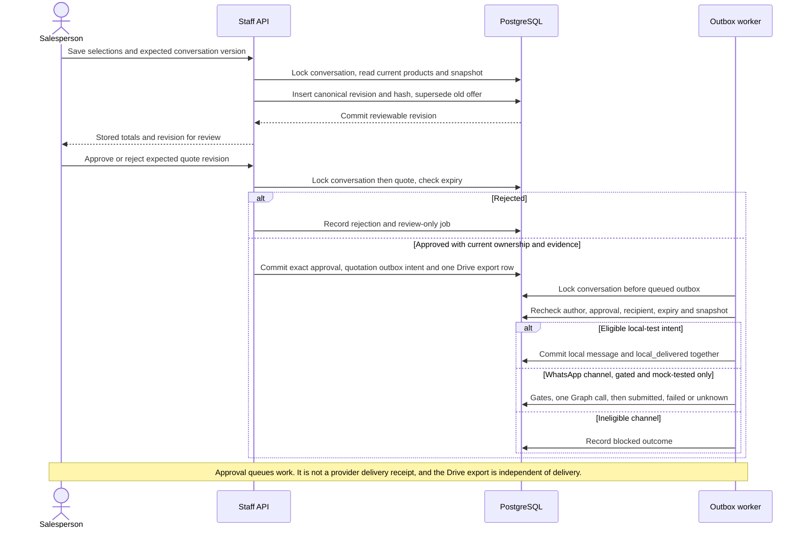

# Backend contracts and business transactions

This reference is for a developer changing the local FastAPI application. It
describes the current working tree, including implemented progress that is not yet
a completed release. Read [the API guide](../api/README.md) for wire formats and
[the data model](DATA_MODEL.md) for persistent constraints.

### Canonical quotation, exact approval and final dispatch checks

Actual transaction sequence and implemented local-channel delivery. See the surrounding contract for details and limitations.

<!-- diagram:quotation-approval:start -->

[Open full-size SVG](../diagrams/rendered/quotation-approval.svg) · [Editable Mermaid](../diagrams/quotation-approval.mmd)

Mermaid source

<!-- diagram:quotation-approval:end -->

## Composition and dependency direction

`app/backend/luma/main.py` creates the staff application, registers CORS, safe
domain-error handling and response middleware, then includes feature routers.
`GET /api/health` confirms the process can respond; it does not query the database,
Storage, Docker, OpenAI, Google or Meta. The Google callback receiver is a separate
composition in `luma/google_gateway.py` and is not included in the staff API.

Core modules contain shared infrastructure. Feature routes own HTTP validation;
feature services own business transactions. Agent code calls those services rather
than copying pricing, ownership or approval rules into a prompt. `main.py` must not
become a place for product queries, provider calls or quotation calculations.

## Identity, company selection and transactions

1. `core/http.staff` extracts a bearer token and asks Supabase Auth's `/auth/v1/user`
   to validate it with a five-second timeout. It accepts the returned UUID, not
   customer-supplied user metadata. Non-200 responses deny the session; transport
   failures or unusable responses report authentication unavailable.
2. `core/database.database(user)` opens a restricted `luma_api` connection, sets
   the transaction search path and `request.jwt.claim.sub`, and yields a dict-row
   connection. Normal context exit commits; an exception rolls back.
3. `core/identity.membership` selects the first active membership ordered by
   company ID. There is no user-controlled company switcher. Multi-company staff
   selection is therefore a future explicit contract, not an inferred capability.
4. Business queries use that membership's company and resource identity. Database
   RLS provides another boundary. UUID knowledge alone is not authority.

`database(worker=True)` uses `luma_worker` and no browser identity. Its broader
cross-company access is intentional for trusted jobs; worker entry points must
carry and check the persisted company/conversation scope. Administrative DSNs and
Storage service credentials belong to provisioning/backend processes only.

**Dependency outages.** `core/http.dependency_unavailable` (registered in `main.py` for
`psycopg.OperationalError` and `httpx.TransportError`) answers 503 with `Retry-After: 30` and a
fixed message, never the exception text, because connection errors can echo a DSN. The request
transaction has already rolled back, so a failed upload leaves no message, media row or job; the
same call works after recovery. Authentication outages keep their own 503 in `staff`. The signed
gateway (`google_gateway.py`) does not register this handler, so a database outage during a Google
callback or WhatsApp webhook still returns FastAPI's generic 500 (no exception text); the senders
retry on their own, but the answer carries no `Retry-After`. Untested. Before
2026-11-03 a database outage returned a bare 500. Tested in `tests/integration/test_outages.py`
(database unreachable, Storage transport error during a voice upload, recovery afterwards). A
Storage success followed by a failed commit can leave an orphan object; retention works from
database rows (`scripts/retention.py`), so nothing removes an object that has no row. This is an
open gap (see the data model).

The response middleware rejects invalid or declared bodies above 11 MiB and adds
`no-store`, `nosniff`, `no-referrer` and framing-denial headers to responses that
reach its normal response path. This coarse declaration check does not replace
the actual-byte limits implemented by media and callback routes. CORS accepts the
two configured loopback Vite origins and explicit headers; it is not authorization.

## Surface inventory (reviewed 2026-11-03)

Two processes, two different exposures. `tests/unit/test_surface_inventory.py` fails when either
list changes without this table being reviewed.

| Process | Reachable from | Operations |
|---|---|---|
| Staff API `luma.main:app` (port 8001) | this machine only; never tunneled | 17 operations under `/api/` (workspace, events, conversations and their draft/decision/ownership/reply/messages/customer-reply/audio/image actions, media preview, quote and source PDFs, catalog search) all behind a bearer credential, plus unauthenticated `GET /api/health`. FastAPI's `/docs`, `/redoc` and `/openapi.json` are also served unauthenticated, acceptable only because the process is local; disable them before any non-local exposure. |
| Signed gateway `luma.google_gateway:app` (port 8002) | the internet, through a tunnel, once live | `POST /callbacks/google`, `/callbacks/google/snapshot`, `/callbacks/google/exports/claim`, `/callbacks/google/exports/receipt` (HMAC and nonce) and `GET`/`POST /webhooks/whatsapp` (verify token and raw-body signature). No staff route and no documentation endpoints. |
| Direct Supabase paths | the browser, by design only Auth | `anon` and `authenticated` hold no grants on any `luma` table (asserted against the clean-install schema in `test_migrations.py`); the `luma-private` Storage bucket is private. Business data is reached only through the staff API. |
| Outbound adapters | this machine to providers | OpenAI (Responses, transcription, vision, embeddings), LangSmith export, Meta Graph (fixed host), Google through Apps Script callbacks (no backend Google credentials), local Supabase Auth and Storage. |

## Admission and repeat submissions

`core/admission.rate_limit` increments a PostgreSQL minute bucket with an atomic
upsert. Keys are chosen by the server. It commits a denial before raising 429 so
rejected work cannot reset its own counter through rollback. Call it before
business mutations: a later commit in an arbitrary partially completed transaction
would have different consequences. The current policy uses staff read, mutation,
approval, attachment-type and conversation-turn keys. It is a fixed-window counter,
not a sliding-window limiter. Counter retention and all public ingress profiles
are not yet complete.

Limits per user per minute: reads 120, catalog search 30, mutations 30, staff replies 10,
decisions 10, voice or photo uploads 6 each; per conversation 6 customer messages or media
(a shared key for the staff-operated reply, WhatsApp ingress and uploads). Each is exercised
through the real API by `tests/integration/test_admission_limits.py` (the n-th request passes,
the next is 429), plus the denial-counter-kept and key-isolation property and the queue cap
(503 at 100 jobs). **Known gap (xfail test):** the increment shares the request transaction, so
a request that passes the check and then fails in business code (409, 404) rolls its increment
back; 14 stale decisions all returned 409 and none 429. Only successful requests and the
denial itself consume the window. A fix needs the counter committed independently of the
request transaction (an extra short connection), which is a security-behavior change awaiting
the user's decision (rule R2). The 100-job queue cap is global, not per company, so one
tenant can fill it for all.

`enqueue` takes the shared queue advisory lock and admits at most 100 queued or
running jobs globally. It inserts the job inside the caller's transaction. A full
queue raises 503; acceptance must not be acknowledged if its durable job rolled
back. Worker concurrency is a separate control described in
[agent runtime](AGENT_RUNTIME.md).

`core/idempotency.operation` takes a transaction advisory lock over company,
principal, action and UUID key. It hashes the canonical payload and either:

- Returns the stored serializable response for an identical replay.
- Raises 409 if the same scoped key names different input.
- Runs the callback and stores its canonical response atomically with its effects.

Replay still passes current authentication, membership and route admission. A key
does not bypass revocation. Optimistic versions solve a different problem: they
reject an edit based on an obsolete conversation, even with a new operation key.
Changing an expected version while reusing an old key changes the payload and
must conflict. Media keys additionally bind the selected bytes' digest.

## Conversation commands

`features/conversations/service.intake` inserts a local-test conversation, its
customer message, an agent job and an audit event in one transaction. The recipient
is generated as a local identity; this route does not provision a WhatsApp sender.
`add_message` records actor/kind/provider identity and advances the conversation
version. A duplicate provider ID returns no new message or version increment.

`repository.conversation` resolves company plus conversation ID and optionally
locks the row. Participation commands use this lock to serialize consequential
changes:

- `record_note`: internal staff message and audit only. It does not create an
  outbound intent or change the customer's requested products.
- `record_customer_reply`: staff-operated simulation restricted to `local_test`.
  It delegates to `accept_customer_text`, which records customer activity (deduplicated by an
  optional provider id), supersedes review/approved quotes, blocks queued sends and enqueues
  preparation only when ownership permits automation. The verified WhatsApp ingress and the
  Telegram poller call the same function, so every channel invalidates old decisions identically;
  see [WhatsApp channel](WHATSAPP.md) and [Telegram channel](TELEGRAM.md).
- `change_ownership`: requires `expected_version`. Takeover blocks queued
  non-staff intents. Resume blocks queued staff-origin replies and can enqueue
  preparation. Neither operation fabricates a quotation approval.
- `queue_staff_reply`: requires current staff ownership, expected version and an
  active authenticated author. It queues a reply with persisted staff origin and
  author identity; dispatch checks both again.

There is no broad conversation-edit/delete endpoint. Do not describe simulation,
internal notes and actual channel messages as interchangeable customer events.

## Drafting an immutable offer

`features/quotations/drafting.draft` locks the conversation and checks its expected
version, resolves selected products within the company and active sources, and
requires one consistent snapshot across lines. The browser supplies product IDs
and quantities, not authoritative unit prices or totals.

`rules.calculate` enforces distinct products, integer quantities 1..10,000,
availability, pack multiples, active products and finite nonnegative source
prices. Discount must be finite and 0..10%; any nonzero discount requires an
admin. Shipping must be finite/nonnegative. Decimal line totals, discount and
shipping are rounded to cents using the implemented rules. Subtotal is the sum
of rounded line totals; total is subtotal minus discount plus shipping.

For example, three units at USD 32.35 produce USD 97.05 before other adjustments.
Neither retrieval similarity nor model prose participates in that arithmetic.
Tax is excluded and stock remains observed, never reserved.

Drafting captures customer name/company, terms, product/source/page references
and calculated strings in canonical JSON. It hashes that content, assigns the
next conversation revision and seven-day expiry, supersedes the previous quote,
blocks affected queued replies/old quotation intents, advances conversation
version and appends an audit event. These changes commit together.

The runtime database grants allow changing quote status but not rewriting
canonical content, recipient, hash, snapshot or expiry. A correction requires a
new revision. The hash correlates reviewed content; it is not a substitute for
database authorization or cryptographic tamper-proof storage.

## Approval, freshness and dispatch

`approval.decide` locks conversation then latest quote and requires the displayed
revision to remain in review and unexpired. Rejection sets needs-staff status,
queues only review completion and audits the decision. Approval additionally
requires agent ownership and current commercial eligibility. It atomically writes
the approver/hash/recipient binding, approved status, quotation outbox intent and
review-completion job. Current active admin and salesperson memberships can make
this decision; discount authorization is a separate admin rule.

`freshness.check_snapshot` is called at approval and again at dispatch. Synthetic
snapshots can finalize only on the local-test channel. Google observations must
be no more than 90 seconds old. Every persisted line must still refer to an active
source and matching product snapshot, source ID, page and unit price, with valid
pack quantity, sufficient available stock (on hand minus reserved, from the stock ledger,
[Inventory](INVENTORY.md)) and a non-discontinued product. A
failure requires reviewing a fresh revision; it is not a reason to silently
substitute a model or rewrite an approved price.

`messaging/authorization.authorize_outbound` rechecks the persisted origin and
ownership. Human replies require staff ownership and the original author's active
membership. Agent replies require agent ownership. Quotations also require the
matching approval, active approver, recipient, expiry and freshness checks.

`runtime/delivery.deliver_one` follows conversation-before-outbox lock order,
matching edit/approval/takeover transactions. It reselects queued work under lock
before applying the local effect. A local message ID derives from its outbox ID;
the message and `local_delivered` outcome commit together. Nonlocal delivery is
currently blocked with `live_adapter_not_enabled`. Supported status vocabulary
does not establish a working Meta sender or receipt reconciler.

## Private PDFs and read models

`quotations/documents.quotation_pdf` renders persisted canonical values without
recalculating them. It escapes customer/product/terms text for ReportLab markup,
uses the reviewed customer identity and shows expiry in Africa/Cairo time.
`quotations/routes.pdf` authorizes the quote, reads its private canonical object,
creates it if absent, and reads the stored bytes back after a possible concurrent
creation. Storage writes use create-only behavior. Historical PDFs can be viewed;
view permission does not make a historical offer dispatchable.

`core/storage` accepts only server-chosen paths and uses backend service
credentials. `get_file` returns `None` for missing objects and propagates other
Storage failures; `put_file` tolerates an existing object without overwriting it.
The helper does not authorize a path: its caller must resolve the resource first.

`features/workspace/queries` builds scoped collections and detail records;
schemas define the public read shapes. Media responses expose kind/status and
availability booleans rather than private paths. Integration configuration is
reported as configured/unverified, not connected merely because a secret exists.
The current frontend polls. The separately implemented SSE endpoint rechecks
membership for bounded refresh events but has no wired frontend consumer.

## Failure boundaries and evidence

Domain errors are safe business messages; 409 means re-read and review, not retry
with guessed state. Auth/Storage/provider transport failures have different
outcomes and should not be collapsed into success. There is no generic transaction
retry around business mutations or unknown external effects.

Some endpoints have different admission coverage: for example, the quotation PDF
route does not call the shared read limiter. Read the actual route rather than
assuming every GET has identical controls. Retention, backup restoration and full
public deployment controls remain open in the engineering ledger.

Behavioral evidence is mapped in [tooling and tests](TOOLING_AND_TESTS.md), notably
manual workflow, concurrency, storage invariants, preparation conflict, PDF,
staff-reply and catalog-retirement tests. Their source explains the scenario;
dated result artifacts establish which invocation actually passed.
