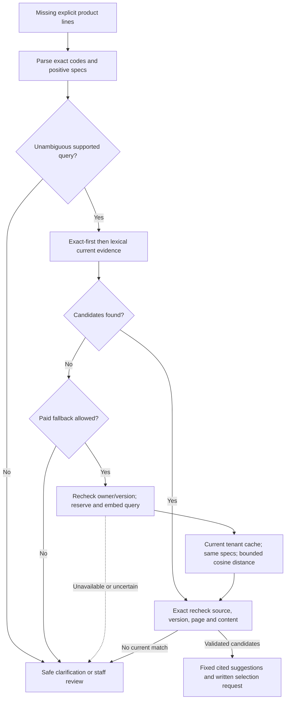

# Catalog evidence, lexical search and semantic fallback

This guide covers backend `features/catalog`, agent `nodes/retrieval.py`,
`adapters/embeddings.py`, `runtime/catalog_index.py` and the catalog scripts. Product
description evidence is separate from authoritative prices/stock and action rights.

### Exact and lexical lookup before admitted semantic fallback

Suggestions only; source recheck precedes clarification publication. See the surrounding contract for details and limitations.

<!-- diagram:catalog-retrieval:start -->


[Open full-size SVG](../diagrams/rendered/catalog-retrieval.svg) · [Editable Mermaid](../diagrams/catalog-retrieval.mmd)

<details>
<summary>Mermaid source</summary>



</details>
<!-- diagram:catalog-retrieval:end -->

## Record and result contracts

Catalog sources identify a private original PDF, version, title and retirement
state. Products carry a source ID/page plus supported structured specifications.
`CatalogHit` returns product/SKU/name/description, watts/CCT/IP and source identity,
title, version and page. It does not return a selected quantity, unit price or
stock promise. The original page can be viewed under current company authorization.

`POST /api/catalog/search` is an authenticated, rate-admitted read with a query
bounded to 500 characters and optional explicit specification filters. It invokes
lexical retrieval only and makes no paid provider call. Semantic fallback is an
internal admitted agent path, not a hidden paid side effect of this read endpoint.

## Shared conservative query parsing

`criteria.query_constraints` is shared by lexical and semantic search so a more
flexible retriever cannot relax explicit customer constraints. It:

1. Refuses negated/alternative wording containing not/except/avoid/without/instead.
   This parser does not implement general natural-language logic.
2. Extracts distinct exact model codes matching the supported two-letter/three-digit
   form, positive watt values, CCT and IP rating tokens.
3. Refuses multiple distinct watt/CCT/IP values rather than choosing a variant.
4. Merges explicit schema filters and refuses disagreement with values in text.
5. Removes configured noise words, keeps at most 24 descriptive words and builds
   an OR lexical expression. A query with only unambiguous specs may browse those
   specs; an empty unsupported query produces no criteria.

Exact code precedence is deliberate: `DL-999 downlights` must not turn into a
nearby available model just because the word downlights matches. Unsupported code
syntax and unrecognized language require further clarification, not a claim that
all possible manufacturer identifiers are normalized.

## Lexical retrieval

`retrieval.search_catalog` joins tenant products to their own current source,
excludes retired sources and discontinued products, applies exact model or English
PostgreSQL full-text terms, and enforces watts/CCT/IP filters. Ranking uses
`ts_rank_cd` over SKU, name, family and description, with SKU as a stable tie-break.
At most five results are returned. The family-search migration supplies the
matching descriptive index. Stock is checked when drafting/finalizing, not used
as proof of technical equivalence during descriptive matching.

`candidate_question` formats only validated SKU/spec/page/version values into a
fixed English confirmation question. It explicitly says suggestions are not
confirmed equivalents and asks for a written model/quantity. Arbitrary retrieved
instructions cannot select tools, discounts or approval.

## Cache identity and vector validation

`semantic.vector_literal` requires exactly 1536 numeric finite nonboolean values,
each within absolute value 1 and with a nonzero squared norm. It serializes data
for a parameterized pgvector cast; it never concatenates customer SQL.

`catalog_embeddings` rows are usable only when company/product/source IDs,
source version, page, fixed model and canonical descriptive text match current
active records. `catalog_evidence_text` includes SKU/name/family/description,
watts/lumens/CCT/IP and excludes commercial/customer data. Price-only or stock-only
edits therefore do not require embedding those values. Final quotation checks
still read their current authoritative records.

`semantic_search` reuses query constraints and delegates exact codes to lexical
lookup. Otherwise it queries current version-bound vectors, applies the same
explicit specification filters and keeps cosine distance at most 0.45, ordered
by distance then SKU. This threshold is an uncalibrated conservative cutoff, not
a probability or a demonstrated accuracy guarantee. This is a bounded scan; no
HNSW/IVFFlat index or large-catalog performance claim is implemented.

## Operator indexing

`embedding_inputs` reads active current records ordered by SKU. It rejects no
records, more than 500 records, a record over 8,000 UTF-8 bytes or more than
100,000 bytes overall. These are bounded local batch limits, not a complete
incremental ingestion platform.

`adapters/embeddings.embed_texts` fixes `text-embedding-3-small`, 1536 float
dimensions, 35-second timeout and zero SDK retries. Inside a job trace it records the
input texts and vector count (masked), never vectors; elsewhere tracing is off. It
checks nonempty bounded inputs, correlates returned response indices to inputs
and rejects missing/duplicate indices or invalid vectors. The calculated amount
uses the rate recorded in [provider contracts](../PROVIDER_CONTRACTS.md).

`runtime/catalog_index.index_company(company, run_id)` is an explicit operator
operation restricted to this project's loopback database and a synthetic company:

1. Validate provider configuration and take the company index advisory lock.
2. Deny a prior reserved/unknown index run, read bounded descriptive inputs and
   commit primary reservation plus `catalog.index_started` audit before the call.
3. Make one provider batch call, then re-read input bindings before publishing.
4. Upsert current vectors, settle the estimate and audit completion atomically.
5. If the provider/publication outcome fails, retain unknown consumption and record
   an unresolved run; do not generate another ID to bypass reconciliation.

`publish_embeddings` refuses a changed record list or mismatched vector count.
Invalid later vectors cause the caller's transaction to roll back earlier upserts.
Source changes after publication still make stale rows unusable at read time.
This is not a claimed cross-provider/database distributed transaction.

The CLI is intentionally explicit:

```powershell
node scripts/python.cjs scripts/index_catalog.py --company <UUID> --run-id <stable-UUID> --execute
```

Use actual authorized UUIDs in a private terminal, not the angle-bracket
placeholders literally. Setup and routine tests never invoke this paid command.
It currently reindexes a bounded batch; automatic refresh after every catalog
change and a reconciliation UI are unfinished.

## Agent fallback and publication recheck

The retrieval node first overwrites old candidate state. It skips retrieval when
explicit lines already exist, returns lexical hits immediately, and considers a
paid semantic query only for a descriptive miss with current cached vectors,
paid AI enabled and no explicit model code.

Before the query call it checks the lease, locks/rechecks owner and request version
and commits a retrieval reservation under the same run maximum. It embeds one
bounded query, settles only that retrieval operation and runs current SQL lookup.
Failure returns safe unavailable/no-candidate state and keeps unresolved reserved
usage unknown. Duplicate work cannot reserve/call the same paid operation again.

`workflow.ask` exact-resolves every proposed candidate again before creating the
outbox question. A retired/edited source between retrieval and question creation
cannot retain the old candidate wording. This recheck protects business freshness;
it does not convert text similarity into a confirmed line or certified equivalent.

## Evaluation and what the evidence proves

`scripts/evaluate_catalog.py` measures a generated development baseline derived
from the current synthetic catalog: one exact and one family/spec query per active
product. It records dataset hash, retrieved codes, failures and local query latency.
The retained initial result exposed missing family participation; the improved
66 exact plus 66 descriptive cases passed Recall@5 for that generated development
set. The queries are derived from records, so this is not untouched holdout or
real-client accuracy.

Deterministic vector tests exercise actual PostgreSQL scope/spec/distance/current-
evidence behavior. Fake-provider index tests exercise actual durable reservation,
publication and unknown-outcome handling. Agent node tests exercise semantic
clarification, takeover, source retirement and duplicate unknown-response denial.

A real three-record provider index/query canary passed. Its query embeds unchanged
evidence text deliberately: it proves adapter/vector/database plumbing, not natural-
language recall. Its calculated combined usage was USD 0.0000024; billing was not
retrieved. Live full-graph semantic quality, calibrated threshold selection and the
frozen 80-scenario evaluation remain unverified. Preserve those distinctions in
LinkedIn copy and release claims. See [current evidence](../evidence/semantic-progress.json).
