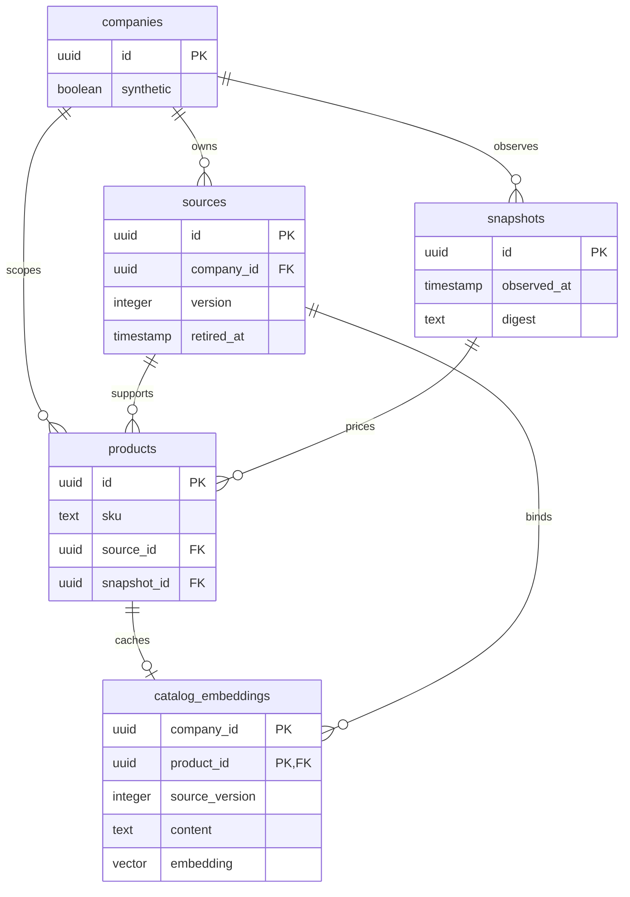
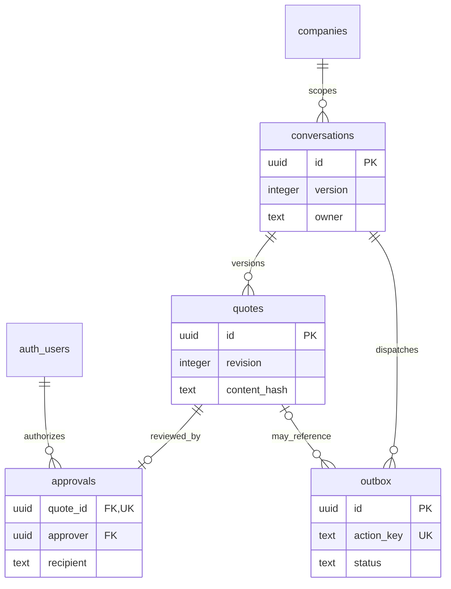
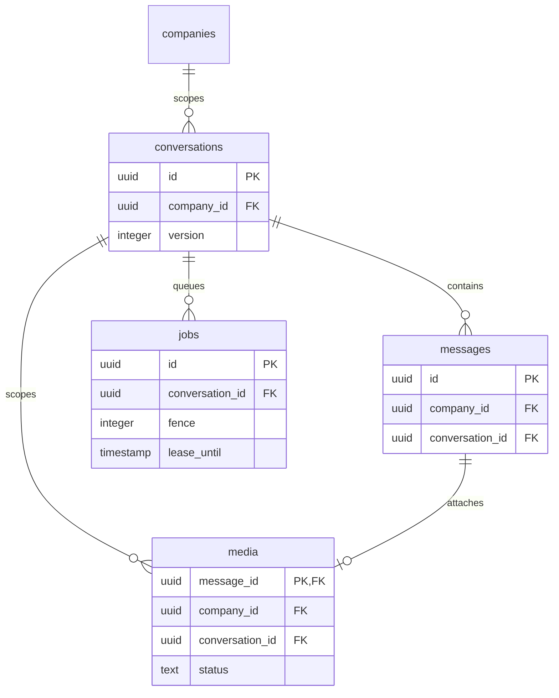

# Persistent data, privileges and migration lifecycle

This reference describes the schema in `supabase/migrations`, including current
working-tree migrations. It explains ownership and constraints rather than
claiming a production migration or restore has been tested. Source SQL remains
the authority for exact column types and grants.

### Catalog, commercial snapshot and current embedding relationships

Selected actual SQL foreign keys; legacy product vector is unused. See the surrounding contract for details and limitations.

<!-- diagram:evidence-data:start -->

[Open full-size SVG](../diagrams/rendered/evidence-data.svg) · [Editable Mermaid](../diagrams/evidence-data.mmd)

Mermaid source

<!-- diagram:evidence-data:end -->

### Conversation, offer, approval, media and work relationships

Selected actual SQL relationships; JSON line references and checkpoint thread keys are not foreign keys. See the surrounding contract for details and limitations.

<!-- diagram:workflow-data:start -->

[Open full-size SVG](../diagrams/rendered/workflow-data.svg) · [Editable Mermaid](../diagrams/workflow-data.mmd)

Mermaid source

<!-- diagram:workflow-data:end -->

## Identity and evidence records

- `companies`: supplier identity and an explicit synthetic flag. Local operator
  indexing/evaluation checks this flag; it is not inferred from a company name.
- `memberships`: `(user_id, company_id)` identity, active flag and admin/salesperson
  role. `user_id` refers to Supabase Auth. Current membership is checked on each
  staff operation and again for consequential dispatch authors/approvers.
- `sources`: private catalog object path, title, version and retirement timestamp.
  Retirement excludes new recommendations and finalization; it does not erase
  historical business records or their authorized original PDF.
- `snapshots`: immutable identity for a synthetic or Google commercial observation,
  observation time and content digest. An unchanged Google observation can refresh
  its observation time without inventing a changed price version.
- `products`: company-local SKU identity, descriptive specifications, current
  commercial fields, source/page and snapshot references. Company-plus-ID foreign
  keys prevent linking a product to another tenant's source or snapshot.

The original `products.embedding` vector column exists, but the current semantic
repository uses `catalog_embeddings`. Do not populate the legacy column and assume
the agent will query it.

## Conversation and quotation records

- `conversations`: customer labels, recipient/channel, agent/staff owner, workflow
  status, optimistic version and customer activity time. `channel` is `local_test`,
  `whatsapp` (recipient is phone digits) or `telegram` (recipient is the private chat id,
  equal to the Telegram user id; migration `20261107010000_telegram_channel.sql`, D44). Owner controls who may
  act; status reports progress. They are separate concepts.
- `messages`: company/conversation, actor, kind, body, optional object/provider
  references and creation time. Provider IDs are unique; local dispatch derives
  one from the outbox identity. Message bodies are plain untrusted content.
- `quotes`: unique `(conversation_id, revision)` plus canonical JSON, hash,
  recipient, snapshot, expiry and lifecycle status. Runtime roles can update
  `status` only. They cannot edit the reviewed commercial content in place.
- `approvals`: one approval per quote, binding the real staff user to its content
  hash and recipient. A matching row still requires current approver membership
  and all current dispatch eligibility checks.

Quote statuses are constrained to review, approved, rejected, superseded and
expired. Conversation status is a text workflow label without an equivalent SQL
enum/check. UI status handling must tolerate unfamiliar labels; the database does
not itself enforce every permitted conversation transition.

## Work identities are deliberately different

- `operations`: company/principal/action/idempotency UUID, canonical payload digest
  and stored response. This protects an HTTP business mutation from duplicate
  effects; it is not the worker job lease.
- `jobs`: durable kind/payload, queued/running/done/failed/blocked status, attempt
  count, lease deadline, fence and safe error code. Company/conversation foreign
  keys scope every job. Supported kinds include agent, transcribe, read_photo and
  the not-yet-enabled drive_export kind.
- `outbox`: reply or quotation intent with unique action key, provider identity,
  status and error. A quotation must have a quote ID; a reply must not. Reply text
  is constrained to a nonempty string of at most 2,000 characters.
- `inbox`: provider event identity and scoped payload storage intended for durable
  inbound deduplication. Its existence does not establish a Meta webhook adapter.
- `usage`: estimated paid-operation accounting. Uniqueness is `(job_id, operation)`
  with primary/retrieval operations. Operator index runs use a stable run UUID in
  `job_id`; this column has no foreign key requiring an actual jobs row.
- `rate_windows`: server-selected key plus minute bucket and atomic count. This
  shared infrastructure table has no company column; isolation depends on correct
  server key construction. Automatic counter cleanup remains unfinished.
- `audit`: append-only through runtime grants, with company, actor, action,
  opaque resource and bounded safe detail. Runtime identities have no general
  audit update/delete grant. Administrative access remains more powerful; this
  is not a cryptographic tamper-evidence claim.

The usage ledger stores reservations at four decimal places and settled estimates
at six. Tiny provider estimates can therefore be rounded in PostgreSQL. A canary
artifact may preserve a more precise calculated estimate. Neither representation
is provider-billed cost. Reserved/unknown amounts continue to consume allowance;
elapsed time does not release them.

## Media and normalized bytes

`media` has one row per message, bound to both the company and conversation by a
three-column message foreign key. The earlier company/message and conversation
foreign keys alone would not prevent relabeling another message in the same
tenant; the later migration closes that gap.

Its fixed kind is audio/image. It stores private original and optional normalized
paths, processing status, metadata, safe error code and a `transcript` column.
That existing column contains a ready voice transcript or photo label reading;
its name does not mean every row is audio. Ready data remains unconfirmed for
commercial purposes. [Media processing](MEDIA.md) defines the transitions.

Private originals and derived bytes are objects in the `luma-private` bucket,
not blobs inside these rows. Bucket `public=false` and a 20 MiB object ceiling do
not replace API limits or application authorization. The backend uses a service
credential after resolving resource access; browser direct access is not the
intended business path. Database transactions cannot atomically roll back an
already uploaded object, so upload failures can leave orphan objects. The agreed
retention/orphan collector is not yet implemented.

## Version-bound semantic cache

`catalog_embeddings` is keyed by company/product and references that tenant's
product and source. Each row stores source ID/version, page, fixed model,
descriptive content, 1536-dimensional vector and index time.

`catalog_evidence_text(product)` builds text from SKU, name, family, description,
watts, lumens, CCT and IP rating. It excludes prices, availability and customer
data. Retrieval requires the cache's binding and content to equal current records,
and excludes retired sources and discontinued products. A stale row can remain
stored while becoming unusable immediately; deletion is not the freshness control.
Index publication re-reads its bounded input before upserting. See
[catalog retrieval](CATALOG.md) for exact search/filter limits.

## Google synchronization records

`google_edit_receipts` and `google_snapshot_receipts` use company/nonce uniqueness
and byte fingerprints to distinguish duplicate delivery from nonce reuse with
different content. Old receipt cleanup happens during receiver processing.
`google_refresh_signals` coalesces pending invalidation per company. It records a
need to refresh, not proof that any Sheet data has been imported.

`drive_exports` (migration 13) holds one row per (company, quote), created by approval in
the same transaction as the approval and outbox intent. Status is `queued`, `claimed`
(`claim_token`, five-minute `lease_until`, `attempts` 0-5), `done` or `blocked`. The canonical
PDF's `pdf_sha256`/`pdf_size` are pinned at first claim; `done` requires a `drive_file_id` and
digest (table check). It foreign-keys the immutable quote row, so a retry can never export other
content. The staff role may insert/select under the membership policy, the worker role
select/insert/update; neither may delete. See [Google synchronization](GOOGLE_SYNC.md).

`google_sync_state` identifies the current validated commercial snapshot,
observation, digest and source-table payload. These integration tables are
worker-only; staff/browser grants do not expose their raw payloads. Snapshot
import is atomic across validated tables and existing product commercial fields.
The receiver cannot insert unsupported SKUs or change catalog specifications.
See [Google synchronization](GOOGLE_SYNC.md).

## Runtime identities and direct-access boundaries

`luma_api` is a login role used by the staff backend. Its RLS checks active
membership through the transaction's verified Auth identity. Membership lookup is
self-only. `luma_worker` is another login role with intentionally broader worker
policies. It must never be handed to the browser or an untrusted tool.

The schema revokes general access from public, anon and authenticated. Business
reads/writes go through the staff API rather than exposing luma tables directly
through Supabase REST. Runtime table grants are operation-specific: catalog
descriptions are not general staff writes, approvals are not a browser table
editor, and immutable quote columns are not writable by runtime roles.

RLS and grants are complementary: a row policy does not grant a missing SQL
privilege, and a table grant does not bypass RLS for these roles. Administrative
provisioning and test cleanup use stronger privileges; those tests must not be
misrepresented as proof that unprivileged direct access succeeds safely.

## Migration sequence and local application

The ordered files introduce:

1. `20261029000000`: pgvector in the extensions schema.
2. `20261029010000`: domain tables, initial RLS/grants, indexes and private bucket.
3. `20261029020000`: worker membership-read policy for existing local installations.
4. `20261029100000`: status-only quote updates and outbox payload constraints.
5. `20261029110000`: voice jobs/media persistence.
6. `20261029111000`: exact company/conversation/message media binding.
7. `20261029120000`: catalog retirement.
8. `20261029120100`: Google hint receipts and coalesced refresh signals.
9. `20261029121000`: family-aware lexical search index.
10. `20261029123000`: Google full-snapshot persistence and restricted import grants.
11. `20261029130000`: photo kind/read_photo jobs.
12. `20261029131000`: operation-scoped usage and current-evidence embeddings.
13. `20261102000000`: `drive_exports`, one Drive copy per approved quotation revision.
14. `20261102010000`: durable WhatsApp inbox state (`kind`, `status`, `attempts`, `error_code`, `lease_until`) on `luma.inbox`.
15. `20261102020000`: `luma.media.purged_at`, stamped when runtime media objects are deleted by retention.

`npm run setup` invokes the guarded bootstrap at `127.0.0.1:55322`. It checks both
`public.luma_migrations` and the Supabase CLI migration ledger before applying a
file, provisions restricted DSNs privately, creates labeled synthetic records and
catalogs, and initializes LangGraph checkpoint tables. It does not reset data or
make paid provider calls. Checkpoint migrations are a setup task, not repeated
worker-startup DDL.

This local database has bootstrap-applied files absent from the CLI ledger.
`supabase db push --local` was observed attempting the existing foundation again
and failing on `companies`. Use the documented setup path for this stack. Do not
repair history, drop tables or reset the database just to suppress that error.
Clean installation and a simple upgrade are now tested by
`tests/integration/test_migrations.py` in a disposable database (`luma_migration_check`,
always dropped) that has only stand-ins for `auth.users`, `auth.uid()`, `storage.buckets` and the
`extensions` schema: all 15 files apply in order, and the resulting `luma` schema (columns,
constraints, indexes, policies, grants, functions, triggers, RLS flags) equals the live local
schema, so a reset cannot drift (negative check: omitting the last file fails the comparison).
A pending job and conversation created under the first ten files survive the last five. Migrations
are one-shot and are not idempotent (re-applying the second file fails on `companies`, by design
of the ledger check above). Not covered: a pending approval or quote across the upgrade, data
transforms on a populated production-size database, and production rollback or restore.

## Checkpoints, retention and preservation

LangGraph tables live in `public` and use the company/conversation-derived thread
key; they are not joined to business tables by foreign key. Integration fixture
cleanup explicitly deletes only its own threads before removing its tenant data.
Application retention must eventually account for business rows, checkpoints,
private objects, vector caches, integration receipts, external traces and backups.

The approved retention targets are seven days for runtime media, 90 days for
business/checkpoint/audit data and seven days for backups. `scripts/retention.py` implements
the first two as an **operator command** (dry run by default; `--execute` deletes; explicit
company; local database only; nothing schedules it):

- Media older than seven days: private original and normalized objects are deleted and the row
  gets `purged_at` (preview routes and `audio_available`/`image_available` then report it gone).
  Its transcript or label reading stays as business data. A rerun is a no-op.
- A conversation idle for more than 90 days is deleted children first (Drive exports, approvals,
  outbox, jobs, media rows, messages, quotes, the conversation), together with its idempotency
  responses (they embed the conversation), quote PDFs, media objects and LangGraph checkpoint thread.
  Conversations with queued/running jobs, queued/submitting sends or queued/claimed Drive exports are
  skipped and counted. Audit events and WhatsApp inbox rows older than 90 days are deleted.
- Preserved deliberately: `luma.usage` (budget and spend accounting; opaque ids and amounts only) and
  catalog, snapshots and sources (commercial reference data).
- Not covered: Drive copies of exported quotations, provider-side copies (OpenAI, LangSmith, Meta,
  Google), database backups and the Docker volume. Tested in `tests/integration/test_retention.py`.

`scripts/backup_restore_drill.py` demonstrates the backup side on this machine: it dumps the
`luma` and `public` (checkpoint) schemas, restores into a scratch database, compares per-company row
counts, content hashes and checkpoint counts, round-trips the company's Storage objects, then removes
every artifact (so no seven-day backup obligation is created). Evidence:
[backup-restore-drill-2026-11-02.json](../evidence/backup-restore-drill-2026-11-02.json) (populated
isolated tenant: identical, restore about 0.3 s for a 115 KB dump). Limits: Supabase Auth is stubbed
with user ids only, no volume snapshot or point-in-time recovery, no scheduled backup, local only. Routine Docker
stop/start preserves volumes; this task does not authorize a reset or deletion.

## Exact conversation and attachment binding

This separate view keeps the media composite foreign key readable rather than crowding the approval model.

<!-- diagram:conversation-data:start -->

[Open full-size SVG](../diagrams/rendered/conversation-data.svg) · [Editable Mermaid](../diagrams/conversation-data.mmd)

Mermaid source

<!-- diagram:conversation-data:end -->
