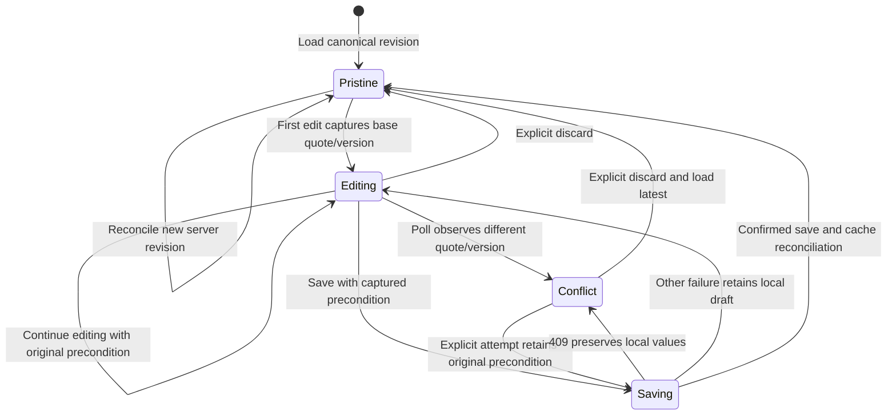
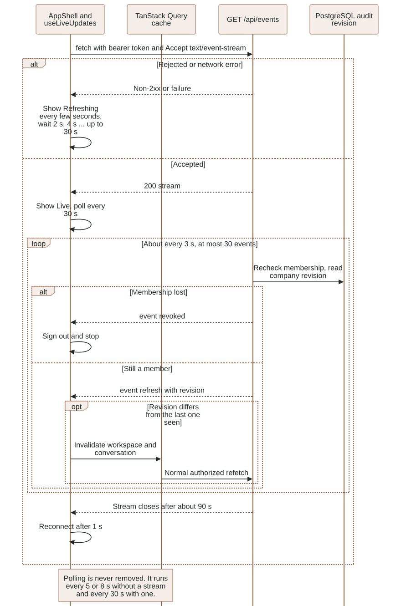
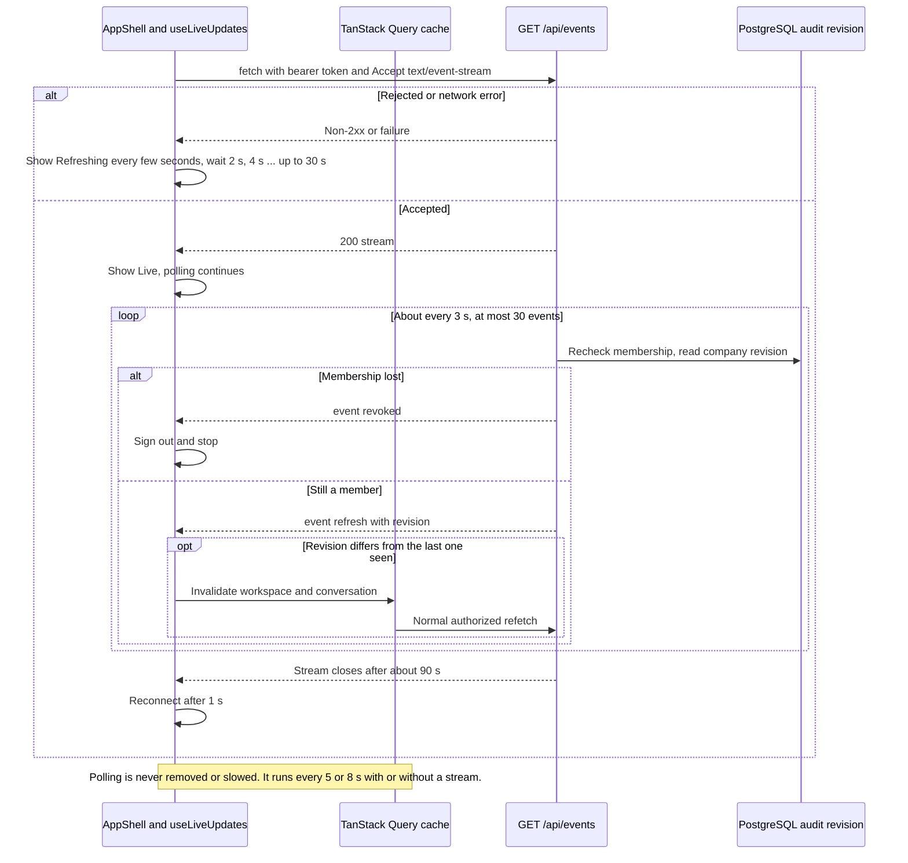

# Frontend ownership, server state and interaction contracts

This reference describes the React/TypeScript/Vite source under
`app/frontend/src`. For visual choices read [DESIGN.md](../../DESIGN.md) and
[UI_DIRECTION.md](../UI_DIRECTION.md); for business rules read
[backend contracts](BACKEND.md). Browser controls improve interaction but do not
grant company access or authorize a send.

### Unsaved quotation edits survive polling and conflicts

Local draft state is separate from the immutable server offer. See the surrounding contract for details and limitations.

<!-- diagram:frontend-draft:start -->

[Open full-size SVG](../diagrams/rendered/frontend-draft.svg) · [Editable Mermaid](../diagrams/frontend-draft.mmd)

Mermaid source

<!-- diagram:frontend-draft:end -->

## Composition and routes

`main.tsx` imports self-hosted fonts/styles and composes React StrictMode,
TanStack Query, `SessionProvider` and `App`. Query defaults use a five-second stale
time and disable window-focus refetch. `app/App.tsx` displays session startup,
sign-in or the authenticated router. `AppShell` owns workspace loading/failure,
navigation, responsive shell and capture-mode context.

Routes are overview `/`, inbox `/inbox/:id?`, new request `/requests/new`,
quotations `/quotations`, catalog `/catalog` and connections `/integrations`.
Any other path renders `NotFoundPage` (`features/not-found`) inside the shell: the
heading "This page does not exist." with links to `/` and `/inbox`. It requests no data
and names no resource.
Feature components own their task; shared modules must not import feature code.

Vite binds to loopback, reads the root environment directory and proxies `/api`
to the native backend. `LUMA_API_PROXY_TARGET` changes that local development
proxy, including isolated browser-test ports. It is not a browser-selected API
destination or a production deployment topology.

## Live updates over an authenticated event stream

### Authenticated live updates with polling fallback

One bearer-authenticated event stream per tab invalidates cached data; polling is unchanged and still covers worker-side results.

<!-- diagram:frontend-live-updates:start -->

[Open full-size SVG](../diagrams/rendered/frontend-live-updates.svg) · [Editable Mermaid](../diagrams/frontend-live-updates.mmd)

Mermaid source

<!-- diagram:frontend-live-updates:end -->

**Actors and authority.** `GET /api/events` requires the staff bearer header
(`HTTPBearer`), so the browser `EventSource` API cannot be used. `shared/api/events.ts`
uses `fetch` and a `ReadableStream` reader instead. The server rechecks company
membership before every event; the browser only reacts. `AppShell` mounts
`useLiveUpdates` once, so there is one stream per tab.

**Call flow.** `openEventStream({ path, token, signal, onEvent, onOpen })` sends
`Authorization: Bearer <token>` and `Accept: text/event-stream`, decodes with a
`TextDecoder` and feeds `parseEventStream(chunk, buffer)` (pure: LF and CRLF, a CR/LF
pair split across chunks, comment lines ignored, several `data:` lines joined). The
server sends `event: refresh` with `data: {"revision": <int>}` about every 3 s,
`event: revoked` when membership fails, and closes after 30 events (about 90 s).

**State and transitions.** `useLiveUpdates` returns `{ connected }`.
- Opened: `connected` becomes true and the failure count resets.
- `refresh` with a revision different from the last one seen (the first one always counts):
  invalidates the `workspace` and `conversation` query keys; TanStack Query refetches
  through the normal API, so authorization and the canonical data path are unchanged.
- `revoked`: `auth.signOut()`, then the loop stops.
- Normal end: reconnect after 1 s; `connected` stays true across that planned gap so the
  topbar label does not flicker.
- Error (non-2xx, network, missing session): `connected` becomes false and the loop
  reconnects after 2 s, 4 s, 8 s ... capped at 30 s.
- Unmount or staff identity change: the stream is aborted and no timer remains.

**Topbar and polling.** The shell shows the text "Live" when connected and "Refreshing
every few seconds" when not (text, not colour alone). Polling does not
change when connected: `useWorkspace` still polls every 8 s and `useConversation` every 5 s.
The stream's revision is the company's maximum `luma.audit` id, and the worker writes no
audit row when it finishes a transcription or an agent job, so those results appear only
through polling. The first version of this task slowed polling to 30 s while connected;
the browser workflow test (a voice note processed by the worker) then waited longer than
its 15 s limit, so the slowdown was removed. Open gap (backend, out of scope here): emit a
revision for worker-side changes, after which polling could be slowed.

**Limits and cost.** One stream per about 90 s is far under the 120 reads per minute
limit. No token or event data is logged or stored by the browser code; failures carry
only a fixed message and the status.

**Tests and evidence.** `shared/api/events.test.ts` covers the parser and the bearer
header; `features/workspace/useLiveUpdates.test.tsx` covers invalidation only on a changed
revision, abort on unmount, reconnect after a normal end, backoff and sign-out on
`revoked` (all with a mocked `fetch`, label `local`).

**Open gaps.** Cross-tab propagation was checked only through the mocked stream tests;
a live two-tab check against the local API is recorded in the work log.

## Session and cache boundary

`shared/auth/client.ts` uses only public Supabase URL/anon configuration. Auth
persists in `sessionStorage` and does not detect callback sessions in the URL.
There is no backend credential-cookie fallback. `SignIn` submits entered staff
credentials to Supabase; it does not create users or embed the generated password.

`SessionProvider` loads the existing session, subscribes to Auth changes and clears
the query cache when the user identity changes. The subscription is detached on
unmount. These are client lifecycle controls; every business API call still
revalidates the token and current membership on the server.

`features/workspace/api.useWorkspace` keys data by staff user ID, polls every eight
seconds and retries a failed query once.
`conversations/api.useConversation` keys by user/conversation, polls every five
seconds and passes query cancellation
to fetch so navigation can cancel stale reads. Company selection is derived by
the server; a browser cache key is not authorization.

`shared/api/client.request<T>` retrieves the current session, attaches its bearer
token and optional stable operation ID, and sends a same-origin request. Its
default JSON content type can be explicitly overridden for raw media. It converts
safe server failures into `ApiError(message, status)` without attaching tokens or
submitted payloads. `T` and generated API aliases are compile-time types; this
helper does not perform independent runtime response-schema validation.

## Mutations and canonical reconciliation

`useConversationAction` accepts a discriminated command plus caller-generated
operation key. It POSTs the command to the selected conversation action and
invalidates conversation/workspace queries after server success. It does not
optimistically display approval or delivery before the server records it.

Local controls disable the relevant pending action and preserve useful errors.
The backend still enforces idempotency, versions, membership, ownership and
capacity. A mutation timeout is not proof that its transaction failed; retries
must preserve the original key/input relationship where that component supports
retry. Do not introduce automatic new-key retries for approvals or uploads.

## Quotation editing and conflict preservation

`useQuotationDraft` owns only unsaved product selections, discount/shipping strings,
dirty state and the base quote/version observed when editing begins. The immutable
server quote remains the source for reviewed totals and status.

When pristine, a confirmed new canonical revision can reconcile local fields.
When dirty, background polling does not overwrite fields or advance their base
version. A conflict is detected when current conversation version or quote ID
differs from the captured base. Saving uses that original precondition; a 409
keeps local values visible. **Discard local edits & load latest** explicitly
resets them. **markSaved** clears dirty state only after confirmed save/reconciliation.

`QuotationPanel` composes the hook, product selection, canonical summary and review
actions. `ui/ProductSelections` owns selection/quantity controls;
`ui/QuoteSummary` displays stored monetary strings; `ui/ReviewActions` submits the
displayed revision decision. The frontend does not calculate authoritative offer
prices or silently grant an admin discount. An illustrative editable quantity is
not a reviewed quotation until saving creates a backend revision.

### Two-step approval confirmation

`ui/ReviewActions` no longer approves with one click. Step 1 is the button "Review
approval" (disabled while a decision is pending or staff owns the conversation). It opens
an inline panel (no `window.confirm`, no browser dialog) that restates the quote number,
revision, customer ("this customer" in capture mode), the server total as
`money(quote.content.total)` (formatting of a server string, never a browser calculation)
and the channel. Only the panel's button, "Approve revision N & queue delivery", calls
`onDecide("approve")`; the decision payload is unchanged (`expected_revision` is the revision
the parent captured). "Cancel" and `Escape` close the panel without a call.

Focus: opening moves focus to the panel heading ("Confirm approval"); Cancel or Escape
returns focus to "Review approval". Staleness: the panel is open only for the quote id and
revision it was opened for. If the displayed id or revision changes, the panel closes and
the text "This quotation changed. Review the new revision." appears (`role="status"`); if
the user begins editing, or the quote leaves `review`, it closes silently. "Request changes"
stays available in both steps. Approval and delivery still appear only after the server
confirms: when the stored status changes the footer shows the server status. Server
authorization, the revision check and idempotency are unchanged and remain authoritative.
Tests: `ui/ReviewActions.test.tsx` (server total string, one approve call, capture wording,
revision and id change, focus, Escape, staff ownership, Request changes) and the browser
workflow, which now clicks "Review approval" and then the revision-numbered button.

## Conversation actors and ownership

`InboxPage` owns selected detail and inbox filtering. `NewRequest` creates a
staff-operated local-test request. `ConversationThread` renders escaped plain
message bodies, explicit customer/staff/assistant/system labels, current ownership,
media state and delivery records.

`ConversationComposer` keeps internal staff note, human customer reply and local
test-customer reply modes distinct. Human reply requires takeover; it records a
queued intent, not a completed delivery. An internal note never impersonates a
customer answer. `Take over`/`Resume agent` uses the displayed optimistic version;
the server rechecks it and blocks incompatible queued work.

Media behavior belongs to [the media reference](MEDIA.md): stable selected-byte
identity/version, explicit upload, authorized normalized preview and temporary
object URL lifetime. `VoiceNoteUpload.test.tsx` retains its historical filename
but now tests the shared `MediaUpload` component.

### Portrait inbox section switcher

At 680 px and below the inbox stacks the conversation list, the thread and the quotation
panel. `SectionSwitch` (a `shared/ui/toggle-group` with two options, "Conversation" and
"Quotation") sits under the list and chooses which one shows; the "Quotation" option carries the
server-derived "Needs approval" badge while the stored quote is in `review`, so the approval
is one tap away. The selection is local state in `InboxPage`, keyed to the selected conversation
(another conversation starts on "Conversation"). Hiding is CSS only
(`.inbox-workspace[data-section]` in `conversations.css`, inside the 680 px media query):
both panels stay mounted, so an unsaved quotation draft and an open approval panel survive
switching. Above 680 px the switcher is `display: none` and the three-column and two-column
layouts are unchanged. Checked locally on 2026-11-03 with a populated conversation: no horizontal
overflow at 390 x 844 in either section or with the approval panel open; "Review approval" is
visible after one tap on "Quotation"; the desktop screenshot at 1440 x 1050 differs before and
after only in the randomly generated quote number (pixel diff of the two runs). The F8 review
repeats the overflow and axe checks for the whole app.

### Assistant job state

`workspace.jobs` holds the 20 newest jobs company-wide (newest first) as
`{id, conversation_id, kind, status, error_code}`. It carries no timestamp and no
progress value, so the UI shows none. `InboxPage` filters the list to the selected
conversation and passes it to `ConversationThread`, which renders `JobState` under the
thread header (the thread still does not read workspace context itself). `JobState`
considers only the newest `agent` job: `queued` shows "Assistant queued", `running`
"Assistant is working" with a spinner, `failed` or `blocked` "Assistant stopped" plus the
error code with underscores as spaces, and `done` shows nothing. The line is a
`role="status"` element with the existing `Status` badge. The spinner is decorative
(`aria-hidden`) and stops under `prefers-reduced-motion`. A job older than the 20 newest
disappears from the list, so a very old stuck job can show no line; that limit comes from
the API. Tests: `JobState.test.tsx` (every status, `done`, other job kinds, error text).

### Voice-note waveform

`MediaPreview` still owns the blob URL lifecycle (one `createObjectURL` through
`documentUrl`, one revoke on replacement or unmount). For audio it renders
`AudioWaveform` with that URL. `AudioWaveform` decodes the local bytes once, draws 64
peak bars in an `aria-hidden` SVG and follows the native player's `timeupdate`,
`seeked` and `ended` events; a mouse click on the bars seeks. Elapsed / total time is
text. If decoding fails or `AudioContext` is missing, only the native player renders.
Capture mode still hides media entirely. Tests: `waveform.test.ts` (silence, a single
spike, fewer samples than buckets, clamping, normalizing, clock format) and
`AudioWaveform.test.tsx` (fallback, decode failure, 64 bars and a single context close).
Not verified: playback progress with a real voice note in a browser (jsdom has no audio
engine); see the work log for the browser check.

## Private documents and temporary capabilities

`shared/api/client.documentUrl` fetches authorized bytes and creates a browser
blob URL. The caller owns its release. It does not return a private Storage path,
signed public download link or bearer token for an iframe URL.

`shared/ui/document-button.tsx` displays a PDF in a native modal dialog, bounds the
requested page, handles pending/error states and revokes its blob on close or
replacement/unmount. `MediaPreview` separately guards late fetch completion after
unmount. Existing document lifecycle tests should be retained when changing modal
or navigation behavior; one wrapper's guard does not prove every consumer has
identical race handling.

Viewing an original catalog page is a provenance action. It does not mean the
product/source is still eligible for a new quote, and the UI does not fabricate
Acrobat-style precise cited-line highlighting.

## Overview, catalog and connection screens

`Overview` derives request/review/quoted counters and the "Assistant jobs running"
count (jobs with status `running` among the 20 newest) from returned stored collections.
It does not invent revenue, conversion improvements or measured hours saved.
`CatalogPage` presents product/source evidence from workspace data.
`QuotationsPage` presents stored revisions and their current lifecycle labels.
`ConnectionsPage` describes intended integrations and displays server configuration
states. Configured/unverified is not a successful provider roundtrip or a receipt.

The connections copy matches the approved architecture (D10, D24). The Google card
says Apps Script sends signed snapshots after edits and on an approximately one-minute
timer, and that Drive export of the approved PDF runs through Apps Script and has not
run in Google yet; it does not mention OAuth or a backend Google client. The LangSmith
card says every step, model call and tool call is exported with inputs and outputs,
with keys, tokens and phone numbers masked. The status badge on each card comes only
from the server (`data.integrations`); the copy never claims a verified connection.
See [Google synchronization](GOOGLE_SYNC.md) and `gas/README.md` for the contract.

## Optional 3D and presentation limits

`Overview` lazy-loads `LightingScene` inside Suspense and `SceneBoundary`.
`LightingScene` builds procedural luminaire geometry with React Three Fiber/Drei,
uses demand rendering and capped device pixel ratio, and offers illustrative
warm/neutral/cool controls. It disables pan/zoom and bounds orbit rotation.

Reduced-motion preference switches to a static fallback and follows preference
changes with listener cleanup. A canvas fallback/error boundary keeps the screen
usable when rendering is unavailable. The geometry and temperature controls are
illustrative, not manufacturer specifications or photometric simulation.

Capture mode (display only, never stored, never in normal mode) does the following.
- Replaces customer names and companies with neutral labels ("Project customer",
  "Commercial customer", "this customer" in the approval panel).
- Hides media upload and previews (media is hidden, not masked).
- Masks free text through `shared/lib/mask.ts` (`maskForCapture`, `captureText`): emails
  become `[email]`; phone numbers become `[phone]` (a leading "+" with 8-15 digits; a bare run
  of 10-15 digits; a separated run of 9-15 digits in three or more groups with a last group of
  three or more digits, never a date); key-shaped secrets (`sk-`, `lsv2_`, `EAA`, JWT) become
  `[secret]`. SKUs, prices, quantities, dates and quote numbers are left alone. The patterns
  follow `PRIVATE` in the browser review scripts. Surfaces: message bodies and delivery
  previews in the thread, the conversation list preview in the inbox and the request table
  preview on the overview. The conversation recipient is not rendered anywhere in the UI.
It does not redact the PDF document (capture mode hides the PDF button), quote terms,
catalog text, names written inside message bodies, addresses, numbers written in words, or
local numbers written in groups of two digits. It is a pattern mask, not a guarantee. Use
labeled synthetic data for LinkedIn captures and inspect the actual image.
Tests: `shared/lib/mask.test.ts`.
Graphite/copper tokens, fonts, layout and responsive rules live in shared/global
and feature CSS; do not scatter one-off visual constants into business services.

## Authored, generated and vendor-owned source

`shared/api/generated.ts` is regenerated from OpenAPI; `types.ts` exposes small
owned aliases. Do not hand-edit generated declarations. shadcn primitive files
form the base UI; document owned wrappers and behavioral modifications rather
than claiming all vendor internals were authored here.

The frontend checker validates authored named contracts, shared-to-feature import
direction and local import cycles. It does not prove UX correctness, every inline
callback's meaning, API authorization or full accessibility. Browser tests cover
the actual tested desktop/portrait flow with Axe and overflow checks; no findings
on that flow is not a whole-app accessibility certification. See
[tooling and tests](TOOLING_AND_TESTS.md).
