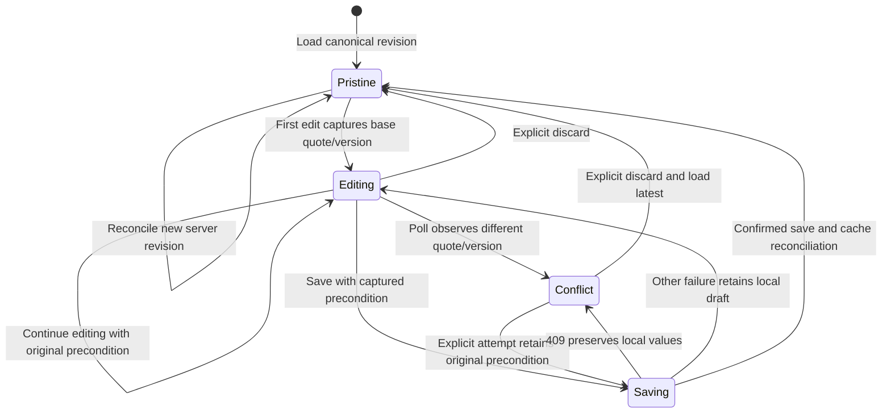
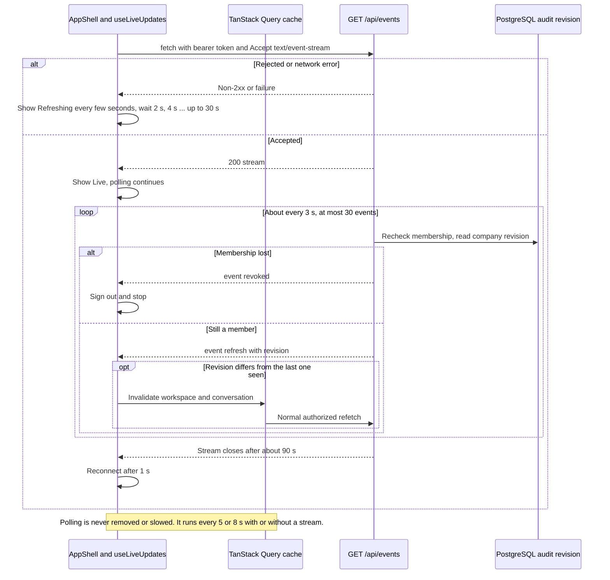

# Frontend ownership, server state and interaction contracts

This reference describes the React/TypeScript/Vite source under
`app/frontend/src`. For visual choices read [DESIGN.md](../../DESIGN.md) and
[UI_DIRECTION.md](../UI_DIRECTION.md); for business rules read
[backend contracts](BACKEND.md). Browser controls improve interaction but do not
grant company access or authorize a send.

### Unsaved quotation edits survive polling and conflicts

Local draft state is separate from the immutable server offer. See the surrounding contract for details and limitations.

<!-- diagram:frontend-draft:start -->

[Open full-size SVG](../diagrams/rendered/frontend-draft.svg) · [Editable Mermaid](../diagrams/frontend-draft.mmd)

Mermaid source

<!-- diagram:frontend-draft:end -->

## Composition and routes

`main.tsx` imports self-hosted fonts/styles and composes React StrictMode,
TanStack Query, `SessionProvider` and `App`. Query defaults use a five-second stale
time and disable window-focus refetch. `app/App.tsx` displays session startup,
sign-in or the authenticated router. `AppShell` owns workspace loading/failure,
navigation, responsive shell and capture-mode context.

Routes are overview `/`, inbox `/inbox/:id?`, new request `/requests/new`,
quotations `/quotations`, inventory `/inventory` (lazy loaded, see
[Inventory page](#inventory-page-order-banner-and-stock-card)), catalog `/catalog` and
connections `/integrations`.
Any other path renders `NotFoundPage` (`features/not-found`) inside the shell: the
heading "This page does not exist." with links to `/` and `/inbox`. It requests no data
and names no resource.
Feature components own their task; shared modules must not import feature code.

Vite binds to loopback, reads the root environment directory and proxies `/api`
to the native backend. `LUMA_API_PROXY_TARGET` changes that local development
proxy, including isolated browser-test ports. It is not a browser-selected API
destination or a production deployment topology.

When multiple checkouts are running, verify the browser's port belongs to the
intended checkout. A server on 5173 may be serving another worktree's source.
From this repository root, `npm run dev --workspace @lumaquote/frontend -- --port 5174`
starts a separate native development server at `http://127.0.0.1:5174`; use that
exact origin to see this checkout's changes. Restart only the Vite process whose
entry path and port match the intended checkout. Existing servers for other
checkouts can keep running. A different port is a different browser origin, so
the staff session may require signing in again. Development source updates do
not require rebuilding `dist`; a production preview serves its last build.

## Live updates over an authenticated event stream

### Authenticated live updates with polling fallback

One bearer-authenticated event stream per tab invalidates cached data; polling is unchanged and still covers worker-side results.

<!-- diagram:frontend-live-updates:start -->

[Open full-size SVG](../diagrams/rendered/frontend-live-updates.svg) · [Editable Mermaid](../diagrams/frontend-live-updates.mmd)

Mermaid source

<!-- diagram:frontend-live-updates:end -->

**Actors and authority.** `GET /api/events` requires the staff bearer header
(`HTTPBearer`), so the browser `EventSource` API cannot be used. `shared/api/events.ts`
uses `fetch` and a `ReadableStream` reader instead. The server rechecks company
membership before every event; the browser only reacts. `AppShell` mounts
`useLiveUpdates` once, so there is one stream per tab.

**Call flow.** `openEventStream({ path, token, signal, onEvent, onOpen })` sends
`Authorization: Bearer <token>` and `Accept: text/event-stream`, decodes with a
`TextDecoder` and feeds `parseEventStream(chunk, buffer)` (pure: LF and CRLF, a CR/LF
pair split across chunks, comment lines ignored, several `data:` lines joined). The
server sends `event: refresh` with `data: {"revision": <int>}` about every 3 s,
`event: revoked` when membership fails, and closes after 30 events (about 90 s).

**State and transitions.** `useLiveUpdates` returns `{ connected }`.
- Opened: `connected` becomes true and the failure count resets.
- `refresh` with a revision different from the last one seen (the first one always counts):
  invalidates the `workspace` and `conversation` query keys; TanStack Query refetches
  through the normal API, so authorization and the canonical data path are unchanged.
- `revoked`: `auth.signOut()`, then the loop stops.
- Normal end: reconnect after 1 s; `connected` stays true across that planned gap so the
  topbar label does not flicker.
- Error (non-2xx, network, missing session): `connected` becomes false and the loop
  reconnects after 2 s, 4 s, 8 s ... capped at 30 s.
- Unmount or staff identity change: the stream is aborted and no timer remains.

**Topbar and polling.** The shell shows the text "Live" when connected and "Refreshing
every few seconds" when not (text, not colour alone). Polling does not
change when connected: `useWorkspace` still polls every 8 s and `useConversation` every 5 s.
The stream's revision is the company's maximum `luma.audit` id, and the worker writes no
audit row when it finishes a transcription or an agent job, so those results appear only
through polling. The first version of this task slowed polling to 30 s while connected;
the browser workflow test (a voice note processed by the worker) then waited longer than
its 15 s limit, so the slowdown was removed. Open gap (backend, out of scope here): emit a
revision for worker-side changes, after which polling could be slowed.

**Limits and cost.** One stream per about 90 s is far under the 120 reads per minute
limit. No token or event data is logged or stored by the browser code; failures carry
only a fixed message and the status.

**Tests and evidence.** `shared/api/events.test.ts` covers the parser and the bearer
header; `features/workspace/useLiveUpdates.test.tsx` covers invalidation only on a changed
revision, abort on unmount, reconnect after a normal end, backoff and sign-out on
`revoked` (all with a mocked `fetch`, label `local`).

**Open gaps.** Cross-tab propagation was checked only through the mocked stream tests;
a live two-tab check against the local API is recorded in the work log.

## Session and cache boundary

`shared/auth/client.ts` uses only public Supabase URL/anon configuration. Auth
persists in `sessionStorage` and does not detect callback sessions in the URL.
There is no backend credential-cookie fallback. `SignIn` submits entered staff
credentials to Supabase; it does not create users or embed the generated password.

`SessionProvider` loads the existing session, subscribes to Auth changes and clears
the query cache when the user identity changes. The subscription is detached on
unmount. These are client lifecycle controls; every business API call still
revalidates the token and current membership on the server.

`features/workspace/api.useWorkspace` keys data by staff user ID, polls every eight
seconds and retries a failed query once.
`conversations/api.useConversation` keys by user/conversation, polls every five
seconds and passes query cancellation
to fetch so navigation can cancel stale reads. Company selection is derived by
the server; a browser cache key is not authorization.

`shared/api/client.request<T>` retrieves the current session, attaches its bearer
token and optional stable operation ID, and sends a same-origin request. Its
default JSON content type can be explicitly overridden for raw media. It converts
safe server failures into `ApiError(message, status)` without attaching tokens or
submitted payloads. `T` and generated API aliases are compile-time types; this
helper does not perform independent runtime response-schema validation.

## Mutations and canonical reconciliation

`useConversationAction` accepts a discriminated command plus caller-generated
operation key. It POSTs the command to the selected conversation action and
invalidates conversation/workspace queries after server success. It does not
optimistically display approval or delivery before the server records it.

Local controls disable the relevant pending action and preserve useful errors.
The backend still enforces idempotency, versions, membership, ownership and
capacity. A mutation timeout is not proof that its transaction failed; retries
must preserve the original key/input relationship where that component supports
retry. Do not introduce automatic new-key retries for approvals or uploads.

## Quotation editing and conflict preservation

`useQuotationDraft` owns only unsaved product selections, discount/shipping strings,
dirty state and the base quote/version observed when editing begins. The immutable
server quote remains the source for reviewed totals and status.

When pristine, a confirmed new canonical revision can reconcile local fields.
When dirty, background polling does not overwrite fields or advance their base
version. A conflict is detected when current conversation version or quote ID
differs from the captured base. Saving uses that original precondition; a 409
keeps local values visible. **Discard local edits & load latest** explicitly
resets them. **markSaved** clears dirty state only after confirmed save/reconciliation.

`QuotationPanel` composes the hook, product selection, canonical summary and review
actions. `ui/ProductSelections` owns selection/quantity controls;
`ui/QuoteSummary` displays stored monetary strings; `ui/ReviewActions` submits the
displayed revision decision. The frontend does not calculate authoritative offer
prices or silently grant an admin discount. An illustrative editable quantity is
not a reviewed quotation until saving creates a backend revision.

### Two-step approval confirmation

`ui/ReviewActions` no longer approves with one click. Step 1 is the button "Review
approval" (disabled while a decision is pending or staff owns the conversation). It opens
an inline panel (no `window.confirm`, no browser dialog) that restates the quote number,
revision, customer ("this customer" in capture mode), the server total as
`money(quote.content.total)` (formatting of a server string, never a browser calculation)
and the channel. Only the panel's button, "Approve revision N & queue delivery", calls
`onDecide("approve")`; the decision payload is unchanged (`expected_revision` is the revision
the parent captured). "Cancel" and `Escape` close the panel without a call.

Focus: opening moves focus to the panel heading ("Confirm approval"); Cancel or Escape
returns focus to "Review approval". Staleness: the panel is open only for the quote id and
revision it was opened for. If the displayed id or revision changes, the panel closes and
the text "This quotation changed. Review the new revision." appears (`role="status"`); if
the user begins editing, or the quote leaves `review`, it closes silently. "Request changes"
stays available in both steps. Approval and delivery still appear only after the server
confirms: when the stored status changes the footer shows the server status. Server
authorization, the revision check and idempotency are unchanged and remain authoritative.
Tests: `ui/ReviewActions.test.tsx` (server total string, one approve call, capture wording,
revision and id change, focus, Escape, staff ownership, Request changes) and the browser
workflow, which now clicks "Review approval" and then the revision-numbered button.

## Conversation actors and ownership

`InboxPage` owns selected detail and inbox filtering. `NewRequest` creates a
staff-operated local-test request. `ConversationThread` renders escaped plain
message bodies, explicit customer/staff/assistant/system labels, current ownership,
media state and delivery records.

`ConversationComposer` keeps internal staff note, human customer reply and local
test-customer reply modes distinct. Human reply requires takeover; it records a
queued intent, not a completed delivery. An internal note never impersonates a
customer answer. `Take over`/`Resume agent` uses the displayed optimistic version;
the server rechecks it and blocks incompatible queued work.

Media behavior belongs to [the media reference](MEDIA.md): stable selected-byte
identity/version, explicit upload, authorized normalized preview and temporary
object URL lifetime. `VoiceNoteUpload.test.tsx` retains its historical filename
but now tests the shared `MediaUpload` component.

### Portrait inbox section switcher

At 680 px and below the inbox stacks the conversation list, the thread and the quotation
panel. `SectionSwitch` (a `shared/ui/toggle-group` with two options, "Conversation" and
"Quotation") sits under the list and chooses which one shows; the "Quotation" option carries the
server-derived "Needs approval" badge while the stored quote is in `review`, so the approval
is one tap away. The selection is local state in `InboxPage`, keyed to the selected conversation
(another conversation starts on "Conversation"). Hiding is CSS only
(`.inbox-workspace[data-section]` in `conversations.css`, inside the 680 px media query):
both panels stay mounted, so an unsaved quotation draft and an open approval panel survive
switching. Above 680 px the switcher is `display: none` and the three-column and two-column
layouts are unchanged. Checked locally on 2026-11-03 with a populated conversation: no horizontal
overflow at 390 x 844 in either section or with the approval panel open; "Review approval" is
visible after one tap on "Quotation"; the desktop screenshot at 1440 x 1050 differs before and
after only in the randomly generated quote number (pixel diff of the two runs). The F8 review
repeats the overflow and axe checks for the whole app.

### Assistant job state

`workspace.jobs` holds the 20 newest jobs company-wide (newest first) as
`{id, conversation_id, kind, status, error_code}`. It carries no timestamp and no
progress value, so the UI shows none. `InboxPage` filters the list to the selected
conversation and passes it to `ConversationThread`, which renders `JobState` under the
thread header (the thread still does not read workspace context itself). `JobState`
considers only the newest `agent` job: `queued` shows "Assistant queued", `running`
"Assistant is working" with a spinner, `failed` or `blocked` "Assistant stopped" plus the
error code with underscores as spaces, and `done` shows nothing. The line is a
`role="status"` element with the existing `Status` badge. The spinner is decorative
(`aria-hidden`) and stops under `prefers-reduced-motion`. A job older than the 20 newest
disappears from the list, so a very old stuck job can show no line; that limit comes from
the API. Tests: `JobState.test.tsx` (every status, `done`, other job kinds, error text).

### Voice-note waveform

`MediaPreview` still owns the blob URL lifecycle (one `createObjectURL` through
`documentUrl`, one revoke on replacement or unmount). For audio it renders
`AudioWaveform` with that URL. `AudioWaveform` decodes the local bytes once, draws 64
peak bars in an `aria-hidden` SVG and follows the native player's `timeupdate`,
`seeked` and `ended` events; a mouse click on the bars seeks. Elapsed / total time is
text. If decoding fails or `AudioContext` is missing, only the native player renders.
Capture mode still hides media entirely. Tests: `waveform.test.ts` (silence, a single
spike, fewer samples than buckets, clamping, normalizing, clock format) and
`AudioWaveform.test.tsx` (fallback, decode failure, 64 bars and a single context close).
Not verified: playback progress with a real voice note in a browser (jsdom has no audio
engine); see the work log for the browser check.

## Private documents and temporary capabilities

`shared/api/client.documentUrl` fetches authorized bytes and creates a browser
blob URL. The caller owns its release. It does not return a private Storage path,
signed public download link or bearer token for an iframe URL.

`shared/ui/document-button.tsx` displays a PDF in a native modal dialog, bounds the
requested page, handles pending/error states and revokes its blob on close or
replacement/unmount. `MediaPreview` separately guards late fetch completion after
unmount. Existing document lifecycle tests should be retained when changing modal
or navigation behavior; one wrapper's guard does not prove every consumer has
identical race handling.

Viewing an original catalog page is a provenance action. It does not mean the
product/source is still eligible for a new quote, and the UI does not fabricate
Acrobat-style precise cited-line highlighting.

## Overview, catalog and connection screens

`Overview` derives request/review/quoted counters and the "Assistant jobs running"
count (jobs with status `running` among the 20 newest) from returned stored collections.
"Open conversations" uses `isOpenConversation` (`features/overview/conversationGroups.ts`):
`quoted`, `order_pending`, `declined` and `ordered` are not open requests (the customer
answered or the order moved on); `needs_staff` stays open. A stock card below the metric
strip shows low-stock products, orders to confirm and open alerts and links to `/inventory`.
It does not invent revenue, conversion improvements or measured hours saved.
`CatalogPage` presents product/source evidence from workspace data.
`QuotationsPage` presents stored revisions and their current lifecycle labels.
`ConnectionsPage` describes intended integrations and displays server configuration
states. Configured/unverified is not a successful provider roundtrip or a receipt.

The connections copy matches the approved architecture (D10, D24). The Google card
says Apps Script sends signed snapshots after edits and on an approximately one-minute
timer, and that Drive export of the approved PDF runs through Apps Script and has not
run in Google yet; it does not mention OAuth or a backend Google client. The LangSmith
card says every step, model call and tool call is exported with inputs and outputs,
with keys, tokens and phone numbers masked. The status badge on each card comes only
from the server (`data.integrations`); the copy never claims a verified connection.
See [Google synchronization](GOOGLE_SYNC.md) and `gas/README.md` for the contract.

## Inventory page, order banner and stock card

Decision D49, plan task T6. Backend contracts: [Inventory](INVENTORY.md). Owner of the code:
`app/frontend/src/features/inventory/`. Nothing here is authority: every number, status and
refusal comes from the staff API, and nothing is shown optimistically.

**Actors and role handling.** Any staff role reads everything and may confirm or cancel customer
orders, acknowledge alerts, download Excel and request a Google Sheets export. Only administrators
create, receive and cancel purchase orders, adjust stock and set reorder levels. The UI learns the
role from the existing workspace payload (`data.role` from `GET /api/workspace`, reached through
`useWorkspaceContext`), so no backend change was needed. `InventoryPage` passes `isAdmin` down;
`StockTable` omits Adjust and Reorder level, and `PurchaseOrdersTab` omits New purchase order,
Receive goods and Cancel purchase order for a salesperson. This is convenience only: the server
returns 403 "administrators only" and the dialogs show that sentence inline if it ever happens.

**Screens.**
- `/inventory?tab=stock|orders|purchase-orders|alerts` (default `stock`; the tab is in the URL so
  the overview and alerts can deep-link). Tabs: Stock (`StockTable`, text search over SKU, name
  and family, status filter, columns SKU, name, family, on hand, reserved, available, reorder
  level and a status chip), Customer orders (`OrdersTab`, pending first), Purchase orders
  (`PurchaseOrdersTab`) and Alerts (`AlertsTab`: stored shortage and refused-acceptance alerts
  with Acknowledge, plus the live low-stock table).
- Status chip rule (`stockState`): `Out` when available <= 0, `Low` when the server flag `low`
  is set (available <= reorder level, discontinued never), else `OK`. Chips always carry an icon
  and a text label; order and purchase-order chips follow the same rule, so colour is never the
  only signal.
- Dialogs (`shared/ui/dialog.tsx`, Radix Dialog, no animation): `AdjustDialog` (signed whole
  number except zero, reason 3 to 200 characters), `ReorderDialog` (0 to 100000),
  `CancelOrderDialog` (reason 3 to 200), `NewPurchaseOrderDialog` (supplier 1 to 120, optional
  date and notes up to 500, 1 to 100 lines, one per product, quantity 1 to 100000, unit cost 0 to
  1,000,000 with two decimals; the product picker hides products already on another line),
  `ReceiveDialog` (a box per line with units outstanding; a value above the outstanding quantity
  shows "Cannot exceed the N still outstanding." and keeps the button disabled) and
  `MovementsDrawer` (right-hand drawer, 50 movements per page, "Load older movements"). Focus
  moves into the dialog on open and back to the trigger on close; Escape closes; every input has
  a label; server errors (409 stock below reserved, 403, 429) are shown inline in `role="alert"`
  with the typed values kept.
- `ExportToolbar`: **Download Excel** calls `downloadFile("/inventory/export.xlsx")` (bearer token,
  Blob, filename from `Content-Disposition`) and clicks a temporary object URL that is revoked
  at once. **Export to Google Sheets** POSTs `/inventory/sheet-exports`, writes the reply into the
  status cache and then `useSheetExport` re-reads `/inventory/sheet-exports/latest` every 5 s
  while the status is `queued` or `claimed`. The status line (`aria-live="polite"`) says
  "Queued. Apps Script picks it up within about a minute.", "Apps Script is writing the Google
  Sheet...", "Done at 8:01 AM. Rows written: Stock 12, Customer Orders 3, Purchase Orders 2." or
  "Failed (code). You can export again."; the button is disabled while queued or claimed.
- `OrderBanner` (inside `QuotationPanel`, above the quote): when this conversation has a pending
  order the banner reads "Customer accepted LQ-... revision n" with **Confirm order** and
  **Cancel order**. The API has no per-conversation filter, so the banner reads
  `GET /api/orders?status=pending` (the same query the overview card uses) and picks the order
  whose `conversation_id` matches. It renders nothing while loading or on error.
- Statuses: `Status` labels `accepted` "Customer accepted", `declined` "Customer declined",
  `order_pending` "Order to confirm", `ordered` "Order confirmed" (quote and conversation lists).
- `InventoryNavCount` adds a count badge to the "Inventory" nav item: `counts.total` of
  `GET /api/inventory/alerts` (open shortage and refused-acceptance alerts plus low-stock
  products). It renders nothing at zero, while loading or on error. The mobile menu also links
  Inventory because the fourth and later nav items are hidden on narrow screens.

**Query keys** (`inventoryKeys` in `api.ts`, all start with `inventory` and carry the user id):
`["inventory","stock",uid]`, `["inventory","alerts",uid]` (re-read every 15 s for the badge),
`["inventory","orders",uid,status|"all"]` (every 15 s), `["inventory","purchase-orders",uid]`,
`["inventory","movements",uid,productId]` (infinite query, cursor `before`),
`["inventory","sheet-export",uid]`. `useLiveUpdates` invalidates the `inventory` prefix on
every company revision change, together with `workspace` and `conversation`.

**Mutations.** `useCommand` in `api.ts` POSTs JSON with a new `crypto.randomUUID()`
`Idempotency-Key` per click and, after the server answers, invalidates `["inventory"]`,
`["workspace"]` (catalog availability, quote status) and `["conversation"]` (conversation status).
Hooks: `useAdjust`, `useSetReorderLevel`, `useConfirmOrder`, `useCancelOrder`,
`useCreatePurchaseOrder`, `useReceivePurchaseOrder`, `useCancelPurchaseOrder`,
`useAcknowledgeAlert`; `useQueueSheetExport` writes the reply into the cache; the download is a
GET, so it carries no key.

**Failures.** A failed list shows the server sentence in place of the list; a failed badge,
banner or stock card shows nothing or an em dash instead of an invented zero, so an inventory
outage never blocks the shell. A 429 on the download (10 per minute) is shown beside the buttons.

**Tests and evidence.** Vitest files in `features/inventory/` (stock table rows, chips, filters
and role hiding; banner confirm with idempotency key and cache invalidation, server error,
cancel reason; receive dialog over-receipt refusal and partial receipt; export toolbar queued
then done by polling; nav badge; purchase tab role hiding and line bounds) and
`features/overview/conversationGroups.test.ts`. Label: `local` (jsdom with a mocked API; no real
browser look at the new screens, no axe run, no live data).

**Open gaps.** No browser (Playwright) or axe review of the inventory page yet, and the page was
not looked at in a real browser. Local Supabase was unavailable while T6 was written. Receipts
cannot be undone from the UI (use an adjustment). The movement drawer does not show who made a
movement (the API returns an actor id, not a name). Orders are listed up to the API's 200; no
paging.

## Optional 3D and presentation limits

Seven lazy scenes and one interactive inspector exist. The scenes are decorative. None carries information the working screens need,
and every one is hidden from assistive technology or labelled as illustrative. The inbox, the
conversation thread, quotation editing and the new-request form have no 3D: they are working
surfaces.

| Scene | Where | What it shows | Interaction |
|---|---|---|---|
| `features/overview/LightingScene.tsx` | Overview hero, right half (380 px tall, 250 px under 680 px width) | Three brass track heads on a rail wash a fluted wall with light scallops over a glossy floor. Beams are additive cones and floor pools are additive glow planes. | On load the heads ignite in sequence (0.6 s delay, 0.45 s stagger, short flicker). They sweep slowly and aim toward the pointer. The camera drifts and follows the pointer slightly. The warm/neutral/cool radios cross-fade the light colour. |
| `features/showcase/PendantField.tsx` | Sign-in story panel, full bleed behind the copy (`aria-hidden`) | 15 brass dome pendants on cords, in a fixed layout so captures repeat. The headline sits at the bottom under a CSS scrim. | Bulbs ignite in a left-to-right wave, sway gently and brighten near the pointer. |
| `features/catalog/FixtureShowroom.tsx` | Catalog: the visual area of every product tile (`aria-hidden`) | One modelled fixture per family, chosen from the SKU prefix: downlight (DL), track spot (TR), high bay (HB), linear (LN), emergency (EM), wall lantern (OD); unknown prefixes show the downlight. Brass reflects a procedural studio map. | Lamps ignite in a quick stagger and turn slowly. Hovering or focusing a card brightens its lamp and turns it to face the viewer. |
| `features/overview/MetricRail.tsx` | Overview, a 110 px band above the metric strip (hidden under 900 px; `aria-hidden`) | A track rail with one lamp over each metric column. Lamp brightness (`brightness`: 0 is an ember, 10 or more is full) and a row of up to 12 beads follow the stored count printed below. | Lamps ignite left to right, beads light one by one, and two light pulses run along the rail and flare each lamp they pass. |
| `features/catalog/FixtureInspector.tsx` | Catalog, a native modal `<dialog>` opened by the "Inspect in 3D" button on a tile (shown only once the tile stage is live) | The product's family model installed at full size over a floor, with a light cone and floor pool for downward lamps (downlight, high bay, linear) and a point light for the others. | Drag to orbit, wheel or pinch to zoom (drei `OrbitControls`, no pan, slow auto-rotate until first touch). Real controls: light on/off, colour temperature 2700/3000/4000/5000 K (opens at the value nearest the product CCT), exploded view, and "Turn 45°" for keyboard users. Escape or the close button closes it; the tile canvas pauses while it is open. |
| `features/integrations/ConnectionHub.tsx` | Connections, a 280 px band under the heading (230 px under 680 px; `aria-hidden`) | The workspace as a brass ring with a glowing core, and Supabase plus the five services as nodes with cables. Each node is lit from the same status the list shows: 1 for a connected status, 0.5 for `configured_unverified`, 0 for `not_connected`, `disabled`, `failed` or `blocked` (`levelOf` in `ConnectionsPage.tsx`). Lit cables carry light pulses toward the hub; half-lit ones pulse slower and dimmer. Labels are canvas-texture sprites. | Nodes ignite in order. The camera drifts and follows the pointer. |
| `features/quotations/RevisionStack.tsx` | Quotations heading, in place of the icon (250 x 150 px; hidden under 680 px; `aria-hidden`) | Up to four blank quotation sheets (one per listed revision) and a brass seal. The sheet texture has no names, prices or products, so capture mode needs nothing from it. | Sheets deal in one by one, the seal presses down, then the stack floats and leans toward the pointer. |
| `features/not-found/LostPendant.tsx` | 404 page, a 340 px panel under the buttons (260 px under 680 px; `aria-hidden`) | One pendant whose bulb has nearly gone out. | The lamp swings slowly; the bulb sputters on a fixed, repeatable pattern. |

Shared mechanics live in `features/showcase/sceneKit.ts`:
- `useScenePlayback` reports the live reduced-motion preference. It sets `frameloop="never"`
  while the canvas is off screen (IntersectionObserver) or the tab is hidden, so idle pages use
  no GPU.
- `glowTexture` caches one radial-gradient texture for halos.
- `ignition` is the pure easing for the staggered switch-on.
- `studioEnvironment` builds three's procedural `RoomEnvironment` once per renderer, prefilters it
  and caches it, so brass has reflections without a network HDRI.
- `kelvinColour` turns a colour temperature into a display colour (Tanner Helland's curve fit),
  for the inspector's light; it is a tint, not colorimetry.

`features/catalog/fixtureModels.tsx` holds the six family models and their poses; the tiles and the
inspector share it. The inspector's exploded view moves every mesh outward from the model centre
along its own offset (further for the lens), computed once from the mounted model, so a new model
needs no explode data. Its dialog opens with `showModal()` in an effect with no cleanup: closing in
a cleanup fired `close` under StrictMode and unmounted the inspector at once.

Page transitions: sidebar and mobile-menu links pass react-router's `viewTransition`, so
navigation runs inside `document.startViewTransition`. Only `.workspace-main`
(`view-transition-name: workspace-page`) animates: the old page fades up and out in 150 ms, the new
one rises and un-blurs in 320 ms. Browsers without the API navigate instantly; reduced motion sets
every transition animation to none (`shell.css`).

`features/showcase/reducedMotion.ts` holds `useReducedMotion`, which imports no Three.js. Pages
use it to decide whether to request a 3D chunk at all; `useScenePlayback` uses it too.

The catalog draws all tiles through one canvas. `FixtureCanvas` is fixed to the viewport at
`z-index: 5`, under the sticky mobile bar (10) and dialogs, and has `pointer-events: none` on its
own wrapper (R3F otherwise sets `auto` and the canvas swallows every click). Each tile renders a
drei `View` that tunnels its scene into that canvas, which scissor-renders it into the tile's
rectangle every frame; tiles off screen are skipped. Each View paints an opaque background, which
also clears its rectangle. The View sits 6 px inside the tile so its square corners never cover
the card's rounded ones. Once the WebGL context exists, `onReady` sets `data-stage="on"` on the
grid, which darkens the tiles and lifts the family label above the canvas. Without WebGL it never
fires and the CSS fixtures stay.

All animation mutates Three.js objects inside `useFrame`. React state never changes per frame.
Device pixel ratio is capped at 1.75.

Reduced motion creates no canvas. `Overview` shows the static `LightingFallback`. `SignIn` shows
the plain panel gradient. The catalog keeps its CSS fixtures, Quotations keeps its icon, and
Connections and the 404 page show nothing extra; these pages do not even request the 3D chunk.
`tests/integration/test_scene_review.py` enforces this for Overview; the other pages were
checked by script (zero canvases on all four, desktop and mobile). Each scene sits inside
`SceneBoundary`, which takes an optional `fallback` (`null` for most; Quotations passes its icon).
The canvas `fallback` covers missing WebGL. The geometry and temperature controls are
illustrative, not manufacturer specifications or photometric simulation.

Bundle: Three.js and every scene load in lazy chunks. The shared chunk is 919 kB. Scene chunks:
FixtureShowroom 14.1 kB, ConnectionHub 5.1 kB, RevisionStack 2.9 kB, LostPendant 2.9 kB,
PendantField 55.8 kB. The entry chunk holds no Three.js (628 kB on 2026-11-07 after the merges;
only page wiring and `useReducedMotion` were added to it). The sign-in page now requests the shared chunk, so the first
paint of sign-in no longer avoids Three.js. drei's `MeshReflectorMaterial` was tried and dropped:
it rendered black under software WebGL, and nobody verified it on a real GPU.

**Re-review (2026-11-07, `local-substitute`)** after the showcase rework
([evidence](../evidence/scene-review-2026-11-07.json)):
- Axe reports zero violations on desktop, portrait and reduced motion.
- Reduced motion creates no canvas.
- The radios stay keyboard operable.
- OrbitControls was removed, so the pointer is the only scene input.

Frame rate on a real GPU was not measured.

**Inspector, rail and transitions (2026-11-07, `local-substitute`).** Inspector screenshotted at
1440 x 900 and 390 x 844 (lit at 3000 K; exploded at 5000 K), Escape closed it, no console errors.
Overview rail and a mid-transition frame captured. Reduced motion: zero canvases, no rail and no
inspect buttons. Ideas came from public references: lighting-brand configurators rebuilt in React
Three Fiber with animated part assembly (Bock Lighting case study), lamp-viewer briefs asking for a
glow on/off toggle, and dashboard-plus-3D and data-flow entries on Awwwards.

**More scenes (2026-11-07, `local-substitute`).** Catalog, Connections, Quotations and 404 were
screenshotted at 1440 x 900 and 390 x 844 in headless Chromium with software WebGL, with motion on
and reduced. All six fixture families were captured. The catalog canvas stayed under the evidence
dialog's overlay and under the sticky mobile bar while scrolling. No console errors. The first hub
version used drei `Html` labels, which logged React "synchronously unmount a root" errors; canvas
sprite labels replaced them. Not measured: frame rate on a real GPU, and the cost of 72 Views on a
low-end device.

**Review (2026-11-03, `local-substitute`).** `tests/integration/test_scene_review.py` drives
headless Chromium with software WebGL through `tests/browser/scene-review.cjs`
([evidence](../evidence/scene-review-2026-11-03.json)). It found a serious axe violation
(`aria-prohibited-attr`: the canvas wrapper had `aria-label` without a role), fixed with
`role="img"`. Earlier accessibility runs used reduced motion, so they never rendered the canvas.
Keyboard: the canvas is not a tab stop and orbit is pointer-only, an accepted limit because orbit
conveys nothing; the temperature radios work with arrow keys and show a 3 px focus outline. The
production build keeps Three.js out of the entry chunk (entry 616 kB, 179 kB gzip; scene chunk
934 kB, 248 kB gzip, loaded on demand). Timings are from the dev server and are not a performance
claim. Capture privacy: no credential, email or phone pattern in the overview text.

`tests/integration/test_page_review.py` reviews 14 views (six pages and one populated conversation,
at 1440 px and 430 px) for axe violations, overflow, landmarks, unnamed controls and WCAG 2.2 target
size of at least 24 x 24 px ([evidence](../evidence/page-accessibility-review-2026-11-03.json)). It
found undersized controls (a 14 px icon button, a 23 px remove button, 18 px text links), now
fixed in CSS and enforced by the test. Automated axe is not a screen-reader review.
Before axe runs, `page-review.cjs` and `ui-review.cjs` wait up to 15 s for an `h1`. The app's
loading screen is also a `<main>` without one, and a fixed 700-800 ms wait sometimes scanned it and
reported `page-has-heading-one` on a random page (seen 2026-11-07). If no `h1` appears, axe still
runs and the test still fails.

Capture mode changes displayed customer labels and hides media upload/previews.
It does not comprehensively redact messages, PDFs or every potential identifier.
Use labeled synthetic data for LinkedIn captures and inspect the actual image.

Capture mode (display only, never stored, never in normal mode) does the following.
- Replaces customer names and companies with neutral labels ("Project customer",
  "Commercial customer", "this customer" in the approval panel).
- Hides media upload and previews (media is hidden, not masked).
- Masks free text through `shared/lib/mask.ts` (`maskForCapture`, `captureText`): emails
  become `[email]`; phone numbers become `[phone]` (a leading "+" with 8-15 digits; a bare run
  of 10-15 digits; a separated run of 9-15 digits in three or more groups with a last group of
  three or more digits, never a date); key-shaped secrets (`sk-`, `lsv2_`, `EAA`, JWT) become
  `[secret]`. SKUs, prices, quantities, dates and quote numbers are left alone. The patterns
  follow `PRIVATE` in the browser review scripts. Surfaces: message bodies and delivery
  previews in the thread, the conversation list preview in the inbox and the request table
  preview on the overview. The conversation recipient is not rendered anywhere in the UI.
It does not redact the PDF document (capture mode hides the PDF button), quote terms,
catalog text, names written inside message bodies, addresses, numbers written in words, or
local numbers written in groups of two digits. It is a pattern mask, not a guarantee. Use
labeled synthetic data for LinkedIn captures and inspect the actual image.
Tests: `shared/lib/mask.test.ts`.
Graphite/copper tokens, fonts, layout and responsive rules live in shared/global
and feature CSS; do not scatter one-off visual constants into business services.

## Whole-app review and its limits

The 2026-11-03 review ([evidence](../evidence/ui-review-2026-11-03.json), `local-substitute`) found
no axe violation, horizontal overflow, console error or privacy-pattern match in 19 views. It also
showed: Tab reaches the skip link on press 1, the conversation list on press 12, the composer on 17
and "Review approval" on 23; the "Live" label appears about 0.9 s after load; a note posted in a
second browser appears in the first in about 1.4 s (1374 ms). The first page opens two `/api/events`
requests in this dev run because React StrictMode mounts effects twice in development (the first
stream is aborted); a production build opens one. Controls under 24 x 24 CSS px are recorded
(about 2 to 4 per view: the "Capture mode" button, the text links "Review your workspace",
"View all", "Connection status" and "Back to inbox", and the 23 x 23 "Remove" line button) and are
not asserted; they are an open WCAG 2.2 target-size gap. Not covered: the live WebGL scene
(reduced motion shows the static fallback), screen readers, real devices and a production-build
performance budget. Dev-server timings were 48 to 75 ms `domContentLoaded` and 396 to 556 ms LCP.
Full-page screenshots taken after a scroll show the fixed skip link and sticky header at the
scroll offset; that is a capture artifact, the skip link is off-screen for real users.

## Authored, generated and vendor-owned source

`shared/api/generated.ts` is regenerated from OpenAPI; `types.ts` exposes small
owned aliases. Do not hand-edit generated declarations. shadcn primitive files
form the base UI; document owned wrappers and behavioral modifications rather
than claiming all vendor internals were authored here.

The frontend checker validates authored named contracts, shared-to-feature import
direction and local import cycles. It does not prove UX correctness, every inline
callback's meaning, API authorization or full accessibility. Browser tests cover
the actual tested desktop/portrait flow with Axe and overflow checks; no findings
on that flow is not a whole-app accessibility certification. See
[tooling and tests](TOOLING_AND_TESTS.md).
