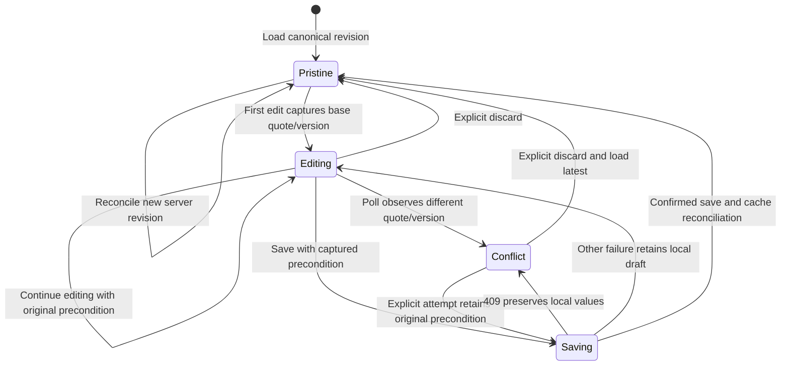

# Frontend ownership, server state and interaction contracts

This reference describes the React/TypeScript/Vite source under
`app/frontend/src`. For visual choices read [DESIGN.md](../../DESIGN.md) and
[UI_DIRECTION.md](../UI_DIRECTION.md); for business rules read
[backend contracts](BACKEND.md). Browser controls improve interaction but do not
grant company access or authorize a send.

### Unsaved quotation edits survive polling and conflicts

Local draft state is separate from the immutable server offer. See the surrounding contract for details and limitations.

<!-- diagram:frontend-draft:start -->

[Open full-size SVG](../diagrams/rendered/frontend-draft.svg) · [Editable Mermaid](../diagrams/frontend-draft.mmd)

Mermaid source

<!-- diagram:frontend-draft:end -->

## Composition and routes

`main.tsx` imports self-hosted fonts/styles and composes React StrictMode,
TanStack Query, `SessionProvider` and `App`. Query defaults use a five-second stale
time and disable window-focus refetch. `app/App.tsx` displays session startup,
sign-in or the authenticated router. `AppShell` owns workspace loading/failure,
navigation, responsive shell and capture-mode context.

Routes are overview `/`, inbox `/inbox/:id?`, new request `/requests/new`,
quotations `/quotations`, catalog `/catalog` and connections `/integrations`.
Unknown routes currently show overview rather than a dedicated not-found page.
Feature components own their task; shared modules must not import feature code.

Vite binds to loopback, reads the root environment directory and proxies `/api`
to the native backend. `LUMA_API_PROXY_TARGET` changes that local development
proxy, including isolated browser-test ports. It is not a browser-selected API
destination or a production deployment topology.

## Session and cache boundary

`shared/auth/client.ts` uses only public Supabase URL/anon configuration. Auth
persists in `sessionStorage` and does not detect callback sessions in the URL.
There is no backend credential-cookie fallback. `SignIn` submits entered staff
credentials to Supabase; it does not create users or embed the generated password.

`SessionProvider` loads the existing session, subscribes to Auth changes and clears
the query cache when the user identity changes. The subscription is detached on
unmount. These are client lifecycle controls; every business API call still
revalidates the token and current membership on the server.

`features/workspace/api.useWorkspace` keys data by staff user ID, polls every eight
seconds and retries a failed query once. `conversations/api.useConversation`
keys by user/conversation, polls every five seconds and passes query cancellation
to fetch so navigation can cancel stale reads. Company selection is derived by
the server; a browser cache key is not authorization.

`shared/api/client.request<T>` retrieves the current session, attaches its bearer
token and optional stable operation ID, and sends a same-origin request. Its
default JSON content type can be explicitly overridden for raw media. It converts
safe server failures into `ApiError(message, status)` without attaching tokens or
submitted payloads. `T` and generated API aliases are compile-time types; this
helper does not perform independent runtime response-schema validation.

## Mutations and canonical reconciliation

`useConversationAction` accepts a discriminated command plus caller-generated
operation key. It POSTs the command to the selected conversation action and
invalidates conversation/workspace queries after server success. It does not
optimistically display approval or delivery before the server records it.

Local controls disable the relevant pending action and preserve useful errors.
The backend still enforces idempotency, versions, membership, ownership and
capacity. A mutation timeout is not proof that its transaction failed; retries
must preserve the original key/input relationship where that component supports
retry. Do not introduce automatic new-key retries for approvals or uploads.

## Quotation editing and conflict preservation

`useQuotationDraft` owns only unsaved product selections, discount/shipping strings,
dirty state and the base quote/version observed when editing begins. The immutable
server quote remains the source for reviewed totals and status.

When pristine, a confirmed new canonical revision can reconcile local fields.
When dirty, background polling does not overwrite fields or advance their base
version. A conflict is detected when current conversation version or quote ID
differs from the captured base. Saving uses that original precondition; a 409
keeps local values visible. **Discard local edits & load latest** explicitly
resets them. **markSaved** clears dirty state only after confirmed save/reconciliation.

`QuotationPanel` composes the hook, product selection, canonical summary and review
actions. `ui/ProductSelections` owns selection/quantity controls;
`ui/QuoteSummary` displays stored monetary strings; `ui/ReviewActions` submits the
displayed revision decision. The frontend does not calculate authoritative offer
prices or silently grant an admin discount. An illustrative editable quantity is
not a reviewed quotation until saving creates a backend revision.

## Conversation actors and ownership

`InboxPage` owns selected detail and inbox filtering. `NewRequest` creates a
staff-operated local-test request. `ConversationThread` renders escaped plain
message bodies, explicit customer/staff/assistant/system labels, current ownership,
media state and delivery records.

`ConversationComposer` keeps internal staff note, human customer reply and local
test-customer reply modes distinct. Human reply requires takeover; it records a
queued intent, not a completed delivery. An internal note never impersonates a
customer answer. `Take over`/`Resume agent` uses the displayed optimistic version;
the server rechecks it and blocks incompatible queued work.

Media behavior belongs to [the media reference](MEDIA.md): stable selected-byte
identity/version, explicit upload, authorized normalized preview and temporary
object URL lifetime. `VoiceNoteUpload.test.tsx` retains its historical filename
but now tests the shared `MediaUpload` component.

## Private documents and temporary capabilities

`shared/api/client.documentUrl` fetches authorized bytes and creates a browser
blob URL. The caller owns its release. It does not return a private Storage path,
signed public download link or bearer token for an iframe URL.

`shared/ui/document-button.tsx` displays a PDF in a native modal dialog, bounds the
requested page, handles pending/error states and revokes its blob on close or
replacement/unmount. `MediaPreview` separately guards late fetch completion after
unmount. Existing document lifecycle tests should be retained when changing modal
or navigation behavior; one wrapper's guard does not prove every consumer has
identical race handling.

Viewing an original catalog page is a provenance action. It does not mean the
product/source is still eligible for a new quote, and the UI does not fabricate
Acrobat-style precise cited-line highlighting.

## Overview, catalog and connection screens

`Overview` derives request/review/quoted counters from returned stored collections.
It does not invent revenue, conversion improvements or measured hours saved.
`CatalogPage` presents product/source evidence from workspace data.
`QuotationsPage` presents stored revisions and their current lifecycle labels.
`ConnectionsPage` describes intended integrations and displays server configuration
states. Configured/unverified is not a successful provider roundtrip or a receipt.

The connections copy still contains legacy Google OAuth/Drive wording while the
approved backend architecture is Apps Script-only and Drive export is unfinished.
Follow [Google synchronization](GOOGLE_SYNC.md) and `gas/README.md` for the actual
contract; this documentation task records that UI-copy gap rather than changing
product behavior silently.

## Optional 3D and presentation limits

`Overview` lazy-loads `LightingScene` inside Suspense and `SceneBoundary`.
`LightingScene` builds procedural luminaire geometry with React Three Fiber/Drei,
uses demand rendering and capped device pixel ratio, and offers illustrative
warm/neutral/cool controls. It disables pan/zoom and bounds orbit rotation.

Reduced-motion preference switches to a static fallback and follows preference
changes with listener cleanup. A canvas fallback/error boundary keeps the screen
usable when rendering is unavailable. The geometry and temperature controls are
illustrative, not manufacturer specifications or photometric simulation.

Capture mode changes displayed customer labels and hides media upload/previews.
It does not comprehensively redact messages, PDFs or every potential identifier.
Use labeled synthetic data for LinkedIn captures and inspect the actual image.
Graphite/copper tokens, fonts, layout and responsive rules live in shared/global
and feature CSS; do not scatter one-off visual constants into business services.

## Authored, generated and vendor-owned source

`shared/api/generated.ts` is regenerated from OpenAPI; `types.ts` exposes small
owned aliases. Do not hand-edit generated declarations. shadcn primitive files
form the base UI; document owned wrappers and behavioral modifications rather
than claiming all vendor internals were authored here.

The frontend checker validates authored named contracts, shared-to-feature import
direction and local import cycles. It does not prove UX correctness, every inline
callback's meaning, API authorization or full accessibility. Browser tests cover
the actual tested desktop/portrait flow with Axe and overflow checks; no findings
on that flow is not a whole-app accessibility certification. See
[tooling and tests](TOOLING_AND_TESTS.md).
