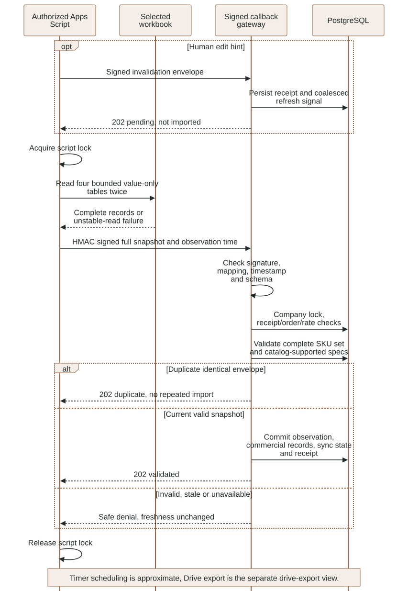
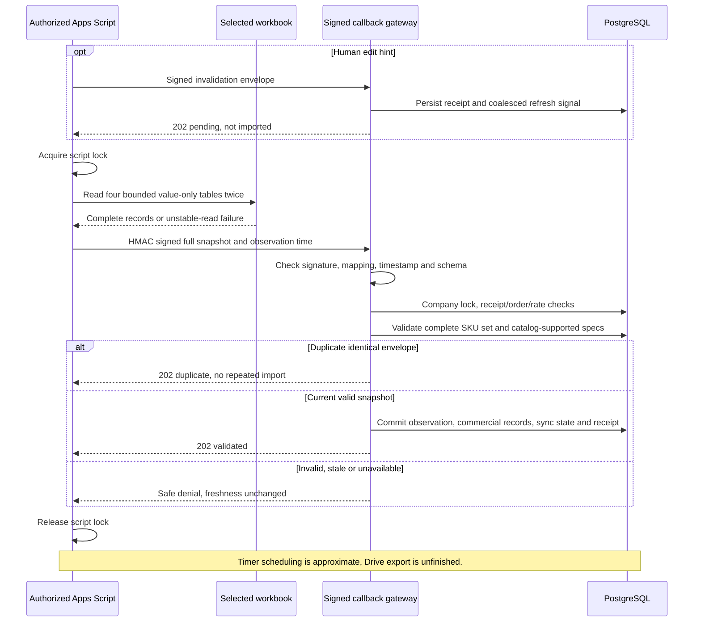

# Apps Script transport and validated commercial snapshots

This reference explains the existing working-tree Google integration, including
concurrent integration work. It does not claim this documentation task performed
new account authorization, trigger installation, remote push or live Sheet reads.
Use [gas/README.md](../../gas/README.md) for the account/setup runbook and
[Google progress evidence](../evidence/google-gas-progress.json) for observed results.

### Signed Apps Script snapshot validation and atomic publication

Implemented GAS transport; live timer and complete account verification remain separate. See the surrounding contract for details and limitations.

<!-- diagram:google-snapshot:start -->

[Open full-size SVG](../diagrams/rendered/google-snapshot.svg) · [Editable Mermaid](../diagrams/google-snapshot.mmd)

Mermaid source

<!-- diagram:google-snapshot:end -->

## Authority and process boundary

Google Apps Script is the approved Google Workspace adapter. The user's authorized
script reads a selected workbook and pushes signed records. The Python backend
does not need a Google OAuth client/refresh token. GAS still needs the user's
Google authorization for its declared scopes; Apps Script-only does not mean
anonymous access to Sheets.

The workbook supplies commercial prices, observed stock and allowed product policy
fields. Independently ingested catalog evidence supplies supported specifications.
The receiver cannot treat a newly typed SKU/specification as automatically backed
by a PDF. Quotes, approvals and delivery states remain backend-owned.

`luma.google_gateway:app` exposes only callback routes on loopback port 8002, with
API docs disabled. An authorized temporary tunnel targets that gateway rather than
the staff API, Supabase or Studio. The receiver has no staff bearer-token contract;
it authenticates exact callback bytes with the configured shared HMAC secret.

## GAS source responsibilities

- `Configuration.gs`: reads required Script Properties; requires an HTTPS callback
  URL ending `/callbacks/google`; signs exact UTF-8 payload bytes as lowercase
  SHA-256 HMAC hex. Secrets are never worksheet cells or frontend configuration.
- `Workbook.gs`: initializes the dedicated synthetic workbook non-destructively
  and inspects intended workbook/tab state. Existing populated tabs are preserved;
  successful initialization is not proof those tabs match an intended dataset.
- `Notifications.gs`: installs only the owned edit handler, verifies expected
  workbook/tab, sends an invalidation hint and then attempts a complete snapshot.
- `Synchronization.gs`: reads complete bounded tables twice, rejects unstable
  reads, signs a full snapshot and manages the owned approximate one-minute timer.
- `appsscript.json`: V8, Africa/Cairo timezone and Sheets/script-trigger/external-
  request scopes. Drive access/export is not implemented by declaring these scopes.

`scripts/google.cjs` wraps selected clasp operations using the ignored `.clasp.json`
project mapping, fixed argument arrays and bounded execution. `google:push` manages
source; it is not proof a trigger ran or a remote execution succeeded. Inspect
private result files for failed clasp run operations without copying credentials.

## Envelope authentication and replay

Both receivers require `X-Luma-Signature`, exactly 64 lowercase hexadecimal
characters. The secret must have at least 32 characters and company/workbook
mapping must be configured. The backend computes HMAC over the raw body and uses
constant-time comparison before trusting parsed data.

Version-1 envelopes carry configured company/workbook, timestamp, UUID nonce and
event. Mapping must match configuration and timestamp must be within five minutes.
Snapshots additionally reject observations more than five seconds in the future.
HMAC authenticates origin/content; it does not by itself prove commercial records
are valid, current or catalog-backed.

Under the company advisory lock, receipts use nonce plus byte fingerprint. Identical
replay is acknowledged without importing twice; changed bytes under the same nonce
return 409. Fresh-nonce older snapshots also return 409 rather than rolling back
current data. Receipts older than ten minutes are cleaned during receiver calls;
there is no separate scheduled backend retention job for them.

## Invalidation hint versus full snapshot

`POST /callbacks/google` accepts at most 4,096 actual bytes and the
`supplier_records_changed` event. It persists the replay receipt and one coalesced
refresh signal before returning 202/pending. A maximum of 120 new hints/minute
per company is counted under the same lock. This acknowledgment is not imported
price data and must not refresh commercial freshness.

`POST /callbacks/google/snapshot` accepts at most 512 KiB and the
`supplier_snapshot` event with complete Products, Prices, Inventory and Policies.
It caps at 30 new snapshots/minute per company. Database work has a five-second
statement timeout and failures return unavailable rather than accepted. The HTTP
routes enforce actual bytes, but do not currently implement the staff media
route's explicit 30-second absolute streaming deadline.

The gateway shares safe response/error middleware. Being a separate composition
reduces exposed routes; it does not establish a complete production TLS, ingress
abuse or deployment policy.

## Whole-snapshot validation

Schemas reject unknown fields. Product/price/inventory tables each contain
1..1,000 records; policies contain 1..50. Each table must have unique stable keys,
and the three SKU sets must be identical. Backend catalog SKU set must also match
exactly: a partial snapshot cannot quietly drop existing products.

Product name/family/watts/lumens/CCT/IP must match already ingested catalog records.
Input pack size and discontinued state can update as validated policy fields.
Stock is a bounded nonnegative strict integer; prices are finite nonnegative USD
decimals with at most two decimal places and no future effective date in Cairo.
Location is recorded input, not a delivery guarantee or stock reservation.

Policies must contain exactly the approved values and primitive types: synthetic
dataset disclosure, USD, tax excluded, seven-day validity, max admin discount 10,
stock_reserved false and staff-confirmed delivery. A truthy string is not accepted
as the boolean policy. Unsupported policy changes require an intentional contract
change rather than a silent import.

## Atomic publication and offer freshness

The receiver canonicalizes validated product/price/inventory records ordered by
SKU and computes a digest. A changed digest creates a new snapshot identity. An
unchanged digest reuses its snapshot and refreshes observation time. It then
updates existing products' price, available quantity, pack size, discontinued
state and snapshot ID; saves sync state/source tables; inserts the receipt; and
clears refresh signals covered by that observation. These writes commit together.

Rejected data does not update observation time or commercial fields. Older quote
content is never rewritten. At approval/dispatch the quotation's snapshot must
still match product records and be fresh enough, so changed data invalidates old
finalization even without directly editing each historical quote row.

## Trigger/reconciliation limitations

Manual edit triggers cover allowed human edits; API edits may not fire them.
The timer takes a fresh complete read to reconcile missed changes. GAS uses a
script lock to coordinate its own invocations and double-reads tables to detect
changes during capture. Those controls do not create an atomic Sheets transaction
across tabs or lock out independent users/API writers.

The timer is approximate. The backend's 90-second freshness gate is an independent
denial control, not a promise that Google delivers each run within 60 seconds.
Failed pushes update safe script status properties and leave backend freshness
unchanged; the next eligible trigger reads again. URL changes require updating the
callback property and keeping the intended gateway/tunnel alive.

Drive canonical-PDF export, independent export retry, Quote Register automatic
writes and complete live full-snapshot/timer evidence remain unfinished. Existing
comment text in the edit handler about backend fetching is older than the GAS-only
push design; actual calls send the snapshot from GAS. Follow code and this
contract rather than inferring an unimplemented backend Google fetcher.

## Diagnosis without leaking integration data

- 401: verify exact raw-byte signing, timestamp and secret privately; never paste it.
- 403: verify company/workbook mapping, not a caller-selected replacement tenant.
- 409: inspect nonce reuse or observation order; retry with a fresh complete read.
- 422: inspect schema/SKU/spec/policy differences; ingest catalog evidence before
  importing new technical records.
- 429/503: preserve current state and wait for bounded reconciliation; do not mark
  stale stock fresh manually or expose the staff API to bypass the receiver.

Local callback/snapshot tests exercise actual persistence and invalid cases.
Live evidence belongs to its dated artifact and must remain separate from local
substitutes and from a successful clasp source upload.
