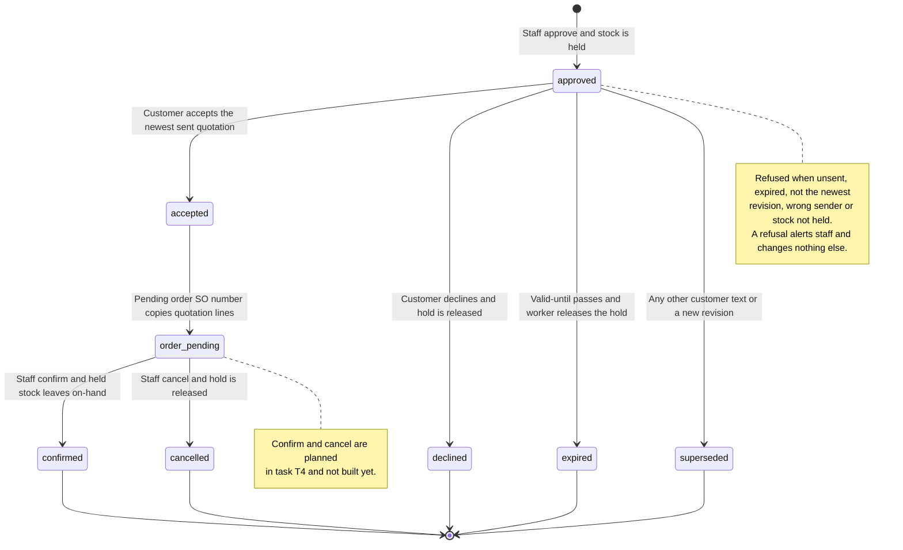

# Inventory: the stock ledger

Decision [D49](../DECISIONS.md), plan [stock, orders and purchasing](../proposals/2026-11-07-stock-orders-plan.md).
This guide describes what is implemented in tasks T1, T2 and T3: the tables, the single writer
(`app/backend/luma/features/inventory/ledger.py`), the read queries, how the rest of
the application reads stock, and the reservation lifecycle (hold at approval, release on
every exit, the dispatch check and the worker's reconcile) and customer acceptance (the
pending order a customer's Accept creates). Order confirmation and cancellation, purchase
orders, exports and the UI are later tasks; they are listed under
[Open gaps](#open-gaps) and are not described as working.

## Purpose and ownership

The web app is the stock master. Google Sheets still syncs Products and Prices but no
longer supplies stock; the `Inventory` tab is still validated and hashed into the snapshot
digest, and its values are ignored (`google_sync/snapshots.py` writes no stock). Stock is
a ledger, not a number someone overwrites:

- `luma.stock_movements` is the append-only history (kinds `opening`, `adjustment`,
  `receipt`, `order`, `order_cancel`).
- `luma.stock_levels` caches `on_hand` and `reserved` per (company, product), plus the
  admin-editable `reorder_level` (default 20).
- `luma.stock_reservations` holds stock for an approved quotation (`held`), then closes it
  as `released` or `converted`.
- Available is `on_hand - reserved`. It is never stored; every reader computes it.

`ledger.py` is the only code allowed to write the first three tables. Other code calls its
functions inside its own transaction. Authorization is not decided here: routes (task T4)
check the role (admin-only adjustments and receipts) before calling the ledger.

## Invariants

For every company and product, always, after each committed transaction:

1. `stock_levels.on_hand = sum(stock_movements.delta)`.
2. `stock_levels.reserved = sum(stock_reservations.quantity where status = 'held')`.
3. `0 <= reserved <= on_hand` (table check, plus the ledger refusing the write first).
4. Movements are never updated or deleted: `luma_api` has select/insert, `luma_worker`
   select only, and nobody has update or delete.
5. A reservation exists at most once per (quote, product) and `closed_at` is set exactly
   when it is not `held`.

`tests/integration/test_stock_ledger.py` re-computes 1-3 from the raw tables after a mixed
sequence (reserve, receive, release, convert, adjust, cancel) and after each refused write.

Movement signs are fixed by table checks: `opening`, `receipt` and `order_cancel` are
positive, `order` is negative, `adjustment` is either (reason of 3-200 characters required).
A movement needs a non-zero delta, so a product with zero stock has a level row and no
opening movement.

## Data model

Created by migration `20261107030000_stock_ledger.sql`; ownership, grants and RLS are
summarized in [Data model](DATA_MODEL.md#stock-order-and-purchasing-records). The migration
also creates the order, purchase-order, alert, Sheets-export and document-counter tables
that later tasks fill, extends `quotes.status` with `accepted` and `declined`, copies every
product's `available` into a level row (and an `opening` movement when it is above zero),
then drops `products.available`. The backfill and the dropped column are proved by
`test_stock_ledger_backfills_every_product_then_drops_available`; row-level security on all
ten tables and the append-only grants by `test_stock_tables_are_protected_and_the_ledger_is_append_only`.

Both application roles read and write levels and reservations (the API at approval,
adjustment and receipt time; the worker when it releases). Only the API role inserts
movements. The partial unique index `sheet_exports_one_open` limits a company to one
queued or claimed Sheets export.

## Ledger functions

All take the caller's open psycopg transaction (dict rows) and never commit.

| Function | Effect |
|---|---|
| `lock_levels(conn, company, product_ids)` | `select ... for update` in ascending product id; returns rows by product id; creates nothing |
| `apply_movement(conn, company, product_id, delta, kind, actor, reference_id=None, reason=None)` | One movement and the on-hand change; creates a missing level row; returns the level |
| `held_quantities(conn, company, quote_id)` | Read only: held quantity per product of one quote; the dispatch check uses it |
| `reserve_quote(conn, company, quote)` | All-or-nothing hold of every quote line; idempotent per (quote, product) |
| `release_quote(conn, company, quote_id, reason)` | `held` to `released`, lowers `reserved`; idempotent; no movement |
| `convert_quote(conn, company, quote_id, order_id, actor)` | `held` to `converted`, lowers `reserved` and writes `order` movements together; idempotent |
| `reconcile(conn, company=None)` | Safety net, see below |
| `seed_opening(conn, company, product_id, quantity, actor)` | Level row plus opening movement for a new product; used by the local seed and test fixtures |

Errors are `DomainError` with safe messages: 409 for a result below zero or below reserved
and for "Stock changed. Create a new revision."; 422 for a zero delta, unknown kind or an
adjustment without a 3-200 character reason; 404 for a product that is not in the company.

Concurrency: the caller locks conversation, then quote; the ledger then locks level rows
in ascending product id, all of a call's products before any write. Two approvals racing
for the last units therefore serialize on the level rows and exactly one succeeds
(`test_two_approvals_race_for_the_last_units`, two worker-role connections). `release_quote`
and `convert_quote` read the held product ids without a lock, lock the levels, then lock
the reservation rows, the same order `reserve_quote` uses.

Idempotency: `reserve_quote` skips lines already `held`; a line whose reservation was
released or converted cannot be held again (409), because approval is once per quote.
`release_quote` and `convert_quote` return 0 when nothing is held. `convert_quote` after a
release moves no stock.

## Reconcile rules

`reconcile` examines up to 200 quotes that still have `held` reservations (one company, or
all when `company` is `None`) with `for update of q skip locked`; a quote another
transaction holds is retried on the next call. It locks all involved levels (companies and
product ids sorted) before changing anything, releases through `release_quote` and writes a
`stock.released` audit event with actor `system`. A quote is released when:

| Condition | Release reason | Quote status |
|---|---|---|
| status is not `approved` or `accepted` (superseded, rejected, declined, expired) | `quote_<status>` | unchanged |
| `approved` and `valid_until <= now()` | `expired` | set to `expired` |
| `approved` and its quotation outbox has a `blocked` or `failed` row and no row that is `queued`, in flight, delivered, read, local-delivered or `unknown` | `delivery_failed` | unchanged |

Never released: an `accepted` quote (it keeps its hold until staff confirm or cancel the
order, even past `valid_until`), an `approved` quote with any `unknown` outbox row (the
mail or message may have reached the customer), a quote whose outbox is still queued or
delivered and has not expired, and an approved quote with no outbox row yet.
One interpretation to be aware of: an `unknown` delivery is spared by the delivery rule
only; an unknown-delivery quote that passes `valid_until` is still released and marked
`expired`, since the customer can no longer accept it. Each case is a test in
`test_reconcile_rules`.

## Reservation lifecycle (task T2)

A quotation's stock is held from its approval until it is released or converted:
`review` -> approve -> `approved` with `held` reservations -> `released` (superseded, blocked,
failed, expired, taken over) or `converted` (order confirmed, task T4).

**Hold.** `quotations/approval.decide` calls `ledger.reserve_quote` right after
`check_snapshot` and before it writes the approval, the quotation outbox row or the Drive
export row, all in the one request transaction. Lock order: conversation, then quote, then
stock levels in ascending product id. A request for more than `on_hand - reserved` raises the
ledger's 409 "Stock changed. Create a new revision."; the transaction rolls back, so no approval,
outbox row, Drive export, reservation or `reserved` change survives
(`test_a_ledger_refusal_after_the_snapshot_check_rolls_the_whole_approval_back`). The earlier
`check_snapshot` availability check gives the same 409 in the common case (stock gone before
the click); the ledger check is the one that wins a race. Two staff approving 60 + 60 units of a
100-unit product at once: exactly one succeeds
(`test_two_approvals_race_for_the_last_units_and_exactly_one_wins`).

**Dispatch check.** `check_snapshot(conn, quote, current, dispatch=True)`, called from
`quotations/dispatch.check_quotation` (through `messaging/authorization.authorize_outbound`) with
the quote row locked, replaces the `available >= quantity` test, which would count the quote's own
hold against itself, with "the quote's `held` reservations equal its summed line quantities per
product". A missing, released, converted or differently sized hold raises `DomainError`; the
dispatcher then blocks the intent with `dispatch_revalidation` and releases whatever is left.
At approval time `dispatch=False` keeps the original available check, because no hold exists yet.

**Release triggers.** Every one calls `ledger.release_quote`, which is idempotent.

| Trigger | Where | Reason stored |
|---|---|---|
| Customer text arrives (any channel) | `conversations/participation.accept_customer_text`, for each review/approved quote it supersedes | `superseded` |
| Customer photo or voice note | `media/intake.accept_media`, same rule | `superseded` |
| Staff saves a new revision | `quotations/drafting.draft`, before stock is read so the old hold does not count against the new lines; it rolls back with a refused draft | `superseded` |
| Staff takeover blocks a queued quotation send | `conversations/participation.change_ownership`, for the quotes of the outbox rows it just blocked | `staff_takeover` |
| A gate or the revalidation blocks the send | `messaging/outbound.block`; `runtime/delivery.deliver_one` for `live_adapter_not_enabled` and `dispatch_revalidation` | `delivery_blocked` |
| The provider definitely did not take it | `messaging/outbound.record` when the result is `failed` | `delivery_failed` |
| Gmail mail not collected in 24 h, or PDF over 5 MiB | `messaging/email_dispatch.sweep`, `claim_mail` | `delivery_failed` |
| Anything missed, and expiry | `ledger.reconcile` from the worker | `quote_<status>`, `expired`, `delivery_failed` |
| Operator retention deletes a conversation idle for 90 days | `scripts/retention.py` releases its held reservations, then deletes the reservation rows before the quotes | `retention` |

`unknown` outcomes never release, because the message may have reached the customer: not
`record` with `unknown`, not the 2-minute stale-`submitting` sweep, not an expired Gmail lease.
A takeover does not touch a send that is already `submitting` or `submitted`; its hold stays.
Takeover releases explicitly instead of waiting for reconcile because the blocked send can never
go out, and the hold would otherwise keep stock from other customers; reconcile still covers
it if that release were ever missed. A WhatsApp `failed` delivery receipt
(`messaging/inbound.apply_status`) is left to reconcile, which sees the `failed` outbox row on
its next tick.

**Worker.** `worker.tick` ends with `reconcile_stock()`: `ledger.reconcile(conn)` for all
companies in its own `database(worker=True)` transaction with a 10-second statement timeout.
A failure is logged as the exception class only and never stops the loop. The worker role's
existing grants suffice (select/update on the ledger tables, `update(status)` and row locks on
`quotes`, insert on `audit`), so no new migration was needed. Proved by
`test_worker_reconcile_releases_an_expired_approved_quote` and
`test_tick_runs_reconcile_once_and_a_failure_never_stops_the_loop`.

**Quotation content and PDF.** The hashed quotation content keeps `stock_reserved: false`:
content is immutable and fixed at draft time, before any hold exists, so it cannot report one.
The authoritative record of a hold is `luma.stock_reservations`. The PDF sentence now reads
"Availability is a snapshot. Stock is held for this quotation until it expires." (the PDF is not
part of the content hash). PDFs already stored for earlier quotes keep their old wording.

## Customer acceptance and orders (task T3)

<!-- diagram:order-lifecycle:start -->

[Open full-size SVG](../diagrams/rendered/order-lifecycle.svg) · [Editable Mermaid](../diagrams/order-lifecycle.mmd)

Mermaid source

<!-- diagram:order-lifecycle:end -->

**Actors and authority.** A customer on Telegram, Gmail or WhatsApp (or the staff-operated local
test reply) may accept or decline the newest sent quotation of their own conversation. No AI is
involved. The agent and the worker only record the answer; they cannot confirm an order or move
on-hand stock. Staff confirm or cancel an order in task T4.

**Recognizing the answer** (`orders/acceptance.py`, `parse_answer`). Lowercase, trim, collapse
spaces, strip trailing `.` and `!`; the whole message (at most 40 characters) must equal one phrase.
Accept: `accept`, `i accept`, `accepted`, `yes i accept`, `yes, i accept`, `accept quotation`,
`accept the quotation`, `i accept the quotation`. Decline: `decline`, `i decline`, `declined`,
`reject`, `no thanks`, `decline quotation`. Plain `yes` is not an acceptance (D46 uses YES to confirm
an order restatement). Anything else, such as "accept but change qty to 20", is ordinary text and
supersedes the offer as before. Unit table: `tests/unit/test_acceptance_phrases.py`.

**Call flow.** `participation.accept_customer_text` (typed text, every channel) and
`participation.accept_quote_button` (Telegram button) run under the caller's conversation lock,
rate limit (six per minute per conversation) and message store (`provider_id` dedupe). A phrase
match goes to `orders/service.answer_quote` and the function returns before the supersede update,
so an answer never supersedes a quotation or queues an agent job.

**Binding rules** (`service.refusal_reason`, then `answer_quote`). The target is the newest
revision of the conversation (row-locked). It is answerable only when all hold: status `approved`;
`valid_until > now()`; `recipient` equals the conversation's recipient; a quotation outbox row is
`submitted`, `delivered`, `read` or `local_delivered` (not `queued`, `blocked`, `failed`, `unknown`);
and every product still has a `held` reservation equal to its line quantity. A button's `quote_id`
must equal that target. Otherwise the answer is refused with an opaque reason (`no_quotation`,
`not_current_quotation`, `not_open`, `expired`, `recipient_mismatch`, `not_sent`, `stock_not_held`).

| Outcome | Writes (one transaction, no commit here) |
|---|---|
| `accepted` | quote -> `accepted`; `orders` row (`pending`, `SO-0001` from `document_counters` under a row lock, created on first use) and `order_lines` copied from the immutable quote content (prices, names, total, currency never recomputed; customer name and company from the conversation); hold kept; conversation `order_pending`; audit `order.accepted`; notice |
| `already_accepted` (accept again) | no new order; conversation status restated; the same confirmation notice is queued again for the new message |
| `declined` | quote -> `declined`; `ledger.release_quote(..., 'declined')`; conversation `declined`; audit `quotation.declined`; notice |
| `refused` | `stock_alerts` row `acceptance_refused` (open); conversation `needs_staff`; audit `order.acceptance_refused` with the reason code and the path (`reply` or `telegram_button`); the refusal notice; nothing superseded, no agent job |

A decline of an already accepted quote is refused (`not_open`): the order and its hold stay.
Order numbers are gap-tolerant (a rolled-back acceptance rolls its increment back too).

**Fixed notices** (English, `orders/service.py`), queued only while the agent owns the conversation
through the outbox pattern of `conversations/service.queue_notice` (moved there from
`messaging/inbound` so orders can use it without an import cycle; action key
`inbound-notice:<provider id>`, so a redelivered message queues one). Under staff ownership the
answer is applied (an order can still be created from a delivered quotation) and the conversation
becomes `needs_staff`; no notice is queued.

- Accepted: "Thank you. Your acceptance of quotation {number}, revision {n}, is recorded. Our sales team will confirm your order."
- Declined: "Thank you. Quotation {number} is declined. Send a new request any time."
- Refused: "This quotation can no longer be accepted. Our sales team will contact you."

**Revising an accepted quotation.** `quotations/drafting.draft` refuses (409) a new revision while
the latest one is `accepted`. Otherwise the draft would mark the accepted quotation `superseded`
and the next `ledger.reconcile` would release the order's reservation. Staff handle the order first
(cancel is task T4).

**Delivery wording.** The quotation caption ends with "Reply ACCEPT to accept or DECLINE to
decline." in `outbound.begin` (WhatsApp, Telegram, Gmail body) and in the local-test text
(`runtime/delivery._deliver_local`). Telegram also attaches inline buttons; see
[TELEGRAM](TELEGRAM.md#quotation-buttons-accept-and-decline-d49).

**Retention.** `scripts/retention.py` skips a conversation that has an order (a business record) and
deletes the `stock_alerts` of the conversations it removes.

**Failures.** A database error rolls the whole answer back (the customer message too) and the inbox
row is retried or failed by the normal rules; a refusal is a value, never an exception, so the
inbox row finishes `done`. Rate limiting returns 429 for typed local replies and requeues inbox rows.
Tests: `tests/integration/test_stock_acceptance.py` (label `local`; the Telegram and Gmail parts are
`local-substitute`).

## How the rest of the application reads stock

Every former reader of `products.available` now joins `stock_levels` and computes
`on_hand - reserved` (zero when the row is missing): quotation drafting and its
`rules.calculate` input, `quotations/freshness.check_snapshot`, the agent's `prepare` node,
the staff workspace product list (the API payload keeps an `available` field, so the UI
contract is unchanged) and `scripts/evaluate_scenarios.py`. Freshness checks
`available >= quantity` at approval and the quote's own held reservations at dispatch
(see the reservation lifecycle above).

`inventory/queries.py` (read-only, scoped by company, current non-retired sources only):
`stock_rows`, `low_stock_rows` and `low_stock_count` (`available <= reorder_level`,
discontinued products are never low; computed live and never stored), `movements_page`
(keyset on `(created_at, id)` newest first; limit 1-200; returns `items` and the `next`
cursor), and `open_alerts`.

## Failures and recovery

- A refused write raises `DomainError` before any row is written; the caller's transaction
  rolls back as a whole, so a partial reservation cannot persist.
- A crash between approval and dispatch leaves holds that `reconcile` later releases when
  the quote expires or its delivery is dead. Nothing releases a hold from a customer's
  `unknown` delivery automatically (until the quote expires); staff decide.
- If `reconcile` fails (database down, statement timeout), the worker logs the error class
  and retries on the next one-second tick; holds only stay longer, stock is never lost.
- A release hook that raises inside a request rolls that request back (for example a
  customer message is then not stored). The hooks write only rows the caller already locks,
  so the practical cause is a database outage, which fails the whole request anyway.
- If the ledger and a reader ever disagreed, the movements are the authority: recompute
  `on_hand` as their sum. No repair command exists yet.
- Data loss risk: the migration drops `products.available` irreversibly. The local database is
  the only database (D06); the copied values are in the ledger as opening movements.

## Operation

- Apply with `npm run setup` (it records applied files in `public.luma_migrations`). Seeded
  products get their opening stock from `seed_opening`, so a rerun leaves current stock alone.
- Tests: `node scripts/python.cjs -m pytest tests/integration/test_stock_ledger.py tests/integration/test_migrations.py`.
  The shared `environment` fixture seeds three products (100, 100 and 0 units) through
  `seed_opening` and deletes the ledger rows of its tenant on teardown.
- Evidence label for these tests: `local` (isolated local Supabase).

## Open gaps

- `stock_reserved` in the hashed quotation content stays `false` by design (see above). PDFs
  stored before T2 keep the old "does not reserve stock" sentence. The review-screen text in
  `QuoteSummary.tsx` is only reworded; the inventory UI is task T6.
- A WhatsApp `failed` delivery receipt does not release at once; reconcile does within a tick.
- Quotes approved and queued before T2 have no hold and are blocked at dispatch.
- Release on order cancel belongs to task T4. Release on customer decline is done (T3).
- A pending order has no staff screen or route yet. Confirm, cancel, acknowledging
  `acceptance_refused` alerts and the status labels `order_pending` and `declined` in the UI are
  tasks T4 and T6 (the UI falls back to "order pending" and "declined" text, and the overview
  counts those conversations as open).
- A customer who accepted and then writes ordinary text re-opens nothing: the accepted quotation
  stays, the agent is queued, and its draft is refused with a 409 until staff handle the order.
- An accept typed with extra words or an email signature ("Accept, thanks") is ordinary text.
- Purchase orders, adjustments and reorder-level routes, exports and the UI are not built
  (tasks T4-T6); their tables exist and are empty.
- Google sync still requires the `Inventory` table to be present (task T5 makes it optional).
- No automatic repair of a ledger/level mismatch and no stock-take reconciliation workflow.
- Diagrams for the ledger and order state machine are task T7.
