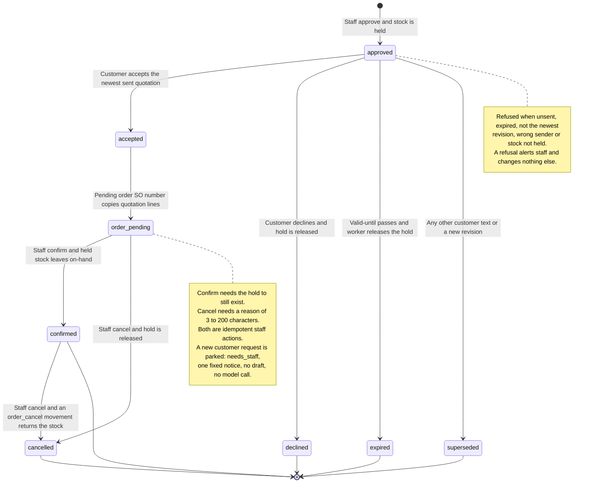
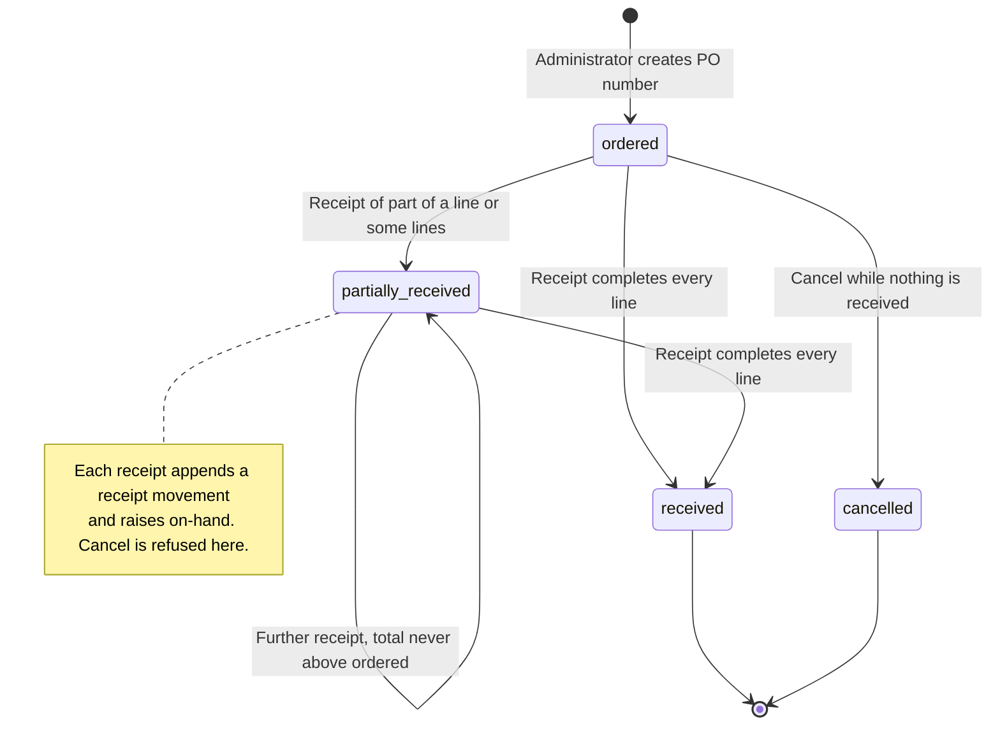
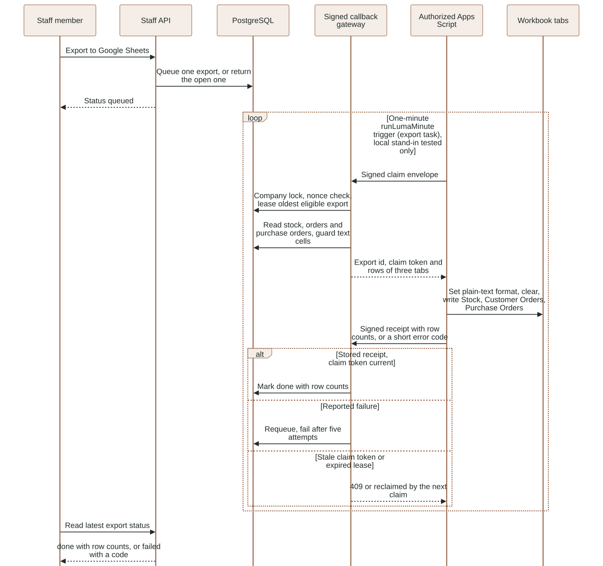
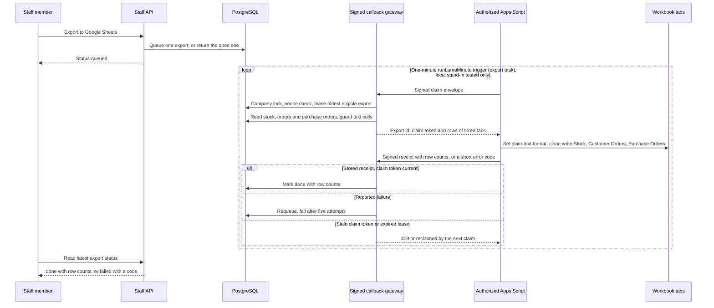

# Inventory: the stock ledger

Decision [D49](../DECISIONS.md), plan [stock, orders and purchasing](../proposals/2026-11-07-stock-orders-plan.md).
This guide describes what is implemented in tasks T1 to T5: the tables, the single writer
(`app/backend/luma/features/inventory/ledger.py`), the read queries, how the rest of
the application reads stock, and the reservation lifecycle (hold at approval, release on
every exit, the dispatch check and the worker's reconcile) and customer acceptance (the
pending order a customer's Accept creates) and the staff routes (confirm and cancel orders,
purchase orders and receipts, adjustments, reorder levels, alerts) and the Excel and Google
Sheets exports (T5). The staff screens (T6) are described in
[the Inventory UI section](#inventory-ui-task-t6); they were checked with mocked-API unit tests only.

## Purpose and ownership

The web app is the stock master. Google Sheets still syncs Products and Prices but no
longer supplies stock; the `Inventory` tab is optional and ignored (accepted from older
Apps Script versions, never validated, hashed or stored; `google_sync/snapshots.py` writes no stock). Stock is
a ledger, not a number someone overwrites:

- `luma.stock_movements` is the append-only history (kinds `opening`, `adjustment`,
  `receipt`, `order`, `order_cancel`).
- `luma.stock_levels` caches `on_hand` and `reserved` per (company, product), plus the
  admin-editable `reorder_level` (default 20).
- `luma.stock_reservations` holds stock for an approved quotation (`held`), then closes it
  as `released` or `converted`.
- Available is `on_hand - reserved`. It is never stored; every reader computes it.

`ledger.py` is the only code allowed to write the first three tables. Other code calls its
functions inside its own transaction. Authorization is not decided here: the services behind
the staff routes check the role (admin-only adjustments, reorder levels and purchase orders)
before calling the ledger.

## Invariants

For every company and product, always, after each committed transaction:

1. `stock_levels.on_hand = sum(stock_movements.delta)`.
2. `stock_levels.reserved = sum(stock_reservations.quantity where status = 'held')`.
3. `0 <= reserved <= on_hand` (table check, plus the ledger refusing the write first).
4. Movements are never updated or deleted: `luma_api` has select/insert, `luma_worker`
   select only, and nobody has update or delete.
5. A reservation exists at most once per (quote, product) and `closed_at` is set exactly
   when it is not `held`.

`tests/integration/test_stock_ledger.py` re-computes 1-3 from the raw tables after a mixed
sequence (reserve, receive, release, convert, adjust, cancel) and after each refused write.

Movement signs are fixed by table checks: `opening`, `receipt` and `order_cancel` are
positive, `order` is negative, `adjustment` is either (reason of 3-200 characters required).
A movement needs a non-zero delta, so a product with zero stock has a level row and no
opening movement.

## Data model

Created by migration `20261107030000_stock_ledger.sql`; ownership, grants and RLS are
summarized in [Data model](DATA_MODEL.md#stock-order-and-purchasing-records). The migration
also creates the order, purchase-order, alert, Sheets-export and document-counter tables
that later tasks fill, extends `quotes.status` with `accepted` and `declined`, copies every
product's `available` into a level row (and an `opening` movement when it is above zero),
then drops `products.available`. The backfill and the dropped column are proved by
`test_stock_ledger_backfills_every_product_then_drops_available`; row-level security on all
ten tables and the append-only grants by `test_stock_tables_are_protected_and_the_ledger_is_append_only`.

Both application roles read and write levels and reservations (the API at approval,
adjustment and receipt time; the worker when it releases). Only the API role inserts
movements. The partial unique index `sheet_exports_one_open` limits a company to one
queued or claimed Sheets export.

## Ledger functions

All take the caller's open psycopg transaction (dict rows) and never commit.

| Function | Effect |
|---|---|
| `lock_levels(conn, company, product_ids)` | `select ... for update` in ascending product id; returns rows by product id; creates nothing |
| `apply_movement(conn, company, product_id, delta, kind, actor, reference_id=None, reason=None)` | One movement and the on-hand change; creates a missing level row; returns the level |
| `held_quantities(conn, company, quote_id)` | Read only: held quantity per product of one quote; the dispatch check uses it |
| `reserve_quote(conn, company, quote)` | All-or-nothing hold of every quote line; idempotent per (quote, product) |
| `release_quote(conn, company, quote_id, reason)` | `held` to `released`, lowers `reserved`; idempotent; no movement |
| `convert_quote(conn, company, quote_id, order_id, actor)` | `held` to `converted`, lowers `reserved` and writes `order` movements together; idempotent |
| `reconcile(conn, company=None)` | Safety net, see below |
| `seed_opening(conn, company, product_id, quantity, actor)` | Level row plus opening movement for a new product; used by the local seed and test fixtures |

Errors are `DomainError` with safe messages: 409 for a result below zero or below reserved
and for "Stock changed. Create a new revision."; 422 for a zero delta, unknown kind or an
adjustment without a 3-200 character reason; 404 for a product that is not in the company.

Concurrency: the caller locks conversation, then quote; the ledger then locks level rows
in ascending product id, all of a call's products before any write. Two approvals racing
for the last units therefore serialize on the level rows and exactly one succeeds
(`test_two_approvals_race_for_the_last_units`, two worker-role connections). `release_quote`
and `convert_quote` read the held product ids without a lock, lock the levels, then lock
the reservation rows, the same order `reserve_quote` uses.

Idempotency: `reserve_quote` skips lines already `held`; a line whose reservation was
released or converted cannot be held again (409), because approval is once per quote.
`release_quote` and `convert_quote` return 0 when nothing is held. `convert_quote` after a
release moves no stock.

## Reconcile rules

`reconcile` examines up to 200 quotes that still have `held` reservations (one company, or
all when `company` is `None`) with `for update of q skip locked`; a quote another
transaction holds is retried on the next call. It locks all involved levels (companies and
product ids sorted) before changing anything, releases through `release_quote` and writes a
`stock.released` audit event with actor `system`. A quote is released when:

| Condition | Release reason | Quote status |
|---|---|---|
| status is not `approved` or `accepted` (superseded, rejected, declined, expired) | `quote_<status>` | unchanged |
| `approved` and `valid_until <= now()` | `expired` | set to `expired` |
| `approved` and its quotation outbox has a `blocked` or `failed` row and no row that is `queued`, in flight, delivered, read, local-delivered or `unknown` | `delivery_failed` | unchanged |

Never released: an `accepted` quote (it keeps its hold until staff confirm or cancel the
order, even past `valid_until`), an `approved` quote with any `unknown` outbox row (the
mail or message may have reached the customer), a quote whose outbox is still queued or
delivered and has not expired, and an approved quote with no outbox row yet.
One interpretation to be aware of: an `unknown` delivery is spared by the delivery rule
only; an unknown-delivery quote that passes `valid_until` is still released and marked
`expired`, since the customer can no longer accept it. Each case is a test in
`test_reconcile_rules`.

## Reservation lifecycle (task T2)

A quotation's stock is held from its approval until it is released or converted:
`review` -> approve -> `approved` with `held` reservations -> `released` (superseded, blocked,
failed, expired, taken over) or `converted` (order confirmed, see [staff actions](#staff-actions-purchasing-and-alerts-task-t4)).

**Hold.** `quotations/approval.decide` calls `ledger.reserve_quote` right after
`check_snapshot` and before it writes the approval, the quotation outbox row or the Drive
export row, all in the one request transaction. Lock order: conversation, then quote, then
stock levels in ascending product id. A request for more than `on_hand - reserved` raises the
ledger's 409 "Stock changed. Create a new revision."; the transaction rolls back, so no approval,
outbox row, Drive export, reservation or `reserved` change survives
(`test_a_ledger_refusal_after_the_snapshot_check_rolls_the_whole_approval_back`). The earlier
`check_snapshot` availability check gives the same 409 in the common case (stock gone before
the click); the ledger check is the one that wins a race. Two staff approving 60 + 60 units of a
100-unit product at once: exactly one succeeds
(`test_two_approvals_race_for_the_last_units_and_exactly_one_wins`).

**Dispatch check.** `check_snapshot(conn, quote, current, dispatch=True)`, called from
`quotations/dispatch.check_quotation` (through `messaging/authorization.authorize_outbound`) with
the quote row locked, replaces the `available >= quantity` test, which would count the quote's own
hold against itself, with "the quote's `held` reservations equal its summed line quantities per
product". A missing, released, converted or differently sized hold raises `DomainError`; the
dispatcher then blocks the intent with `dispatch_revalidation` and releases whatever is left.
At approval time `dispatch=False` keeps the original available check, because no hold exists yet.

**Release triggers.** Every one calls `ledger.release_quote`, which is idempotent.

| Trigger | Where | Reason stored |
|---|---|---|
| Customer text arrives (any channel) | `conversations/participation.accept_customer_text`, for each review/approved quote it supersedes | `superseded` |
| Customer photo or voice note | `media/intake.accept_media`, same rule | `superseded` |
| Staff saves a new revision | `quotations/drafting.draft`, before stock is read so the old hold does not count against the new lines; it rolls back with a refused draft | `superseded` |
| Staff takeover blocks a queued quotation send | `conversations/participation.change_ownership`, for the quotes of the outbox rows it just blocked | `staff_takeover` |
| A gate or the revalidation blocks the send | `messaging/outbound.block`; `runtime/delivery.deliver_one` for `live_adapter_not_enabled` and `dispatch_revalidation` | `delivery_blocked` |
| The provider definitely did not take it | `messaging/outbound.record` when the result is `failed` | `delivery_failed` |
| Gmail mail not collected in 24 h, or PDF over 5 MiB | `messaging/email_dispatch.sweep`, `claim_mail` | `delivery_failed` |
| Anything missed, and expiry | `ledger.reconcile` from the worker | `quote_<status>`, `expired`, `delivery_failed` |
| Operator retention deletes a conversation idle for 90 days | `scripts/retention.py` releases its held reservations, then deletes the reservation rows before the quotes | `retention` |

`unknown` outcomes never release, because the message may have reached the customer: not
`record` with `unknown`, not the 2-minute stale-`submitting` sweep, not an expired Gmail lease.
A takeover does not touch a send that is already `submitting` or `submitted`; its hold stays.
Takeover releases explicitly instead of waiting for reconcile because the blocked send can never
go out, and the hold would otherwise keep stock from other customers; reconcile still covers
it if that release were ever missed. A WhatsApp `failed` delivery receipt
(`messaging/inbound.apply_status`) is left to reconcile, which sees the `failed` outbox row on
its next tick.

**Worker.** `worker.tick` ends with `reconcile_stock()`: `ledger.reconcile(conn)` for all
companies in its own `database(worker=True)` transaction with a 10-second statement timeout.
A failure is logged as the exception class only and never stops the loop. The worker role's
existing grants suffice (select/update on the ledger tables, `update(status)` and row locks on
`quotes`, insert on `audit`), so no new migration was needed. Proved by
`test_worker_reconcile_releases_an_expired_approved_quote` and
`test_tick_runs_reconcile_once_and_a_failure_never_stops_the_loop`.

**Quotation content and PDF.** The hashed quotation content keeps `stock_reserved: false`:
content is immutable and fixed at draft time, before any hold exists, so it cannot report one.
The authoritative record of a hold is `luma.stock_reservations`. The PDF sentence now reads
"Availability is a snapshot. Stock is held for this quotation until it expires." (the PDF is not
part of the content hash). PDFs already stored for earlier quotes keep their old wording.

## Customer acceptance and orders (task T3)

<!-- diagram:order-lifecycle:start -->

[Open full-size SVG](../diagrams/rendered/order-lifecycle.svg) · [Editable Mermaid](../diagrams/order-lifecycle.mmd)

Mermaid source

<!-- diagram:order-lifecycle:end -->

**Actors and authority.** A customer on Telegram, Gmail or WhatsApp (or the staff-operated local
test reply) may accept or decline the newest sent quotation of their own conversation. No AI is
involved. The agent and the worker only record the answer; they cannot confirm an order or move
on-hand stock. Staff confirm or cancel an order through the T4 routes below.

**Recognizing the answer** (`orders/acceptance.py`, `parse_answer`). Lowercase, trim, collapse
spaces (line breaks too), strip trailing `.` and `!`; the message must be at most 60 characters.
It is matched against the table as is, then once more after dropping one leading and one trailing
courtesy word (`thanks`, `thank you`, `thx`, `many thanks`, `thanks a lot`), so "Accept, thanks"
and "Thanks, I accept" accept while "please accept" and "accept, thanks, change qty to 20" do not.
The remainder (at most 40 characters) must equal one phrase.
Accept: `accept`, `i accept`, `accepted`, `yes i accept`, `yes, i accept`, `accept quotation`,
`accept the quotation`, `i accept the quotation`. Decline: `decline`, `i decline`, `declined`,
`reject`, `no thanks`, `decline quotation`. Plain `yes` is not an acceptance (D46 uses YES to confirm
an order restatement). Anything else, such as "accept but change qty to 20", is ordinary text and
supersedes the offer as before. Unit table: `tests/unit/test_acceptance_phrases.py`.

**Call flow.** `participation.accept_customer_text` (typed text, every channel) and
`participation.accept_quote_button` (Telegram button) run under the caller's conversation lock,
rate limit (six per minute per conversation) and message store (`provider_id` dedupe). A phrase
match goes to `orders/service.answer_quote` and the function returns before the supersede update,
so an answer never supersedes a quotation or queues an agent job.

**Binding rules** (`service.refusal_reason`, then `answer_quote`). The target is the newest
revision of the conversation (row-locked). It is answerable only when all hold: status `approved`;
`valid_until > now()`; `recipient` equals the conversation's recipient; a quotation outbox row is
`submitted`, `delivered`, `read` or `local_delivered` (not `queued`, `blocked`, `failed`, `unknown`);
and every product still has a `held` reservation equal to its line quantity. A button's `quote_id`
must equal that target. Otherwise the answer is refused with an opaque reason (`no_quotation`,
`not_current_quotation`, `not_open`, `expired`, `recipient_mismatch`, `not_sent`, `stock_not_held`).

| Outcome | Writes (one transaction, no commit here) |
|---|---|
| `accepted` | quote -> `accepted`; `orders` row (`pending`, `SO-0001` from `document_counters` under a row lock, created on first use) and `order_lines` copied from the immutable quote content (prices, names, total, currency never recomputed; customer name and company from the conversation); hold kept; conversation `order_pending`; audit `order.accepted`; notice |
| `already_accepted` (accept again) | no new order; conversation status restated; the same confirmation notice is queued again for the new message |
| `declined` | quote -> `declined`; `ledger.release_quote(..., 'declined')`; conversation `declined`; audit `quotation.declined`; notice |
| `refused` | `stock_alerts` row `acceptance_refused` (open); conversation `needs_staff`; audit `order.acceptance_refused` with the reason code and the path (`reply` or `telegram_button`); the refusal notice; nothing superseded, no agent job |

A decline of an already accepted quote is refused (`not_open`): the order and its hold stay.
Order numbers are gap-tolerant (a rolled-back acceptance rolls its increment back too).

**Fixed notices** (English, `orders/service.py`), queued only while the agent owns the conversation
through the outbox pattern of `conversations/service.queue_notice` (moved there from
`messaging/inbound` so orders can use it without an import cycle; action key
`inbound-notice:<provider id>`, so a redelivered message queues one). Under staff ownership the
answer is applied (an order can still be created from a delivered quotation) and the conversation
becomes `needs_staff`; no notice is queued.

- Accepted: "Thank you. Your acceptance of quotation {number}, revision {n}, is recorded. Our sales team will confirm your order."
- Declined: "Thank you. Quotation {number} is declined. Send a new request any time."
- Refused: "This quotation can no longer be accepted. Our sales team will contact you."
- New request while the order is pending: "Your order {SO number} is waiting for confirmation by our sales team. We will reply to your new request after that."

**Repeat requests after an accepted quotation.** A customer whose quotation was accepted can write
again; what happens depends on the order of the conversation's newest quotation:

| Order | New customer request (any text that is not an exact accept or decline phrase) |
|---|---|
| `confirmed` | Ordinary request. The agent drafts revision N+1 over the same conversation (`quotations/drafting.draft` allows it). The accepted quotation **stays `accepted`** for history: it is not superseded, and its reservations are already `converted`, so nothing is released. Revision N+1 follows the normal approve, send and accept path and creates the next order (`SO-0002`; `orders.quote_id` is unique per quotation). |
| `cancelled` | `orders/management.cancel` already made the quotation `superseded`; the request is ordinary. |
| `pending` | Parked, not drafted. The stock is still held for that order, so a new revision would supersede the quotation and let `ledger.reconcile` free the hold; `draft` still refuses it with a 409. `orders/service.hold_for_pending_order` runs in `participation.accept_customer_text`, before any job is queued, so no agent job and no paid model call (D46 cost) is created. It sets the conversation `needs_staff`, adds one system message for staff, queues one fixed customer notice (below) while the agent owns the conversation and writes audit `order.request_held`. The notice's action key is `order-waiting:<order id>`: further requests while pending add messages and system notes but no second notice. |

The pending-order check also runs at the start of `runtime/conversations.process_conversation`
(before the graph): a voice note or photo reaches the agent only after transcription, past the
text check, and is parked the same way. `accept` and `decline` phrases are handled before the check,
so for the current quotation they keep the T3 behavior (a second accept restates the confirmation;
a decline of an accepted quotation is refused and the hold stays). When staff **confirm** an order
after a request was parked, `orders/management.confirm` keeps the conversation `needs_staff`
(instead of `ordered`) because a customer message is newer than `accepted_at`; staff reply, or the
customer's next message drafts the next revision.

**A failed agent job never goes silent.** `worker.tick` calls `runtime/escalation.escalate_unanswered`
after an agent job ends `blocked` or `failed`: when the conversation is agent-owned, still `new`
(set by every customer text) and no newer customer message exists, it becomes `needs_staff`, gets
one system message with the failure class only, and audit `job.escalated` is written. Staff-owned,
reviewing, clarifying or already escalated conversations are untouched. No customer message is sent.

**Delivery wording.** The quotation caption ends with "Reply ACCEPT to accept or DECLINE to
decline." in `outbound.begin` (WhatsApp, Telegram, Gmail body) and in the local-test text
(`runtime/delivery._deliver_local`). Telegram also attaches inline buttons; see
[TELEGRAM](TELEGRAM.md#quotation-buttons-accept-and-decline-d49).

**Retention.** `scripts/retention.py` skips a conversation that has an order (a business record) and
deletes the `stock_alerts` of the conversations it removes.

**Failures.** A database error rolls the whole answer back (the customer message too) and the inbox
row is retried or failed by the normal rules; a refusal is a value, never an exception, so the
inbox row finishes `done`. Rate limiting returns 429 for typed local replies and requeues inbox rows.
Tests: `tests/integration/test_stock_acceptance.py` (label `local`; the Telegram and Gmail parts are
`local-substitute`).

## Staff actions, purchasing and alerts (task T4)

<!-- diagram:purchase-order-lifecycle:start -->

[Open full-size SVG](../diagrams/rendered/purchase-order-lifecycle.svg) · [Editable Mermaid](../diagrams/purchase-order-lifecycle.mmd)

Mermaid source

<!-- diagram:purchase-order-lifecycle:end -->

**Actors and authority.** Every route needs a verified staff session and an active membership; the
role is read from `luma.memberships.role` on each request. Salespeople and administrators may read
everything, confirm or cancel orders and acknowledge alerts. Only administrators adjust stock, set
reorder levels and write purchase orders (`core/identity.require_admin`, answered with 403 "Only an
administrator can ..."). The customer, the agent and the worker can do none of these.

| Method and path | Role | Effect |
|---|---|---|
| `GET /api/inventory/stock` | staff | Stock table rows plus `low_count` |
| `GET /api/inventory/movements?product_id=&limit=&before=` | staff | Newest-first keyset page (limit 1-200, default 50); `next` is an opaque cursor (`<microseconds since 1970>_<uuid>`), pass it back as `before`. Each item also carries `reference`, the human number of the referenced document: `PO-0001` for a `receipt`, `SO-0001` for an `order` or `order_cancel` movement (two left joins on company and id), null for opening and adjustment movements or when the document is gone; `reference_id` stays the raw id |
| `POST /api/inventory/adjustments` | admin | `ledger.apply_movement(kind='adjustment')`; body `product_id`, `delta` (-100000..100000, not 0), `reason` (3-200) |
| `POST /api/inventory/reorder-levels` | admin | `ledger.set_reorder_level`; body `product_id`, `reorder_level` 0..100000; no movement |
| `GET /api/inventory/alerts` | staff | Open stored alerts (shortage, acceptance_refused) with SKU, name, conversation, plus the live low-stock list and counts |
| `POST /api/inventory/alerts/{id}/acknowledge` | staff | open -> acknowledged; 409 when already, 404 when unknown |
| `GET /api/orders?status=` | staff | Orders with lines, newest first, at most 200; 422 for an unknown status |
| `POST /api/orders/{id}/confirm` | staff | pending -> confirmed |
| `POST /api/orders/{id}/cancel` `{reason 3-200}` | staff | pending -> cancelled, or confirmed -> cancelled |
| `GET /api/purchase-orders` | staff | Purchase orders with lines (SKU, name), newest first, at most 200 |
| `POST /api/purchase-orders` | admin | Create `ordered`; 1-100 lines, distinct products, quantity 1..100000, `unit_cost` 0..1,000,000 with at most two decimals, supplier 1-120, notes at most 500, optional `expected_on` |
| `POST /api/purchase-orders/{id}/receive` `{lines:[{product_id, quantity}]}` | admin | Receipt per line |
| `POST /api/purchase-orders/{id}/cancel` | admin | Only while nothing is received |

All request bodies reject undeclared fields and use strict integers (a float for a quantity is a
422). Response models (`core/contracts.ResponseModel`) drop undeclared database columns, so company
and actor ids never reach the browser; the OpenAPI document lists every route with its response
schema.

**Call flow of a mutation.** `Staff` (bearer verified with Supabase Auth) -> `membership` ->
`rate_limit(f"{user}:mutation", 30)` -> `operation()` (company, user, action and `Idempotency-Key`
lock; a replay of the same payload returns the stored response, a changed payload under the same key
is a 409) -> service function -> audit event -> response model. The service, the stock change and
the idempotency record commit together or not at all. Reads use their own bucket
`f"{user}:stock-read"` (120 per minute) so they do not starve the workspace refresh.

**Order confirm** (`orders/management.confirm`). Lock order: conversation, quote, order, then
stock levels in ascending product-id order (inside the ledger). Checks: order `pending` (else 409
"already confirmed/cancelled") and the quotation's held reservations equal the order's line
quantities (else 409 "The stock held for this order is no longer reserved. Cancel the order and
re-quote."). Then `ledger.convert_quote` converts each hold into one `order` movement (negative
delta, `reference_id` = the order) and lowers `reserved` by the same amount, so available does not
change; the order becomes `confirmed` (`confirmed_by`, `confirmed_at`), the conversation `ordered`,
audit `order.confirmed`. When the agent owns the conversation, one fixed notice is queued: "Your
order {number} is confirmed. Our sales team will contact you about delivery." (no prices, no
dates; outbox action key `order-confirmed:<order id>`). A replay with the same key returns the
stored body and moves nothing.

**Order cancel** (`orders/management.cancel`). Same locks. Pending: `ledger.release_quote(...,
'order_cancelled')`, on-hand unchanged. Confirmed: one `order_cancel` movement per line (positive
delta, reference = the order), levels locked first in product-id order. In both cases the order
becomes `cancelled` with `cancelled_by`, `cancelled_at` and the reason (3-200 characters, trimmed),
the accepted quotation becomes `superseded`, the conversation `needs_staff`, audit `order.cancelled`
(the reason text stays on the order, not in the audit). Already cancelled: 409. No customer notice.

**Purchase orders** (`purchasing/service.py`). Numbers `PO-0001` come from `core/numbering.next_number`
(the same serialized counter table as `SO-0001`; the old `orders.service.next_order_number` was moved
there). Create writes the order (`ordered`), its lines and audit `purchase_order.created`; every
product must exist in the company (422). Receive locks the order, its lines, then the levels: a
cancelled or fully received order is a 409, a product not on the order is a 422, and a line that would
push cumulative received above ordered is a 409 with nothing written. Each line then appends a
`receipt` movement (reference = the purchase order) and raises `quantity_received`; the status is
`received` when every line is complete, else `partially_received`. Cancel is allowed only for
status `ordered` with zero received (409 otherwise; correct received goods with an adjustment).

**Purchase-order products.** `purchasing.service.create` refuses a product that does not exist in
the company ("A product on the purchase order does not exist.") and a discontinued one ("Discontinued
products cannot be ordered: <SKU list>."), both 422 with nothing written and no number consumed. The
New purchase order dialog hides discontinued products and says so.

**Adjustments and reorder levels** (`inventory/service.py`). An adjustment below the quantity
reserved for quotations, or below zero, is the ledger's 409; an unknown product is a 404. The
reason (3-200 characters) is stored on the movement and is not copied into the audit detail.
`ledger.set_reorder_level` is the one addition to the single writer for T4: it updates only
`reorder_level` and writes no movement.

**Alerts.** Shortage alerts are written by the agent's `prepare` node
(`nodes/workflow.raise_shortage_alert`): a known, non-discontinued SKU whose available is below
the requested quantity inserts a `stock_alerts` row (`shortage`, product, conversation, requested,
available) in the same transaction as today's system message and `needs_staff`. At most one open
alert per conversation and product, so a retried job adds none; the customer is not told (D49).
An unknown or discontinued SKU keeps today's behavior without an alert. Low-stock entries are the
live query (`available <= reorder_level`) and are never stored or acknowledged. `acceptance_refused`
alerts come from the T3 acceptance path. Acknowledging is one conditional update, so two staff
members racing produce one success and one 409.

**Failures and recovery.** Any `DomainError` rolls the whole request back (stock, audit, idempotency
record). The same key and body after a transient failure retries safely; a replay after success
returns the stored response. A 429 is not recorded as an operation.

**Tests.** `tests/integration/test_stock_staff_routes.py` (label `local`): confirm once and
replay, hold gone, cancel pending and confirmed, list filters, purchase-order partial and full
receipt, over-receipt, cancel rules, input validation table, adjustments (including below reserved),
reorder levels and the live low list, movement paging, the PO and SO numbers on movements, a
discontinued product refused on a purchase order, shortage alert via the real `prepare`,
acknowledge, salesperson 403 on every admin route, salesperson allowed actions, cross-company 404,
OpenAPI coverage.

## Excel and Google Sheets export (task T5)

Two read-only views of the ledger leave the application: an Excel file a staff member downloads,
and three Google Sheets tabs that Apps Script pulls. Both come from the same table definitions
(`inventory/exports.py`, `COLUMNS`), so they cannot drift apart. Neither can change stock, orders,
quotations or approvals.

**Actors and authority.** Any active staff member (administrator or salesperson) can download the
Excel file, queue a Sheets export and read its status. The signed gateway acts as the company's
Apps Script (`ACTOR = "google-apps-script"`) and can only claim and complete exports of the one
configured company and workbook (same envelope rules as the Drive export, see
[Google synchronization](GOOGLE_SYNC.md)).

### Excel download

`GET /api/inventory/export.xlsx` (staff). Own admission bucket `{user}:stock-export`, 10 requests per
minute (the file reads thousands of rows), apart from the 120-per-minute stock-read bucket. Response:
media type `application/vnd.openxmlformats-officedocument.spreadsheetml.sheet`,
`Content-Disposition: attachment; filename="lumaquote-stock-YYYYMMDD.xlsx"` (UTC day). Audit event
`inventory.exported` with `format` and the row count per sheet.

| Sheet | Columns | Rows |
|---|---|---|
| `Stock` | sku, name, family, on_hand, reserved, available, reorder_level, status (`OK`, `Low`, `Out`) | every current product, family then SKU |
| `Movements` | date_utc, sku, kind, delta, reason, reference (order or purchase order id) | newest 5,000 |
| `Customer Orders` | order_number, status, accepted_at, confirmed_at, customer_name, customer_company, sku, name, quantity, unit_price, line_total, order_total | one row per order line, newest order first, at most 20,000 |
| `Purchase Orders` | po_number, status, supplier, expected_on, sku, quantity_ordered, quantity_received, unit_cost | one row per line, newest order first, at most 20,000 |

Format: bold frozen header row; column widths follow content (8 to 62 characters); quantities and
money are numeric cells (money `#,##0.00`); `accepted_at`, `confirmed_at` and `date_utc` are UTC
date-time cells (`yyyy-mm-dd hh:mm`, Excel has no time zones); `expected_on` is a date cell; empty
values are empty cells. `status` is `Out` when available is 0 or less, `Low` at or below the reorder
level (discontinued products are never `Low`), otherwise `OK`.

### Formula-injection guard

Customer names and companies come from chats and Gmail, product names from catalog PDFs, suppliers
and reasons from staff typing; all are untrusted when a spreadsheet opens them. One function,
`exports.safe_text(value)`, protects both outputs: a string starting with `=`, `+`, `-`, `@`, tab or
carriage return gets a leading apostrophe, so Excel and Sheets show it as text instead of evaluating
it (`=HYPERLINK("http://x","y")` is stored as `'=HYPERLINK("http://x","y")`). It also removes control
characters a spreadsheet file cannot hold (NUL and the rest of C0 except tab, line feed and carriage
return, which would crash the writer) and cuts text at 30,000 characters (Excel's limit is 32,767).
Numbers, dates and empty values are never touched, so numeric cells stay numeric. Every text cell is
guarded: sku, name, family, status, kind, reason, reference, order and PO numbers, customer, supplier.
The apostrophe stays visible in the cell; that is the accepted cost of a guard the reader cannot
bypass. Excel cells are also written with an explicit string type. Tested with the canaries
`=HYPERLINK("http://x","y")`, `@SUM(1)`, `+1`, `-2+3`, tab+`=1`
(`tests/unit/test_safe_text.py`, `tests/integration/test_stock_exports.py`).

### Google Sheets export (pull)

<!-- diagram:stock-sheet-export:start -->

[Open full-size SVG](../diagrams/rendered/stock-sheet-export.svg) · [Editable Mermaid](../diagrams/stock-sheet-export.mmd)

Mermaid source

<!-- diagram:stock-sheet-export:end -->

Apps Script cannot be called by the backend (D10, no public web app), so it polls, exactly like the
Drive export.

1. **Queue.** `POST /api/inventory/sheet-exports` (staff, `Idempotency-Key`, mutation rate limit 30
   per minute) inserts one `luma.sheet_exports` row (`queued`, `requested_by`). If a `queued` or
   `claimed` row exists, that row is returned instead and nothing is written; the company advisory
   lock and the partial unique index `sheet_exports_one_open` decide a race, so two simultaneous
   presses give one row. Audit `inventory.sheet_export_queued` (only for a new row).
   `GET /api/inventory/sheet-exports/latest` returns `id`, `status` (`none`, `queued`, `claimed`,
   `done`, `failed`), `requested_at`, `completed_at`, `row_counts` (per tab, when done) and
   `error_code` (a short code, never cell contents).
2. **Claim.** `POST /callbacks/google/stock/claim`, event `stock_export_claim`, at most 1 KiB, signed
   envelope. Under the company lock the gateway records the nonce (a replay is a 409), sets a
   `claimed` row whose lease expired at the attempt limit to `failed` (`attempts_exhausted`), then
   leases the oldest `queued` row, or `claimed` row with an expired lease, that has used fewer than
   5 attempts: `attempts + 1`, a fresh `claim_token`, `lease_until = now() + 5 minutes`. The response
   is `{"status": "claimed", "export_id", "claim_token", "tabs": {"Stock": [[header...], [row...]],
   "Customer Orders": ..., "Purchase Orders": ...}, "truncated": [...]}` or `{"status": "idle"}`.
   Cells are guarded text, ints, floats (money) and UTC date text (`YYYY-MM-DD HH:MM`, `YYYY-MM-DD`);
   missing values are empty strings. Each tab is capped at 5,000 data rows; a tab that was cut is named
   in `truncated`. `Movements` is not sent to Sheets.
3. **Write.** `gas/Stock.gs` `exportStockTabs_()` runs inside `exportApprovedQuotations_` (the export
   task of the one-minute `runLumaMinute` trigger, under the script lock the minute run holds, D50; timing: the
   export is picked up within about a minute, after that run's mail and sync tasks). It checks all three tabs are
   well formed first, then for each of `Stock`, `Customer Orders`, `Purchase Orders`: creates the tab
   if missing, `clearContents()`, sets the number format of every text column to plain text `@`
   **before** writing (numeric columns get `0`, or `#,##0.00` for price, total and cost), writes the
   values, bolds and freezes the header, auto-resizes columns. It never writes `Products`, `Prices`,
   `Policies`, `Inventory` or `Quote Register`.
4. **Receipt.** `POST /callbacks/google/stock/receipt`, event `stock_export_receipt`, at most 2 KiB:
   `export_id`, `claim_token`, `outcome` `stored` with `row_counts` (all three tabs, integers
   0..5,000) or `failed` with `error_code` (`[a-z0-9_]`, at most 40; Apps Script sends `bad_response`
   or `sheet_error`). Only the current claim token may report. `stored` sets `done`, `row_counts`
   and `completed_at`, clears the token and lease; audit `inventory.sheet_exported`. `failed`
   requeues (`queued`, `error_code` kept) or, with 5 attempts used, sets `failed` with a completion
   time; audit `inventory.sheet_export_failed` (code and status only). An identical `stored` receipt
   for a `done` export returns `{"status": "done"}`; any other late or stale receipt is a 409.

Envelope (`extra="forbid"`): `schema_version` 1, `company_id`, `spreadsheet_id`, `timestamp`
(within 5 minutes), `nonce`, `event`; HMAC-SHA-256 over the exact bytes in `X-Luma-Signature`;
company and workbook must equal `GOOGLE_COMPANY_ID` and `GOOGLE_SHEET_ID` (403 otherwise). At most
120 new envelopes per company per minute are accepted across all Google endpoints. The claim
response is large (up to three tabs of 5,000 rows) but only ever read-only values.

**Failures and recovery.**

| Failure | Result |
|---|---|
| Apps Script crashes or loses the response | Lease expires after 5 minutes; the next claim reclaims with a new token and the old holder's receipt is a 409 |
| Sheet write throws | Failed receipt `sheet_error`; requeued; five attempts then `failed` |
| Malformed claim response | Failed receipt `bad_response` before any tab is written |
| Receipt lost after a good write | Lease expires, the next claim rewrites the same data (idempotent) |
| Forged signature, stale timestamp, wrong company or workbook, extra fields, replayed nonce | 401 / 401 / 403 / 422 / 409; nothing changes |
| Database unavailable | 503; Apps Script retries on the next minute |
| Backend unreachable from Apps Script | The run fails visibly (status code in `LUMA_LAST_STOCK_EXPORT_STATUS`) |

**Configuration.** No new setting. It uses the existing `GOOGLE_COMPANY_ID`, `GOOGLE_SHEET_ID`,
`GOOGLE_CALLBACK_SECRET` and the Apps Script properties. Migration
`20261108010000_sheet_export_attempts.sql` adds `sheet_exports.attempts`. Dependency:
`openpyxl==3.1.5` (with `et-xmlfile==2.0.0`) in `pyproject.toml` and `requirements.lock.txt`.

**Tests (label `local`).** `tests/unit/test_safe_text.py` (canaries, control characters, length,
numeric types, workbook cell types); `tests/integration/test_stock_exports.py`: the downloaded file
opens with openpyxl and has four sheets, bold frozen headers, numeric numbers, datetimes and
text canaries; a salesperson can download; another company's rows are absent from file and claim;
the export bucket answers 429 after 10; queue dedupe, replay and re-queue after `done`; claim and
receipt happy path, idle, lease exclusivity, concurrent claims, truncation, forged, stale,
cross-company, wrong-workbook and replayed envelopes, wrong claim token, malformed counts, retries,
attempt cap and expired-lease reclaim. A Python stand-in signs envelopes like `Exports.gs`; the script
has not run inside Google.

**Open gaps.** `gas/Stock.gs` is not pushed or executed in Google (MORNING_ACTIONS). Guarded cells show
their leading apostrophe. A tab over 5,000 rows is truncated, not paged. There is no import from the
stock tabs: edits to them are overwritten by the next export and never read.

## How the rest of the application reads stock

Every former reader of `products.available` now joins `stock_levels` and computes
`on_hand - reserved` (zero when the row is missing): quotation drafting and its
`rules.calculate` input, `quotations/freshness.check_snapshot`, the agent's `prepare` node,
the staff workspace product list (the API payload keeps an `available` field, so the UI
contract is unchanged) and `scripts/evaluate_scenarios.py`. Freshness checks
`available >= quantity` at approval and the quote's own held reservations at dispatch
(see the reservation lifecycle above).

`inventory/queries.py` (read-only, scoped by company, current non-retired sources only):
`stock_rows`, `low_stock_rows` and `low_stock_count` (`available <= reorder_level`,
discontinued products are never low; computed live and never stored), `movements_page`
(keyset on `(created_at, id)` newest first; limit 1-200; returns `items` and the `next`
cursor), and `open_alerts`.

## Failures and recovery

- A refused write raises `DomainError` before any row is written; the caller's transaction
  rolls back as a whole, so a partial reservation cannot persist.
- A crash between approval and dispatch leaves holds that `reconcile` later releases when
  the quote expires or its delivery is dead. Nothing releases a hold from a customer's
  `unknown` delivery automatically (until the quote expires); staff decide.
- If `reconcile` fails (database down, statement timeout), the worker logs the error class
  and retries on the next one-second tick; holds only stay longer, stock is never lost.
- A release hook that raises inside a request rolls that request back (for example a
  customer message is then not stored). The hooks write only rows the caller already locks,
  so the practical cause is a database outage, which fails the whole request anyway.
- If the ledger and a reader ever disagreed, the movements are the authority: recompute
  `on_hand` as their sum. No repair command exists yet.
- Data loss risk: the migration drops `products.available` irreversibly. The local database is
  the only database (D06); the copied values are in the ledger as opening movements.

## Operation

- Apply with `npm run setup` (it records applied files in `public.luma_migrations`). Seeded
  products get their opening stock from `seed_opening`, so a rerun leaves current stock alone.
- Tests: `node scripts/python.cjs -m pytest tests/integration/test_stock_ledger.py tests/integration/test_migrations.py`.
  The shared `environment` fixture seeds three products (100, 100 and 0 units) through
  `seed_opening` and deletes the ledger rows of its tenant on teardown.
- Evidence label for these tests: `local` (isolated local Supabase).

## Inventory UI (task T6)

Code: `app/frontend/src/features/inventory/`. The full contract (roles, query keys, dialogs,
polling, failures) is in [Frontend: Inventory page](FRONTEND.md#inventory-page-order-banner-and-stock-card).
Summary of how the screens use the API above:

| Screen | API | Who |
|---|---|---|
| Stock tab, status chip OK / Low / Out | `GET /api/inventory/stock` (Out: available <= 0; Low: server `low` flag) | any staff |
| Adjust, Reorder level dialogs | `POST /api/inventory/adjustments`, `/reorder-levels` | admin controls; salesperson never sees them, server 403 otherwise |
| Movement history drawer | `GET /api/inventory/movements` (cursor `before`) | any staff |
| Customer orders tab, order banner in the quotation panel | `GET /api/orders[?status=pending]`, `POST /api/orders/{id}/confirm`, `/cancel` | any staff |
| Purchase orders tab, New and Receive dialogs, Cancel | `GET/POST /api/purchase-orders`, `/receive`, `/cancel` | create, receive, cancel: admin controls |
| Alerts tab, nav badge, overview stock card | `GET /api/inventory/alerts`, `POST .../acknowledge` | any staff (badge and the card's "Open alerts" = `counts.total`; the card's "Low / out of stock" = `counts.low_stock`) |
| Download Excel, Export to Google Sheets | `GET /api/inventory/export.xlsx`, `POST /api/inventory/sheet-exports`, `GET .../latest` (polled every 5 s while queued or claimed) | any staff |

Every mutation sends a fresh `Idempotency-Key`; the screens refresh stock, orders, alerts,
purchase orders, the workspace and open conversations from the server after each answer and show
nothing optimistically. The role comes from the workspace payload (`data.role`); hiding is a
convenience, the 403 sentence is shown inline if a salesperson ever reaches an admin route.

## Open gaps

- `stock_reserved` in the hashed quotation content stays `false` by design (see above). PDFs
  stored before T2 keep the old "does not reserve stock" sentence. The review-screen text in
  `QuoteSummary.tsx` is only reworded.
- A WhatsApp `failed` delivery receipt does not release at once; reconcile does within a tick.
- Quotes approved and queued before T2 have no hold and are blocked at dispatch.
- Release on order cancel and on customer decline is done (T4, T3).
- Confirm, cancel, acknowledging alerts, purchase orders, adjustments and reorder levels have
  screens since T6 (see the UI section). The status labels `order_pending`, `declined` and
  `ordered` exist, and the overview no longer counts those conversations as open.
- Repeat requests are resolved (see "Repeat requests after an accepted quotation"). Still open:
  the existing rule that new customer text blocks queued replies (`error_code customer_revision`)
  also blocks an order-confirmed or acceptance notice that has not been delivered yet.
- An accept typed with any word beyond one courtesy word, or followed by a signature other than a
  `-- ` block or a whole-line mobile client line ("Sent from my iPhone"), is ordinary text.
- The Download Excel and Export to Google Sheets buttons exist (T6). No real-browser, axe or
  live-data review of the inventory screens has been done.
- Confirming a pending order whose stock hold was released by some other path is a 409; the
  staff member must cancel the order (there is no "re-reserve" action).
- A confirmed order queues one customer notice (action key `order-confirmed:<order id>`); a
  cancelled order sends none. Neither carries prices or dates.
- Purchase-order receipts cannot be reversed; a mistaken receipt is corrected with an adjustment.
- No supplier records, landed cost or stock valuation: `unit_cost` on a purchase-order line is
  informational and never changes a product price.
- A shortage alert is raised only by the agent's `prepare` node (a staff-drafted quote over
  available stock is refused by the rules engine and raises none).
- The first snapshot after T5 gets a new snapshot id once: the digest no longer includes Inventory.
- No automatic repair of a ledger/level mismatch and no stock-take reconciliation workflow.
- Diagrams for the ledger and order state machine are task T7.
