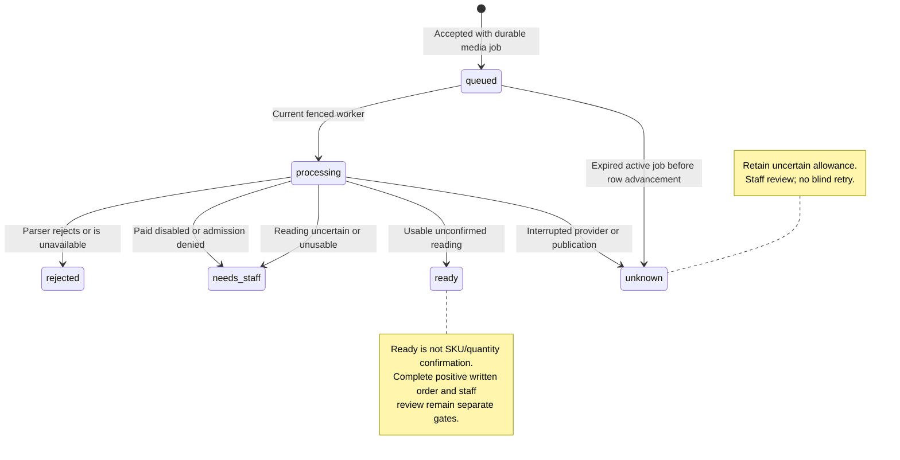

# Voice and product-label media lifecycle

This reference follows an attachment from staff-operated local intake to a
normalized private preview and an unconfirmed reading. It covers backend
`features/media`, agent `runtime/media.py`, `runtime/audio.py`,
`adapters/media_reading.py` and frontend `MediaUpload`/`MediaPreview`.

## Intake and durable acceptance

The current upload routes are local-test tools, not a live WhatsApp media adapter.
Audio and image POSTs require bearer Auth, a UUID operation key and the displayed
conversation `Expected-Version`. Bodies are raw bytes rather than multipart forms.
The actual-byte limits are 10 MiB audio and 5 MiB image; total upload time is
bounded to 30 seconds. Client file extensions and MIME claims are advisory only.

Admission runs before buffering: current membership, scoped local-test conversation,
staff mutation limit and six-per-minute kind counter. After streaming, persistence
reauthorizes membership and resolves the same scope again. The operation payload
binds target/action, expected version and SHA-256 byte digest. Replaying identical
bytes can return the original acceptance; changing bytes/version under the same
key conflicts.

`intake.accept_media` locks/checks the conversation and expected version, checks
nonempty bytes/size and the conversation-turn limit, uploads an opaque private
original, inserts the customer message/media row, supersedes review/approved
offers, blocks queued sends and creates the appropriate transcribe/read_photo
job. The acceptance response is `message_id` plus queued status, not a reading.
`intake.store_media` holds the shared part (size bounds, the conversation-turn limit, immutable
storage, supersession, job admission, optional provider-id deduplication) so a verified, allow-listed
WhatsApp sender enters through the same path after the restricted Graph fetch; only `accept_media`
applies the staff upload's local-test and expected-version checks.

Business rows commit atomically, but object Storage is external to that transaction.
A failure after upload can leave an orphan private original. No automatic orphan
collector or complete media-retention policy is implemented yet. Originals use
server-generated paths rather than customer filenames.

## Fixed sandbox boundary

`sandbox.process_file` accepts only pdf/image/audio operations and bounded bytes.
It writes a temporary input, supplies an output directory and invokes a fixed
`lumaquote-media:local` command. It never accepts a customer-selected executable,
shell command, URL or output path.

The ephemeral Docker container has no network, read-only root, dropped Linux
capabilities, no-new-privileges, 256 MiB memory/swap ceiling, one CPU, 64 PID cap,
file-size ulimit and bounded noexec temporary filesystem. Input is read-only; only
the designated output directory is writable. No application environment secrets
are deliberately passed to the parser.

The host caps stdout at 4 MiB and waits at most 50 seconds for its result, with
additional bounded process wait/cleanup deadlines. It validates result kind and
the exact normalized basename, rejects symlinks/nonfiles and limits normalized
bytes to 8 MiB. Cleanup targets only the generated container name; killing the
Docker CLI alone would not guarantee container termination.

`processor.py` performs actual decode:

- Audio: ffprobe requires audio-only streams and a positive duration no greater
  than 120 seconds. ffprobe/ffmpeg allow only file/pipe protocols. Decode produces
  mono 16 kHz WAV, strips metadata and has its own probe/decode deadlines.
- Image: Pillow accepts actual JPEG/PNG/WebP up to 12 million pixels, loads the
  pixels, converts to RGB, fits within 1600 by 1600 and writes JPEG quality 85.
  The derived file does not reuse original metadata.
- PDF: native-text extraction supports 1..50 unencrypted pages, at least 15
  nonspace characters on every page and at most one million extracted characters
  overall. Scans requiring OCR are rejected. This parser exists, but a general
  catalog-upload/ingestion UI is not thereby implemented.

These are resource and format controls, not a complete malware-scanning or public
deployment certification. A disabled Docker engine does not justify unrestricted
host parsing as a fallback.

## Durable state and provider admission

<!-- diagram:media-lifecycle:start -->

[Open full-size SVG](../diagrams/rendered/media-lifecycle.svg) · [Editable Mermaid](../diagrams/media-lifecycle.mmd)

Mermaid source

<!-- diagram:media-lifecycle:end -->

`runtime/audio.process_audio` is a compatibility wrapper for the shared fixed-kind
processor. `runtime/media.process_media` validates kind and persisted scope, then
`run_media` advances only a queued row. A nonqueued record returns without another
provider call. Every publication transaction validates the current fence/lease.

The original is read privately and decoded offline. Normalized bytes/metadata are
stored before any paid call, so staff can often inspect the attachment even when
AI is disabled or denied. A caught parser `DomainError` currently publishes
rejected/invalid_media even if the underlying issue is parser availability; do
not infer every rejected row proves malicious bytes. Docker diagnosis still
matters.

When paid AI is disabled, state becomes needs-staff with an explicit explanation.
When enabled, the fixed model/key contract must validate, and a primary estimated
reservation must commit before the call. Admission failure leaves a manual path.
Provider exceptions or an estimate exceeding its policy keep an uncertain outcome;
they do not silently authorize another attempt or free consumption.

## Voice reading contract

The adapter sends normalized WAV to configured `gpt-transcribe`, requests English
and checks returned language codes and text. A usable reading is nonempty, at most
16,000 characters and detected only as English (`en`/`eng`). Otherwise staff gets
a request for English written confirmation. An English hint is not proof of
accurate technical SKU recognition.

Estimated transcription usage uses normalized duration and the documented rate
assumption. It is not retrieved billing. The provider client has a 45-second
timeout, no automatic retries and raw tracing disabled.

## Photo reading contract

The adapter sends only normalized JPEG to the fixed Responses model with high
image detail, bounded output, storage disabled and zero SDK retries. Structured
`PhotoReading` contains literal visible text (at most 8,000 characters), up to 20
format-constrained observed SKU strings and an uncertainty flag.

The prompt forbids inferring identity from product appearance, repairing uncertain
characters or granting quantities, prices, compatibility, discounts or approval.
Those prompt instructions are guidance; deterministic confirmation/authorization
outside the model enforce the consequential boundary. Text is explicitly labeled
unconfirmed. Missing/uncertain text becomes needs-staff. A clear literal reading
can be ready without becoming a confirmed quotation line.

## Publication and customer confirmation

`persistence.complete_media` locks the conversation, resolves the exact scoped
message, publishes status/text/path/metadata and advances conversation version.
It avoids overwriting the workflow status of a newer customer turn. A ready
reading can enqueue an agent job only when the agent owns the conversation;
staff takeover suppresses automatic graph admission.

The extraction gate requires a later complete positive written SKU/quantity order
matching all extracted lines. For example, `Confirm 3 DL-001` can establish those
fields; `yes`, `Do not quote 3 DL-001` or a conditional request cannot. The whole
latest text is parsed using the bounded grammar documented in
[agent runtime](AGENT_RUNTIME.md#extraction-and-consequential-field-confirmation),
not a substring scan of transcripts or old turns. The frontend
allows staff to prepare a manual draft, but delivery still needs exact staff
review. A provider's observed SKU array is never an authorization tool.

## Private previews and UI state

Workspace detail exposes status and kind-specific availability booleans, never
private Storage URLs. Preview GETs verify current membership and exact media kind;
audio cannot read an image row. They return normalized WAV/JPEG only. Missing
normalized objects return 404. A normalized path can remain available when the
reading is needs-staff/unknown; availability and reading confidence are separate.

`MediaUpload` captures file, kind, operation key and conversation version when
selection occurs. Failed retries retain them. Type changes explicitly clear that
selection; a background refresh must not silently update its precondition. File
selection alone does not start provider work or request microphone permission.

`MediaPreview` fetches a blob only on staff click, displays native audio or bounded
image content and revokes object URLs on replacement/unmount. Its mounted guard
releases a late response rather than retaining a capability after navigation.
Capture mode hides previews/uploads but does not guarantee full transcript/PDF
redaction; public captures must still use synthetic data.

## Failure response and evidence

- Queued: verify worker, Docker and the correct sandbox image; accepted is not done.
- Needs-staff: listen/view or ask for text; do not present disabled AI as model failure.
- Rejected: check format/limits and parser availability; request supported bytes or text.
- Unknown: retain allowance and review durable job/media/audit state. Expiry recovery
  fences the old worker and exposes interruption without automatic replay.
- Stale upload 409: review current conversation and deliberately reselect/retry with
  the correct operation/version relationship; never substitute a newer version invisibly.

Real local Auth/Storage/sandbox tests, lost-response simulations, graph confirmation
tests and browser evidence are listed in [tooling and tests](TOOLING_AND_TESTS.md).
The single clean synthetic voice/photo provider canaries establish connectivity,
not real-customer media accuracy. Frozen noisy/ambiguous evaluation remains open.
