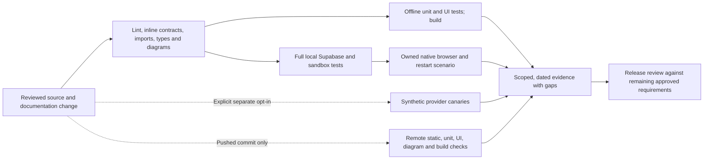

# Development tooling, verification and evidence interpretation

This guide explains the actual scripts and tests. It complements the preserved
[testing requirements](../TESTING_PLAN.md); it does not replace them or turn
planned release obligations into passed checks.

### Offline, local integration and explicit live evidence boundaries

Actual runner/CI responsibilities, not a claim that every gate passed in this task. See the surrounding contract for details and limitations.

<!-- diagram:verification-scope:start -->

[Open full-size SVG](../diagrams/rendered/verification-scope.svg) · [Editable Mermaid](../diagrams/verification-scope.mmd)

Mermaid source

<!-- diagram:verification-scope:end -->

## Command ownership

- `scripts/python.cjs`: launches this repository's `.venv` Python with backend and
  agent packages on PYTHONPATH, no extra shell, hidden Windows process and the
  child's real exit code. Use it for documented native Python commands.
- `scripts/start-local-supabase.cjs`: owns this project's guarded Docker network,
  loopback service binding, preserved mounts/runtime files and health wait. Private
  CLI output is written under ignored `supabase/.temp`, not printed as credentials.
- `scripts/configure-local.cjs`: validates local API/database targets and writes
  selected CLI connection fields into ignored `.env.local`.
- `luma/setup/bootstrap.py`: applies missing guarded migrations, restricted-role
  credentials, private synthetic catalog objects, staff access, starter requests
  and durable checkpoint setup. Repeated setup is not a database reset.
- `scripts/google.cjs`: fixed clasp status/push/initialize/edit-trigger operations.
  Local source tracking, remote upload and remote function execution are different
  results; inspect application-level errors as well as CLI exit status.
- `scripts/index_catalog.py`: explicit stable-run paid synthetic index operation.
  `scripts/evaluate_catalog.py`: read-only generated lexical development baseline.
  Their limits and result meanings are in [catalog retrieval](CATALOG.md).
- `scripts/check_architecture.py`: Python AST check for authored function/class
  docstrings and core/backend/agent import direction. Deterministic rules cannot
  import transport, persistence or provider modules. It currently scans app Python,
  not every test/standalone script, and cannot judge docstring correctness.
- `scripts/check_frontend.cjs`: named authored contracts, shared-to-feature import
  direction and local import cycles. Generated declarations are excluded; this
  is not a complete semantic audit of every anonymous callback or UX state.
- `scripts/verify.cjs`: sequential gate orchestration, private per-command logs and
  summary and first-failure stop. Commands have a 180-second timeout except the
  full Python integration suite, which has a bounded 420-second allowance after
  an observed 180-second timeout during cold local verification. The summary
  records the effective deadline and process error code; timeout is a failure.

Package scripts in root `package.json` are the canonical runnable names. Vite,
Vitest, browser and Python wrappers keep their own configured working directories;
do not copy commands from an unrelated Next.js or RAG project.

## Offline and full gates

The diagram pipeline in `scripts/diagrams` maintains canonical Mermaid, exact guide
embeds and source/code/renderer-bound SVG assets. `test:diagrams` covers freshness,
owned marker preservation, path boundaries and the stray-state separator regression.
`diagrams:render` updates owned outputs; `diagrams:check` performs read-only
integrity/freshness plus actual local Chromium parse/render checks. Both verifiers
and CI include the tests/check. Install the existing Playwright Chromium if needed;
see [the visual guide](../diagrams/README.md). This offline browser rendering does
not exercise the business UI or establish external-provider behavior.

`npm run verify` runs Python lint, Python architecture/inline docs, frontend
contracts/imports, TypeScript, Python unit tests, UI tests and production build.
It does not contact a live model or establish database/RLS/browser behavior.

`npm run verify:full` replaces the unit-only Python step with nonbrowser pytest,
then runs the UI suite, a separate native browser scenario and build. It needs
this project's healthy Supabase and media image. The Python step deliberately
excludes browser-marked tests so browser runs once in its dedicated gate.
Explicit provider canaries skip unless their own opt-in variable is set.

Logs live under `.local/checks/<command>.log`; summary records command, status,
duration and log path. A gate stops on failure. Read that log before changing code;
do not bypass checks or turn timeout into a passing result. A growing suite may
eventually need a reviewed timeout change. The Python-suite allowance was adjusted
after actual timeout evidence; it does not disable a test or change its assertions.

## Isolated integration environment

`tests/integration/conftest.py` creates a real local Auth principal, membership,
synthetic tenant, source, snapshot and three products. It guards port 55322 and
sets paid AI/raw tracing off by default. Credential-bearing fixture repr is
redacted. Tests can opt into a specifically controlled provider seam or live
canary, but service/admin fixtures are not evidence of browser permissions.

Cleanup derives exact owned conversation threads, media originals/normalized
objects and quote PDFs from that generated tenant. It deletes only those private
objects, checkpoints and dependency-ordered rows, including catalog_embeddings
before products, then the generated Auth user. It does not reset the developer's
supplier, delete arbitrary buckets or touch another project.

Trusted worker helpers restrict delivery/job selection to the fixture company.
Do not use a global queue claim in a test that could consume the developer's work.
Checkpoint deletion is explicit because those public tables have no business
foreign key. A failed setup before yield may require inspecting its bounded local
failure; do not infer the fixture is a universal crash-proof garbage collector.

## Unit and component coverage

- `tests/unit/test_quotation_rules.py`: deterministic money, finite inputs, quantity,
  pack/availability and authorization boundaries, including property-based cases.
- `test_requirement_policy.py`: fixed safe clarification and explicit written
  media confirmation, including ambiguous/duplicate consequential fields.
- `test_written_requests.py`: 40 separately labeled development policy cases
  (20 text/12 voice-policy/8 photo-policy), independent evaluator-only oracle,
  generated positive/negated numeric boundaries and malformed/oversized/list
  limits. The controlled extraction output is intentionally not trusted; media
  observations are text substitutes, never measured transcription/vision quality.
  See [the fixture contract](../../tests/fixtures/requirement-policy/README.md).
- `test_trace_privacy.py`: explicit outcome allowlist with canaries at the fake
  export seam; it does not establish successful live LangSmith export.
- `test_embedding_contracts.py`: vector shape/value validation, shared conservative
  constraints and provider index correlation without network/database calls.
- `test_catalog_questions.py`: malicious descriptive/catalog prose cannot become
  commercial instructions in the fixed candidate confirmation question.
- `useQuotationDraft.test.tsx`: dirty edit/version behavior across server changes.
- `VoiceNoteUpload.test.tsx`: stable selected file/key/version retry behavior in
  shared MediaUpload despite the historical test filename.
- `document-button.test.tsx`: private document/dialog/object-URL lifecycle.

Small tests isolate deterministic policy. They do not replace real SQL constraints,
provider contracts, actual browser behavior or a commercial pilot.

The development confirmation corpus is a regression boundary, not the frozen
80-case release evaluation or its 60/20 split. `fields_confirmed` means only that
the complete latest written order agrees with the untrusted extracted fields.
It cannot be counted as retrieval recall, quotation workflow success, approval
or delivery accuracy. Corpus files/oracles stay outside runtime ingestion and
provider traces. Paid inference, noisy media and the holdout remain unrun.

## Integration coverage by responsibility

- `test_manual_workflow.py`: actual staff workflow, authentication/company scope,
  exact revision decisions, stock/pricing and local dispatch boundaries.
- `test_quotation_concurrency.py`: real competing transaction behavior for scoped
  quotation operations. `test_preparation_conflicts.py`: stale background work
  cannot replace staff/customer changes or reviewed state.
- `test_quotation_storage_invariants.py`: actual immutable quote/outbox database
  constraints. `test_quotation_pdf.py`: canonical customer/value/expiry rendering
  and private PDF behavior.
- `test_staff_replies.py`: internal note versus human reply, takeover and final
  author/ownership reauthorization.
- `test_graph_restart.py`: durable customer/staff interrupts through independent
  native processes, duplicate-work silence, media confirmation and cited choices.
- `test_written_confirmation.py`: cancelled/negated/conditional/alternative latest
  turns remain at a persisted customer interrupt; a complete restatement resumes
  in another process into exact-line staff review without approval/send intent.
  Also checks replacement of earlier orders, well-formed false provider fields
  through real reservation/graph seams, and oversized stored input before primary
  provider admission. Fake Responses output is explicitly isolated from inference
  quality; normal tests cannot authorize paid provider execution.
- `test_media_sandbox.py`: actual offline container decode/rejection for native PDF,
  image and overlong/corrupt media. These require Docker, not provider inference.
- `test_voice_intake.py`, `test_photo_intake.py`: raw upload/size/precondition/replay,
  private kind-specific normalized bytes and provider-interruption reservation
  behavior where simulated. A fake response is clearly separate from real media
  decoding and database persistence.
- `test_catalog_retrieval.py`: exact-first/descriptive source provenance, explicit
  filters, tenant scope and stale/retired evidence at commercial boundaries.
- `test_semantic_catalog.py`: real pgvector queries with deterministic vectors,
  scope/spec/distance limits, stale cache exclusion and changed-input rejection.
- `test_catalog_index.py`: real reservation/publication/replay and lost-response
  index outcomes with only the provider response replaced.
- `test_agent_retrieval.py`: leased real nodes/outbox plus fake query embeddings;
  semantic clarification, takeover before admission, source retirement before
  publication and no duplicate call after an unknown response.
- `test_budget_reservations.py`: unresolved prior-day consumption and shared
  primary/retrieval run allowance; this does not prove all last-budget races.
- `test_job_recovery.py`: tenant-scoped/idempotent expiry, stale completion denial,
  visible pending-media interruption and real two-connection lock contention.
- `test_workspace_integrations.py`: configured/unverified Google mapping and no
  secret leakage through workspace integration status.
- `test_google_callback.py`, `test_gas_snapshots.py`: signed ingress, replay and
  validated atomic import using the concurrent Google implementation. Local
  results are not proof of a live workbook timer or Drive export.

## Browser scenario and screenshots

`tests/integration/test_browser_workflow.py` owns temporary native API/Vite servers,
an isolated Auth/data/Storage fixture and subprocess cleanup. It runs
`tests/browser/manual-workflow.cjs` in headless Chromium, then restarts the API and
checks persisted state. The browser uses real UI/API/media/local-worker paths;
it does not call an application approval-bypass debug endpoint.

The scenario covers login, local request, voice/photo upload and private preview,
manual selection/totals, takeover/human reply, stale edit preservation, revisions,
original/canonical PDFs, approval, scoped local dispatch and reload/restart.
It checks browser exceptions, Axe findings on the tested desktop and portrait
flow, and horizontal overflow at 390px. It uses reduced motion. It does not
establish interactive WebGL performance, every route's accessibility, live
transcription/photo accuracy or WhatsApp receipts.

Screenshots are ignored local artifacts, including photo intake, stale editor,
delivered quote and portrait capture. Inspect the actual screenshot before making
visual claims; browser assertions alone do not prove visual polish or privacy.

## Explicit provider canaries

`test_live_model.py`, `test_live_voice.py`, `test_live_photo.py` and
`test_live_embeddings.py` use explicit opt-in gates: `LUMA_RUN_LIVE`,
`LUMA_RUN_LIVE_AUDIO`, `LUMA_RUN_LIVE_PHOTO` and `LUMA_RUN_LIVE_EMBEDDINGS`,
respectively, set to `1`. Read each file before intentionally running it. Ordinary tests do
not enable them or spend merely because `.env` contains a key.

Model/voice/photo canaries use labeled synthetic input and verify bounded outcomes,
not client accuracy or employee time savings. Photo uses the checked-in
`tests/fixtures/media/synthetic-label.png`. The embedding canary indexes three
synthetic records and embeds unchanged evidence for its query: provider/vector/SQL
plumbing only. No quote, approval or send is created by that canary.

Preserve estimated usage versus provider billing. Do not add together a local
reservation, token estimate and a prior canary as if it were an invoice total.
LangSmith export remains limited by the observed account quota.

## Historical checkpoint and remaining gates

[Media/retrieval recovery evidence](../evidence/media-retrieval-recovery.json)
records the October 29 local aggregate: 120 Python tests passed, three paid
canaries skipped and one browser deselected from that Python invocation; five UI
tests, separate browser, lint/docs/types and build passed. Four agent retrieval
cases and the real embedding canary were later verified separately. These are
dated observations, not a rerun caused by the current documentation task; new
test collection may have a different skip/count total.

[The November 1 commit checkpoint](../evidence/commit-checkpoint-2026-11-01.json)
records the later full gate: 124 Python tests, four skipped paid canaries, five UI
tests, a separate browser run, four diagram tooling tests and 15 checked views.

[Written-confirmation evidence](../evidence/written-confirmation-2026-11-01.json)
records the later current-turn safety slice on November 1: 190 Python tests,
four skipped paid canaries, five UI tests, the separate browser, build, inline
contracts and all 15 diagrams passed. The 40-case development policy actions
and 15 focused graph/restart checks have separate scope/denominators in that
artifact; neither is a frozen 80-case media result or real-provider accuracy.

GitHub CI runs Ubuntu Node 22/Python 3.12 with static checks, unit/UI tests and build.
It does not start the local Supabase/sandbox/browser suite or authorize live
providers. A green remote run validates its commit only, not uncommitted changes.

The engineering ledger structurally tracks 42 concepts; current Planned labels
remain open. Its validator checks metadata/artifact existence, not sufficiency or
security certification. Frozen evaluation, complete account integrations,
retention/deletion, backup restoration, public controls and remaining races/outages
still require implementation/evidence under the preserved plan.
