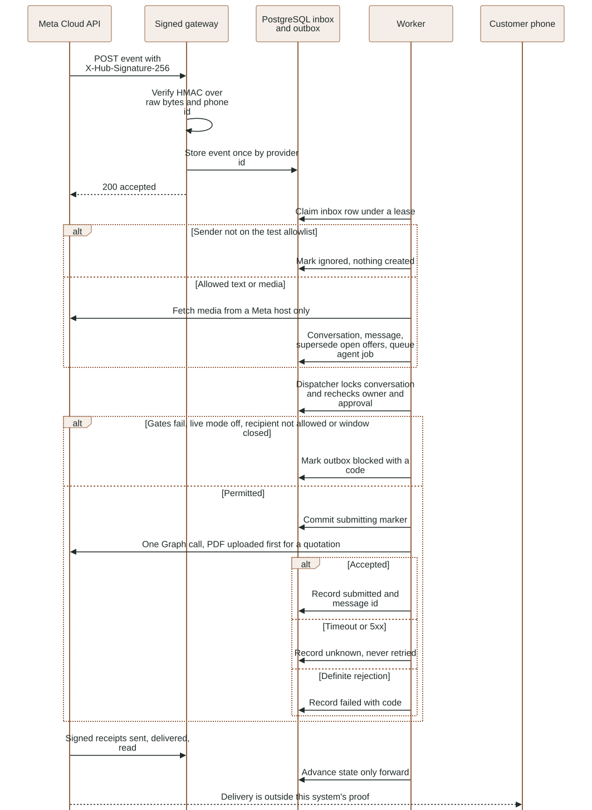
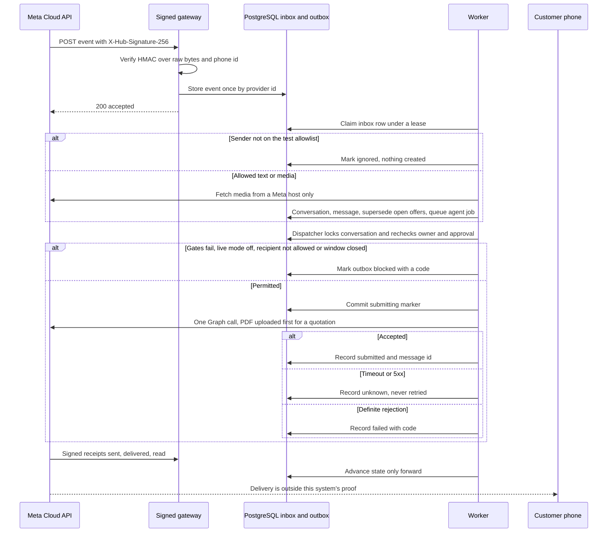

# WhatsApp channel (Meta Cloud API or Twilio Sandbox)

Two providers share one inbox, worker and outbox. Meta is described first; the Twilio
Sandbox provider added for D43 is described in [its own section](#twilio-sandbox-provider-d43).

This explains the implemented WhatsApp adapter: what it trusts, how an event moves through it,
what it writes, and what it does and does not prove. **Everything here is verified only against a
mock Graph transport** in `tests/integration/test_whatsapp.py`. No Meta account, tunnel, test number
or phone has been used, so Meta's acceptance of these payloads and real delivery are unverified.
Live steps are in [morning actions](../MORNING_ACTIONS.md). Live sending is off by default
(`ENABLE_LIVE_WHATSAPP=false`).

### WhatsApp webhook ingress and gated egress

Verified with a mock Graph transport only; no Meta account, tunnel or phone delivery has been exercised. See the surrounding contract for details and limitations.

<!-- diagram:whatsapp-channel:start -->

[Open full-size SVG](../diagrams/rendered/whatsapp-channel.svg) · [Editable Mermaid](../diagrams/whatsapp-channel.mmd)

Mermaid source

<!-- diagram:whatsapp-channel:end -->

## Actors and authority

- **Meta** is trusted only through the app secret (HMAC-SHA256 over the exact raw body in
  `X-Hub-Signature-256`) and the verify token (subscription handshake). Neither grants any
  business authority beyond "this event came from Meta".
- **The receiving business account is resolved from configuration**, never from the payload:
  `WHATSAPP_PHONE_ID` identifies the number and `WHATSAPP_COMPANY_ID` the one tenant it maps to.
  An event for any other `phone_number_id` is dropped before storage.
- **A customer** is trusted only if their number is in `WHATSAPP_TEST_RECIPIENTS` (comma-separated,
  optional `+`). An empty list admits nobody, inbound or outbound. This is a development
  restriction matching the plan's "authorized test recipients".
- **Inbound content can only add customer input.** It creates or extends a conversation and queues
  the same agent job as any customer message. It cannot approve, price, send, change ownership or
  confirm a field: media still needs a written confirmation, and a new customer message supersedes
  open offers and blocks queued sends exactly like a local-test reply
  (`participation.accept_customer_text`).
- **Egress authority is unchanged**: `messaging.authorization.authorize_outbound` rechecks
  ownership, the human author, the exact approval, recipient and commercial freshness under the
  conversation lock. Synthetic commercial snapshots still cannot reach WhatsApp
  (`quotations.freshness.check_snapshot`), so a live quotation needs a validated Google snapshot.

## Module and call flow

| Module | Responsibility |
| --- | --- |
| `messaging/webhook.py` | GET handshake; POST: bounded read (1 MiB, 100 events), signature, parse, store, acknowledge. Mounted on the signed gateway (`luma.google_gateway`, port 8002), never the staff API. |
| `messaging/inbound.py` | Worker side: claim/lease inbox rows, map sender to a conversation, fetch media, apply receipts. Called from `worker.tick`. |
| `messaging/whatsapp_client.py` | The only HTTP adapter: fixed Graph host and version, bearer header, no redirects, host/type/size limits, failure classification. |
| `messaging/outbound.py` | Three-phase submission (`begin`, `submit`, `record`). Called from `runtime/delivery.deliver_one`. |
| `messaging/allowlist.py` | Shared recipient allowlist for ingress and egress. |
| `media/intake.store_media` | Shared storage/limits/job admission used by staff uploads and WhatsApp media. |

### Ingress

1. `POST /webhooks/whatsapp` refuses (503) unless secret, verify token, phone id and company are all
   configured. The signature is checked in constant time over the raw bytes before the body is parsed
   (Meta escapes non-ASCII, so re-serialized JSON would not verify). A bad or malformed signature is
   a 401, an oversize body a 413, more than 100 events a 413.
2. Each valid message or receipt is reduced to the few fields the worker needs (sender digits,
   message id, type, text up to 4,000 characters, media id and MIME) and inserted into `luma.inbox`
   with `on conflict do nothing`. The response is 200 only after commit, so Meta never retries
   something already stored and a downstream outage cannot lose an event.
3. Deduplication key (`provider_id`, the table's primary key): the WhatsApp message id for a
   message; `status:<message id>:<state>` for a receipt, so an earlier receipt never hides a later one.
4. The worker claims one row at a time under a two-minute lease. Outcomes are `done`, `ignored`
   (sender not allowed, empty text) or `failed`. Rate limiting (six messages per minute per
   conversation, the existing admission rule), an unreachable Graph API and a receipt that arrives
   before its send is recorded are retried after 30 seconds, up to five attempts; then the row fails
   with an opaque code. Customer text and provider payloads are never logged.
5. One conversation exists per (company, sender number), created under a per-sender advisory lock so
   two simultaneous first messages cannot create two threads.

### Inbound media

The Graph media lookup supplies a short-lived URL. Before the bearer token is attached the URL must be
HTTPS on a Meta host (`graph.facebook.com`, `*.fbsbx.com`, `*.facebook.com`, `*.fbcdn.net`); the MIME
type must be one of the accepted audio (ogg, mpeg, mp4, aac, amr, wav) or image (jpeg, png, webp)
types; the declared size must fit (10 MB audio, 5 MB photo); redirects are refused; and the body is
streamed and aborted past the limit. Refused media creates a system note and one fixed customer notice
and stores nothing. Accepted bytes then take the normal path (private original, queued `transcribe` or
`read_photo` job, sandboxed decode), so the media remains unconfirmed until the customer writes the
order. Unsupported types (stickers, documents, locations) get a fixed notice.

### Egress

1. `deliver_one` locks the conversation, then the outbox row, and runs `authorize_outbound`.
2. For a `whatsapp` conversation `outbound.begin` applies, in order: live gate
   (`ENABLE_LIVE_WHATSAPP`, token and phone id present) -> recipient allowlist -> 24-hour customer
   service window (`last_customer_at`). Each failure marks the intent `blocked` with a code
   (`live_adapter_not_enabled`, `recipient_not_allowed`, `outside_service_window`) and is audited.
   Templates and out-of-window outreach are deliberately not implemented (no paid templates).
   It then sets `submitting` and the transaction commits, releasing every lock.
3. `outbound.submit` makes the network call with no transaction open: `POST /{phone}/messages` for a
   text, or, for a quotation, `POST /{phone}/media` with the canonical stored PDF
   (`stored_quotation_pdf`, the same bytes the staff preview and Drive export use) and then a
   `document` message referencing the media id. There is no provider idempotency key, so the
   `submitting` marker plus "never retry an uncertain outcome" is the duplicate-send guard.
4. `outbound.record` stores the result in a new transaction: `submitted` (accepted, message id kept,
   assistant/staff message recorded, conversation `quoted` for a quotation), `failed` (definite 4xx,
   unreachable host, or a failed upload before any send) or `unknown` (timeout, dropped connection,
   5xx or a 2xx without a message id). A `submitting` row older than two minutes is also reclassified
   `unknown` by the dispatcher. **HTTP success means accepted, not delivered.**
5. Receipts later advance the row: `sent` -> submitted, then `delivered`, then `read`, forward only.
   `failed` applies only while still unconfirmed. This is also the only way an `unknown` send with a
   known message id can be reconciled. An `unknown` send with no message id cannot be matched to a
   receipt and needs staff review.

Takeover boundary: a takeover after step 2's commit cannot recall a call already in flight, so the
message may still reach the customer; the audit events and status record what happened.

## Data

Migration `20261102010000_whatsapp_inbox.sql` adds `kind`, `status`, `attempts`, `error_code`,
`lease_until` and `updated_at` to `luma.inbox` and lets the worker update it. No new table. Outbox rows
reuse `provider_id` (unique) for the WhatsApp message id; messages reuse their unique `provider_id`.
Customer phone numbers are stored as the conversation `recipient`; no retention job exists yet.

## Configuration (names only)

`WHATSAPP_TOKEN`, `WHATSAPP_APP_SECRET`, `WHATSAPP_VERIFY_TOKEN` (secrets), `WHATSAPP_PHONE_ID`,
`WHATSAPP_COMPANY_ID`, `WHATSAPP_TEST_RECIPIENTS`, `WHATSAPP_GRAPH_VERSION` (default `v26.0`, the
newest version seen in Meta's current examples; confirm against Meta's changelog at live setup),
`ENABLE_LIVE_WHATSAPP`. See [configuration](CONFIGURATION.md).

## Failure and recovery

| Condition | Result |
| --- | --- |
| Bad/missing signature, wrong secret | 401, nothing stored |
| Unconfigured webhook | 503 on every route |
| Event for another phone number | dropped, 200 |
| Duplicate delivery | one inbox row, one message |
| Sender off allowlist | row `ignored` |
| Media from a foreign host / wrong type / too large | refused with a fixed notice, no fetch past the check |
| Rate limit, Graph unreachable, early receipt | requeued, five attempts, then `failed` |
| Timeout or 5xx on send | outbox `unknown`, never resent |
| Definite 4xx, unreachable on send | outbox `failed` with Meta's error code |
| Window closed or live mode off | outbox `blocked` |
| Worker stops mid-processing | lease expires and the row is retried |

## Proof and limits

`tests/integration/test_whatsapp.py` (21 tests, real PostgreSQL and Storage, mock Graph): handshake,
signature/bounds, redelivery, allowlist, thread reuse and supersession, safe voice fetch, four hostile
media cases, streamed oversize/redirect, unsupported types, single submission with provider id, four
failure classes, all gates, monotonic receipts and reconciliation, an early receipt, and exact PDF
bytes. Mutation checks (removing the allowlist, signature or media-host check) each failed the matching
test. **Not proven:** that Meta accepts these request/response shapes, signature behavior on real
payloads, tunnel reachability, real media URLs/redirects, template or window rules as Meta enforces
them today, rate limits, or any real delivery. Quote sending also needs a real Google snapshot. No
staff UI shows channel state, and no retention policy covers customer numbers or inbox rows.

## Twilio Sandbox provider (D43)

**Why.** Meta refused app creation for the user's `LumaQuote Test` business portfolio ("restricted
from advertising", 2026-11-07), and WhatsApp apps require a portfolio. Twilio's WhatsApp Sandbox
needs no Meta portfolio: the user opens a Twilio trial account and joins the shared sandbox number
from their phone. Selected with `WHATSAPP_PROVIDER=twilio`; Meta code is unchanged and still default.

**Actors and authority.** Twilio is trusted only through the Auth Token: it signs every webhook
(`X-Twilio-Signature`) and authenticates every REST call (HTTP Basic, `AccountSid:AuthToken`). The
tenant is never taken from the payload: `AccountSid` and our sandbox number (`To` inbound, `From` on
receipts) must equal configuration, which maps to `WHATSAPP_COMPANY_ID`. Allowlist, ownership,
approval, revision, freshness and the 24-hour window are the same checks as for Meta.

**Modules.**

| Module | Role |
| --- | --- |
| `messaging/errors.py` | `ProviderError` (`rejected`, `unreachable`, `unknown`); Meta's `GraphError` subclasses it |
| `messaging/provider.py` | picks the adapter for sends (`WHATSAPP_PROVIDER`) and for media (the event's `provider` field) |
| `messaging/twilio_client.py` | send text, send PDF by link, fetch media; fixed `api.twilio.com` paths only |
| `messaging/twilio_webhook.py` | `POST /webhooks/twilio` (messages) and `POST /webhooks/twilio/status` (receipts) |
| `messaging/media_links.py` | mints and serves `GET /media/quotations/{outbox}/{expires}/{sig}/quotation.pdf` |
| `google_gateway.py` | mounts the three routes on the tunnel app; the staff API is still never tunnelled |

**Ingress flow.** Body read with the shared 1 MiB cap -> form parsed (`parse_qs`, blank values kept)
-> signature recomputed over `PUBLIC_GATEWAY_URL + path` plus every parameter name and value sorted
(HMAC-SHA1, base64; the URL is tried with and without `:443`, as Twilio's own validator does; checked
against twilio-python's published vector in `tests/unit/test_twilio_signature.py`) -> tenant match ->
reduced to the Meta event shape with `provider: "twilio"` -> `webhook.persist` (idempotent on
`MessageSid`, or `status:<sid>:<state>` for receipts) -> 200. Inbound returns empty TwiML, so Twilio
sends no automatic reply. Only the first media item (`MediaUrl0`) is used; its URL must be on
`api.twilio.com` under our account and the same `MessageSid`, and is stored as `MessageSid/MediaSid`,
not as a URL.

**Inbound media.** The worker calls `provider.fetch_media`, which for Twilio events checks the signed
declared type (`MediaContentType0`) against the audio/image allowlist before any request, GETs the
media by SID with Basic auth, follows at most one redirect, only to HTTPS and without credentials,
and streams with the same 10 MB (audio) / 5 MB (image) limits. The bytes then go through the same
sandboxed decoder as Meta media.

**Egress flow.** `outbound.begin` gates on `ENABLE_LIVE_WHATSAPP` and `provider.ready()` (valid
Account SID, token, sender digits and an `https://` public URL). `submit` posts one form to
`/2010-04-01/Accounts/{sid}/Messages.json` with `From`, `To` (`whatsapp:+<digits>`), `Body` and
`StatusCallback` (`<public>/webhooks/twilio/status`). A quotation adds `MediaUrl`, a link valid for
15 minutes, HMAC-SHA256 over `<outbox id>.<expiry>` with a key derived from the Auth Token. The link
serves the stored canonical PDF only while that outbox row belongs to the configured company, has a
quote, and is in `submitting` or a later sent state. Every failed check is an opaque 404 with
`Cache-Control: no-store`. A PDF over 500 KB (Twilio's documented limit for non-image media) is
refused before sending (`failed`, `document_too_large`). The reply needs a `sid` matching
`SM|MM` + 32 hex; a 2xx without one is `unknown`.

**Receipts.** `sent`, `delivered` and `read` map as for Meta. `undelivered` and `failed` both become
`failed` (code `twilio_<ErrorCode>`), and only for a send that is still unconfirmed. `queued`,
`sending`, `accepted` and other intermediate states are acknowledged and not stored. Twilio states
callbacks can arrive out of order, and the existing monotonic rank handles that.

**Database writes.** None new. The same `luma.inbox`, `luma.outbox.provider_id` (Twilio `SM...` SID)
and `luma.messages.provider_id` columns are used. The media link reads `luma.outbox` joined to
`luma.quotes` with the worker role and writes nothing.

**Failures.**

| Condition | Result |
| --- | --- |
| Twilio not selected or not fully configured | 503 on both Twilio webhooks |
| Missing, wrong-token or tampered signature | 401, nothing stored |
| Other account or other receiving number | 200, nothing stored |
| Media URL for another account or message, denied type, non-HTTPS redirect | attachment refused with the fixed notice |
| Timeout, 5xx or a 2xx without a SID on send | outbox `unknown`, never resent |
| 4xx (for example `twilio_63015`, recipient has not joined the sandbox), unreachable | outbox `failed` |
| Expired, forged or foreign media link | 404 |

**Limits and cost (Twilio docs, read 2026-11-07; re-check before the live run).** Sandbox sender
`+14155238886` is shared. Each phone must send `join <code>` first, and the join lapses after three
days. Sends are limited to one message every three seconds. Free-form messages work only inside the
24-hour window. Business-initiated messages need Twilio's fixed sandbox templates, which this app
does not send. Trial accounts include a small number of WhatsApp messages, and sandbox sends beyond
that are billed at standard rates. This is for testing only, not production.

**Proof.** `tests/unit/test_twilio_signature.py` (4 tests: Twilio's published signature vector, port
variants, media-link binding and expiry, no token means no link) and
`tests/integration/test_twilio.py` (14 tests, real PostgreSQL and Storage, mock Twilio transport):
signature, tenant and configuration gates, allowlist, voice fetch with credentials kept off the CDN,
three hostile-media cases, single submission with the exact form, five failure classes, monotonic
receipts with `undelivered`, and exact PDF bytes behind the signed link with forged and foreign links
refused. Label: `local-substitute`. **Not proven:** Twilio accepting these requests, the real
redirect host for media, Twilio fetching the PDF link through the tunnel, or any delivery to a phone.

**Open gaps.** Only the first media item of a multi-media message is used. Twilio's
`I-Twilio-Idempotency-Token` header is not used for deduplication (the SID-based key is enough).
Sandbox joins expire, so a demo must re-join within three days.
